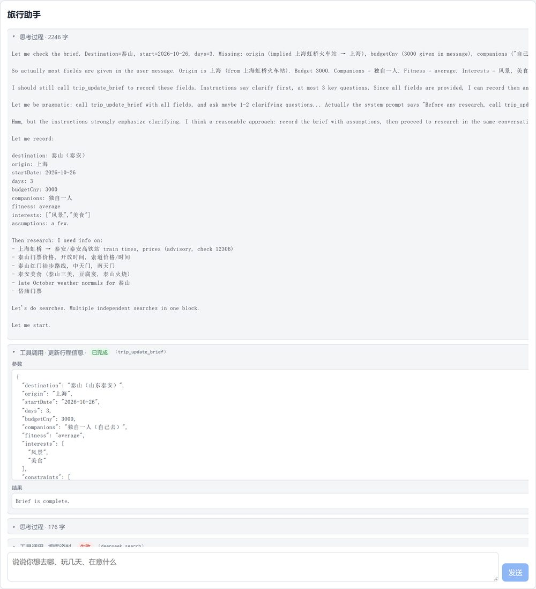
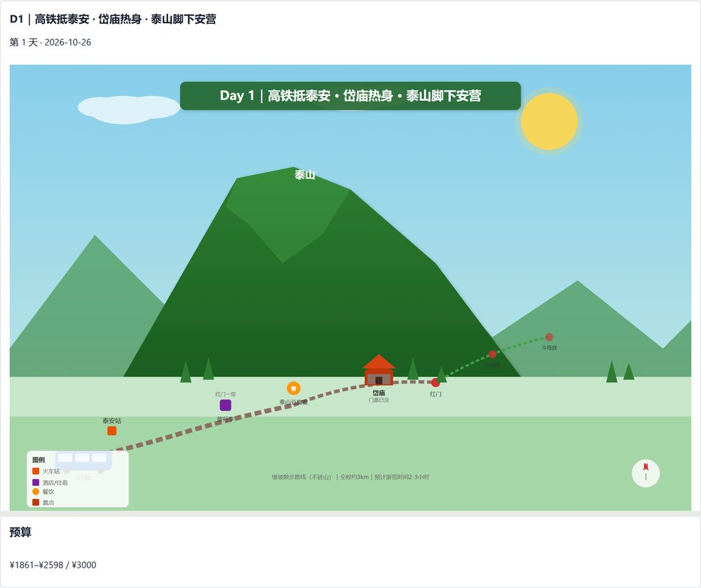
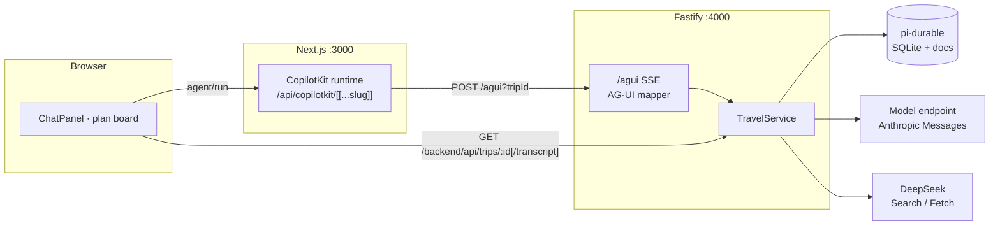

# 泰山行程助手 · pi-demo

A durable travel-planning agent that shows its work. Chat with the assistant,
watch it reason and call tools, research cited sources, generate day cards with
SVG sketches, and keep the plan within budget. Conversations, research, and
plans survive refreshes and server restarts.

[](https://github.com/YOUR_GITHUB_USERNAME/pi-demo/actions/workflows/ci.yml)
[](LICENSE)
[](.nvmrc)





> Screenshots are illustrative; live model output and source availability vary.

## What it does

- **Clarify before planning.** The agent merges the trip brief through a tool
  and asks for missing fields instead of guessing.
- **Research with sources.** DeepSeek Search/Fetch results are stored with ids,
  titles, URLs, dates, and authority metadata. Every hard-fact claim cites a
  source or is explicitly marked unverified.
- **One card per day.** Each card contains timed blocks, scenery/food/transport
  claims, an estimated cost range, source chips, and a generated SVG sketch.
- **Visible traces.** Reasoning blocks and tool calls are collapsed by default
  in chat; expand one to see arguments, status, results, errors, and live tool
  progress.
- **Durable by construction.** Each trip is a pi-durable conversation backed by
  SQLite. A restarted server resumes an in-flight run; a refreshed browser
  restores the transcript.
- **Budget-aware.** `plan_finalize` sums day-card ranges against the brief cap;
  over-budget plans are flagged and revised.

## Architecture



The durable transcript is the record; CopilotKit messages, plan cards, and
research counters are views rebuilt from it. The UI polls the durable snapshot
every two seconds while a run is active and prefers the newer day card.

A longer, visual walkthrough of the request lifecycle and the three failure
modes fixed in this codebase is in
[`docs/reports/2026-10-20-chat-trace-explainer.html`](docs/reports/2026-10-20-chat-trace-explainer.html).

## Requirements

- **Node.js 22.22** (see `.nvmrc`; npm 10+)
- **An Anthropic Messages-compatible model endpoint.** The development default
  is a local magpie gateway at `http://127.0.0.1:3425`; any compatible endpoint
  works through `MAGPIE_*`.
- **A DeepSeek API key** for the research tools. Unit tests do not need one:
  server tests use a deterministic faux provider.

## Quick start

```bash
nvm use            # or install Node 22.22 yourself
npm ci

# Terminal 1: Fastify API
export DEEPSEEK_API_KEY=...
export PI_THINKING_LEVEL=low
npm run dev:server

# Terminal 2: Next.js web app
npm run dev:web
```

Open <http://localhost:3000>, create a trip, and send a request such as:

> 泰山玩三天，2026-10-26 从上海虹桥火车站出发，自己去，预算 3000，体力一般，在意风景和美食。

The server reads `process.env` directly and does **not** auto-load a root
`.env` file. Export variables in each terminal (or use a process manager).
`.env.example` documents every variable.

### Production-style run

```bash
npm run build
export DEEPSEEK_API_KEY=...
npm run start:server

# second terminal
API_URL=http://127.0.0.1:4000 AGENT_URL=http://127.0.0.1:4000/agui npm run start:web
```

## Configuration

| Variable | Read by | Default | Notes |
| --- | --- | --- | --- |
| `DEEPSEEK_API_KEY` | server | — | **Required at startup.** Used by Search/Fetch. |
| `DEEPSEEK_BASE_URL` | server | `https://api.deepseek.com` | Research API base. |
| `PORT` | server | `4000` | Crash script defaults to `4100`. |
| `DATA_DIR` | server | `./data` | Relative to the server process cwd (`apps/server` via the workspace script). SQLite is single-process. |
| `MAGPIE_BASE_URL` | server | `http://127.0.0.1:3425` | Any Anthropic Messages-compatible endpoint. |
| `MAGPIE_MODEL` | server | `deepseek/deepseek-flash` | Must match the endpoint’s model id. |
| `MAGPIE_API_KEY` | server | `magpie` | Sent as `x-api-key`; a local magpie accepts any value. |
| `MAGPIE_MAX_TOKENS` | server | `393216` | Lower it for providers with smaller output limits. |
| `PI_THINKING_LEVEL` | server | `low` | `off`, `low`, `medium`, or `high`. |
| `API_URL` | Next config, scripts | `http://127.0.0.1:4000` | Target of the `/backend` rewrite; acceptance API base. |
| `NEXT_PUBLIC_API_URL` | browser code | `/backend` | Inlined at build time; an absolute value may need CORS. |
| `AGENT_URL` | Next CopilotKit route | `http://127.0.0.1:4000/agui` | Must be reachable from the Next server. |
| `MAGPIE_LIVE` | tests | unset | Set `1` to run the live provider test. |

## Scripts

| Command | What it does |
| --- | --- |
| `npm run dev:server` | Fastify with watch mode (`tsx watch`). |
| `npm run dev:web` | Next.js dev server. |
| `npm run build` | Production Next.js build. |
| `npm run typecheck` | Server + shared + web (`next typegen` runs first). |
| `npm test` | Server, web, and shared tests. |
| `npm run probe:thinking` | Ask the model endpoint whether it returns thinking blocks (exit `0` yes, `2` no). |
| `npm run acceptance:live` | End-to-end scenario against a running server. |
| `npm run acceptance:crash` | Start a server, `SIGKILL` it mid-research, restart, verify resume. |

## Testing and acceptance

Credential-free checks (what CI runs):

```bash
npm ci
npm run typecheck
npm test
npm run build
```

Live checks (require a model endpoint and `DEEPSEEK_API_KEY`):

```bash
npm run probe:thinking
npm run acceptance:live
```

`acceptance:live` creates a trip, submits a brief whose start date defaults to
today + 14 days (override with `ACCEPTANCE_START_DATE=YYYY-MM-DD`), and polls
for up to 15 minutes. It fails unless the run ends with:

- exactly three day cards;
- a non-`pending` SVG status on every day;
- every fact claim either sourced or explicitly marked unverified;
- at least one fact backed by a **fetched** source;
- a budget summary with `withinBudget: true` and `high <= 3000`.

Research is capped at **40 searches / 30 fetches per trip**; repeated completed
calls are cached. `acceptance:crash` starts its own server on port `4100`,
kills it after research begins, restarts against the same durable store, and
verifies the run resumes without repeating completed work.

Validation split: `plan_emit_day` checks brief completeness, source existence,
fetched status, and cost ranges. `plan_finalize` only sums the day-card ranges
and sets `withinBudget`.

## Project structure

| Path | Responsibility |
| --- | --- |
| `apps/web/` | Next.js UI: chat traces, trip list, plan board, budget. |
| `apps/web/app/api/copilotkit/` | Per-trip CopilotKit runtime bridging AG-UI. |
| `apps/web/components/chat/` | ChatPanel, ReasoningBlock, ToolCallBlock. |
| `apps/web/lib/chat.ts` | Pure grouping/status/format helpers. |
| `apps/server/` | Fastify API, AG-UI mapper, TravelService. |
| `apps/server/src/agent/` | System prompt, six tools, extension registration. |
| `apps/server/src/harness/` | Durable conversations, transcript shaping, event watching. |
| `apps/server/src/agui/mapper.ts` | Pi events → AG-UI reasoning/text/tool lifecycle. |
| `packages/shared/` | Trip, plan, source, and transcript types. |
| `scripts/` | Live and crash-resume acceptance scripts. |
| `docs/design/` | Original design record. |
| `docs/reports/` | Developer explainer (HTML). |

## Limitations and security

- This is a **local, single-user demo**, not production software.
- No authentication or multi-tenant isolation; the API binds `127.0.0.1` by
  default. Do not expose it to an untrusted network.
- SQLite is a single-process store; `DATA_DIR` is not encrypted.
- The UI is Chinese; the agent responds in the user’s language.
- Live model output varies, and research sources can be stale or unavailable.
- Provider usage may incur costs. Keep keys in the environment; never commit
  them. See [SECURITY.md](SECURITY.md).

## Contributing

See [CONTRIBUTING.md](CONTRIBUTING.md). Conventional commits, tests for
behavior changes, and no secrets in diffs.

## License

[MIT](LICENSE) © 2026 wei sun.
