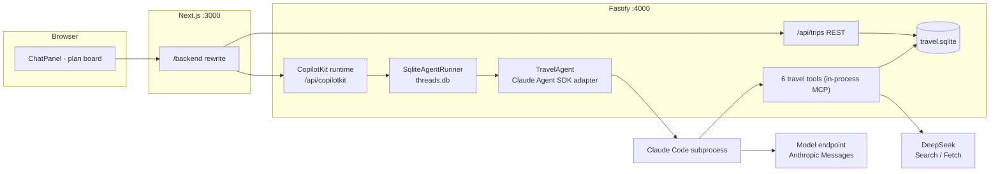

# Claude Agent SDK 后端 Implementation Plan

> **For agentic workers:** REQUIRED SUB-SKILL: Use superpowers:subagent-driven-development (recommended) or superpowers:executing-plans to implement this plan task-by-task. Steps use checkbox (`- [ ]`) syntax for tracking.

**Goal:** 把 `apps/server` 的 agent 运行时从 pi-durable 换成 Claude Agent SDK，并用 CopilotKit 运行时 + `@ag-ui/claude-agent-sdk` 适配器的原生能力提供 AG-UI 事件、线程历史和重连。

**Architecture:** CopilotKit v2 运行时（`SqliteAgentRunner`，`threads.db`）挂在 Fastify 上；`TravelAgent`（`AbstractAgent` 子类）每个 run 新建一个 `ClaudeAgentAdapter`，进程内 MCP 提供 6 个旅行工具，领域状态与 `sessionId`、`inflight` 记录存 `better-sqlite3`（`travel.sqlite`）。进程被杀后，启动时清理 runner 残留的 `is_running` 并经 `runner.run()` 重发被中断的 run。

**Tech Stack:** Node 22.22 · TypeScript · Fastify 5 · `@anthropic-ai/claude-agent-sdk@0.3.296` · `@ag-ui/claude-agent-sdk@0.0.8` · `@copilotkit/runtime@1.79.1` · `@copilotkit/sqlite-runner@1.79.1` · `better-sqlite3@^12.2.0` · zod 4 · vitest

**Spec:** `docs/superpowers/specs/2026-11-02-claude-agent-sdk-design.md`（执行者必须同时读它）

## Global Constraints

- Node.js `22.22`，开发环境 Windows x64，必须在此环境可安装、可运行。
- `@anthropic-ai/claude-agent-sdk` 精确 `0.3.296`；`@ag-ui/claude-agent-sdk` 精确 `0.0.8`。
- `@copilotkit/runtime`、`@copilotkit/sqlite-runner` 精确 `1.79.1`；服务端 `@ag-ui/client`、`@ag-ui/core` 精确 `1.0.2`；`rxjs` 精确 `7.8.1`。
- `better-sqlite3` `^12.2.0`；`zod` `^4.0.0`。
- 分支 `claude-agent-sdk`；**不合并、不修改 `net-rewrite`**。
- 对外配置名不变：`MAGPIE_*`、`PI_THINKING_LEVEL`、`DATA_DIR`、`DEEPSEEK_*`、`PORT`、`API_URL`、`NEXT_PUBLIC_API_URL`、`MAGPIE_LIVE`；`AGENT_URL` 不再使用。
- 研究上限每个行程 40 次搜索 / 30 次抓取。API 绑定 `127.0.0.1`。
- 思考用 SDK 的 `thinking` 选项（`{ type: "disabled" }` / `{ type: "enabled", budgetTokens }`），不用已弃用的 `maxThinkingTokens`。
- 不迁移旧数据（`pi.sqlite`、`trips.json`）。
- **提交纪律：** 工作区里有从 `net-rewrite` 残留的未跟踪目录（`apps/server/src/PiTravel.Server/`、`apps/server/tests/`、`tools/`、`artifacts/`）。**禁止** `git add .` / `git add -A`；每次提交只 `git add` 本任务列出的文件。
- 约定式提交（`feat:` / `fix:` / `test:` / `docs:` / `chore:`），每个任务结束提交一次。
- 测试命令都在仓库根目录执行：`npx vitest run <相对路径> --root apps/server`。

## 阶段说明（重要）

- **Task 0 是门槛。** 6 项探针中服务端的 5 项（第 1–4、6 项和第 5 项的服务端部分）任何一项不通过，**立即停止，把探针记录发给用户**，不得继续 Task 1。
- 第 5 项的前端部分（`useCopilotChatInternal` 能否配合运行时 `connect` 恢复历史）在 Task 10 第 1 步用真实后端验证，不通过同样停止并回报。
- 从 Task 3 起到 Task 9 之前，`npm run typecheck` **预期会失败**（旧的 `agent/extension.ts`、`harness/`、`agui/`、`main.ts` 还引用被替换的 pi API）。这些文件在 Task 9 一次性删除。Task 3–8 只用 `npx vitest run <文件>` 验证本任务的测试。

## 文件结构

**新建**

| 文件 | 职责 |
| --- | --- |
| `apps/server/probe/*.mts` | 探针脚本（Task 11 删除） |
| `docs/superpowers/notes/claude-sdk-probe.md` | 探针结果记录 |
| `apps/server/src/config.ts` | 环境变量 → `ServerConfig`、`thinking` 选项、`DATA_DIR` 路径、`claudeEnv` |
| `apps/server/src/store/trip-store.ts` | `better-sqlite3` 存储：行程索引、领域文档、`sessionId`、`inflight` |
| `apps/server/src/agent/tools/helpers.ts` | `textResult` / `errorResult` / `guarded` |
| `apps/server/src/agent/tools/test-support.ts` | 工具测试夹具 |
| `apps/server/src/agent/mcp.ts` | 绑定 `tripId` 的进程内 MCP 服务 |
| `apps/server/src/agent/system-prompt.ts` | 规划指令 + 当前行程上下文 |
| `apps/server/src/agent/travel-agent.ts` | `TravelAgent` |
| `apps/server/src/agent/claude-adapter.ts` | `ClaudeAgentAdapter` 工厂 |
| `apps/server/src/svg/sketch-model.ts` | 草图生成用的单轮 `query()` |
| `apps/server/src/recovery.ts` | 清残留标记 + 重发被中断的 run |
| `apps/server/src/trips/service.ts` | `TripService`（REST 用） |
| `apps/server/src/runtime.ts` | CopilotKit 运行时 + runner + Node handler |
| `apps/server/src/http/routes/copilotkit.ts` | Fastify 胶水 |

**修改**

`agent/deps.ts`、`agent/tools/{update-brief,finalize,emit-day,sketch-day,search,fetch}.ts`、`agent/section.ts`、`trips/docs.ts`、`http/app.ts`、`http/routes/trips.ts`、`main.ts`、`apps/server/package.json`、根 `package.json`、`package-lock.json`、前端 `TravelChat.tsx` / `ChatPanel.tsx` / `TripView.tsx` / `lib/api.ts` 及对应测试、`scripts/acceptance-live.ts`、`scripts/crash-resume.sh`、`README.md`、`.env.example`、`.github/dependabot.yml`。

**删除（Task 9 / 10 / 11）**

`agui/`、`harness/`、`http/routes/agui.ts`、`http/agui.integration.test.ts`、`agent/extension.ts`、`agent/search-tool.integration.test.ts`、`model/`、`trips/index-store.ts` 及其测试、`scripts/probe-thinking.ts`、`apps/web/app/api/copilotkit/`、`apps/web/lib/agent-config.ts`、`apps/server/probe/`。

---

### Task 0: 依赖与探针（门槛）

**Files:**
- Modify: `apps/server/package.json`、`package-lock.json`
- Create: `apps/server/probe/01-sdk-gateway.mts`、`02-resume-kill.mts`、`03-runtime-wiring.mts`
- Create: `docs/superpowers/notes/claude-sdk-probe.md`

**Interfaces:**
- Produces: 探针记录里的 5 个事实，后续任务依赖：(a) 网关可用的 `claudeEnv` 变量集；(b) `thinking` 档位是否产生思考块；(c) `resume` 在工具中途被杀后是否可用；(d) `connect` 请求的确切 body；(e) 清掉残留 `is_running` 后线程可再次运行。

- [ ] **Step 1: 更新 `apps/server/package.json`**

把整个文件替换为下面内容（旧的 `@earendil-works/*` 暂时保留，Task 9 才删）：

```json
{
  "name": "@pi-demo/server",
  "version": "0.0.0",
  "private": true,
  "license": "MIT",
  "type": "module",
  "scripts": {
    "dev": "tsx watch src/main.ts",
    "start": "tsx src/main.ts",
    "test": "vitest run --maxWorkers=1",
    "typecheck": "tsc --noEmit -p tsconfig.json"
  },
  "dependencies": {
    "@ag-ui/claude-agent-sdk": "0.0.8",
    "@ag-ui/client": "1.0.2",
    "@ag-ui/core": "1.0.2",
    "@anthropic-ai/claude-agent-sdk": "0.3.296",
    "@anthropic-ai/sdk": ">=0.93.0",
    "@copilotkit/runtime": "1.79.1",
    "@copilotkit/sqlite-runner": "1.79.1",
    "@earendil-works/chord": "^1.3.0",
    "@earendil-works/pi-ai": "^1.3.0",
    "@earendil-works/pi-durable": "1.3.0",
    "@modelcontextprotocol/sdk": "^1.29.0",
    "@pi-demo/shared": "*",
    "@xmldom/xmldom": "^0.9.12",
    "better-sqlite3": "^12.2.0",
    "fastify": "^5.12.7",
    "rxjs": "7.8.1",
    "zod": "^4.0.0"
  },
  "devDependencies": {
    "@types/better-sqlite3": "^7.6.13",
    "@types/node": "^22.0.0",
    "typescript": "^5.9.3",
    "vitest": "^5.0.5"
  }
}
```

- [ ] **Step 2: 安装，并验证原生模块与版本去重**

Run（必须指定公共 registry，CI 会检查锁文件里没有 `registry.npmmirror.com`）：
```bash
npm install --registry=https://registry.npmjs.org/ --no-audit --no-fund
node -e "const D=require('better-sqlite3'); const d=new D(':memory:'); console.log('better-sqlite3 ok', d.prepare('select sqlite_version() v').get())"
npm ls @ag-ui/client --workspace @pi-demo/server
grep -c "registry.npmmirror.com" package-lock.json
node -e "const l=require('./package-lock.json'); for (const p of ['node_modules/@next/swc-linux-x64-gnu','node_modules/@esbuild/linux-x64']) if (!l.packages[p]) { console.error('missing '+p); process.exit(1) }"
```
Expected: `better-sqlite3 ok { v: '3.x' }`；`npm ls` 对服务端只出现一个 `@ag-ui/client@1.0.2`；`grep -c` 输出 `0`（命令退出码 1 是正常的）；最后一条无输出。

若 `better-sqlite3` 加载失败（探针第 6 项不通过）：**停止并回报**。若锁文件缺平台包或含 npmmirror：用 `npm install --registry=https://registry.npmjs.org/ --package-lock-only` 重新生成后再核对。

- [ ] **Step 3: 探针 1 —— SDK 经网关调用、思考、工具参数流式（第 1–3 项）**

前置：magpie 网关在 `http://127.0.0.1:3425` 运行（或设置 `MAGPIE_BASE_URL` / `MAGPIE_MODEL` / `MAGPIE_API_KEY`）。

Create `apps/server/probe/01-sdk-gateway.mts`:

```ts
import { mkdirSync } from "node:fs";
import { join } from "node:path";
import { createSdkMcpServer, query, tool } from "@anthropic-ai/claude-agent-sdk";
import { z } from "zod";

const baseUrl = process.env.MAGPIE_BASE_URL ?? "http://127.0.0.1:3425";
const model = process.env.MAGPIE_MODEL ?? "deepseek/deepseek-flash";
const apiKey = process.env.MAGPIE_API_KEY ?? "magpie";
const configDir = join(import.meta.dirname, "..", "data", "probe", "claude");
const workspace = join(configDir, "workspace");
mkdirSync(workspace, { recursive: true });

const calls: unknown[] = [];
const echo = tool(
  "probe_echo",
  "Echo the arguments back. Call this exactly once with every field filled in.",
  {
    text: z.string(),
    tags: z.array(z.string()).optional(),
    level: z.enum(["low", "average", "high"]).optional(),
    pair: z.array(z.number()).length(2),
  },
  async (args) => {
    calls.push(args);
    return { content: [{ type: "text", text: `echoed ${JSON.stringify(args)}` }] };
  },
);
const server = createSdkMcpServer({ name: "probe", version: "1.0.0", tools: [echo] });

const seen = { thinkingDelta: 0, inputJsonDelta: 0, textDelta: 0, toolResult: 0 };
let sessionId: string | undefined;
let result: { subtype?: string; is_error?: boolean; result?: string } | undefined;

for await (const message of query({
  prompt:
    "Call probe_echo once with text 'hi', tags ['a','b'], level 'low' and pair [1,2]. Then reply with the single word done.",
  options: {
    model,
    tools: [],
    mcpServers: { probe: server },
    allowedTools: ["mcp__probe__probe_echo"],
    permissionMode: "dontAsk",
    settingSources: [],
    cwd: workspace,
    includePartialMessages: true,
    thinking: { type: "enabled", budgetTokens: 2048 },
    env: {
      ...process.env,
      ANTHROPIC_BASE_URL: baseUrl,
      ANTHROPIC_API_KEY: apiKey,
      ANTHROPIC_MODEL: model,
      ANTHROPIC_DEFAULT_OPUS_MODEL: model,
      ANTHROPIC_DEFAULT_SONNET_MODEL: model,
      ANTHROPIC_DEFAULT_HAIKU_MODEL: model,
      CLAUDE_CONFIG_DIR: configDir,
      CLAUDE_CODE_DISABLE_NONESSENTIAL_TRAFFIC: "1",
    },
  },
})) {
  if (message.type === "system" && message.subtype === "init") sessionId = message.session_id;
  if (message.type === "user") seen.toolResult += 1;
  if (message.type === "stream_event") {
    const event = message.event as { type: string; delta?: { type?: string } };
    if (event.type === "content_block_delta") {
      if (event.delta?.type === "thinking_delta") seen.thinkingDelta += 1;
      if (event.delta?.type === "input_json_delta") seen.inputJsonDelta += 1;
      if (event.delta?.type === "text_delta") seen.textDelta += 1;
    }
  }
  if (message.type === "result") result = message as never;
}

console.log(JSON.stringify({ sessionId, seen, calls, subtype: result?.subtype, isError: result?.is_error, text: result?.result }, null, 2));
```

Run: `npx tsx apps/server/probe/01-sdk-gateway.mts`

Pass 判据（逐条写进探针记录）：
1. 第 1 项：进程正常结束，`subtype` 为 `success`、`isError` 为 `false`，没有 400/模型名/请求头相关错误。
2. 第 2 项：`seen.inputJsonDelta > 0`（工具参数流式）；`seen.thinkingDelta > 0`（思考块）。若没有思考块，把 `budgetTokens` 提到 8192 再跑一次；仍没有则记录为"该模型/网关不返回思考块"，**这不阻塞**，但要记入记录并告知用户。
3. 第 3 项：`calls` 恰好一项，且 `tags`、`level`、`pair` 都是预期值。

若第 1 项出现需要额外环境变量才通过的情况，把最终可用的变量集原样记录（Task 1 的 `claudeEnv` 要按它调整）。

- [ ] **Step 4: 探针 2 —— 工具执行中途被杀后 `resume`（第 4 项）**

Create `apps/server/probe/02-resume-kill.mts`:

```ts
import { execSync, spawn } from "node:child_process";
import { existsSync, mkdirSync, rmSync, writeFileSync } from "node:fs";
import { join } from "node:path";
import { createSdkMcpServer, query, tool } from "@anthropic-ai/claude-agent-sdk";
import { z } from "zod";

const baseUrl = process.env.MAGPIE_BASE_URL ?? "http://127.0.0.1:3425";
const model = process.env.MAGPIE_MODEL ?? "deepseek/deepseek-flash";
const apiKey = process.env.MAGPIE_API_KEY ?? "magpie";
const dataDir = join(import.meta.dirname, "..", "data", "probe-resume");
const configDir = join(dataDir, "claude");
const workspace = join(configDir, "workspace");
const marker = join(dataDir, "tool-started");

function buildQuery(prompt: string, resume: string | undefined, slow: boolean) {
  const tools = [
    tool("probe_slow", "A slow tool. Call it exactly once.", { note: z.string() }, async () => {
      writeFileSync(marker, "started");
      await new Promise((resolve) => setTimeout(resolve, 120_000));
      return { content: [{ type: "text" as const, text: "slow done" }] };
    }),
    tool("probe_fast", "A fast tool. Call it exactly once.", { note: z.string() }, async () => {
      writeFileSync(join(dataDir, "fast-called"), "yes");
      return { content: [{ type: "text" as const, text: "fast done" }] };
    }),
  ];
  return query({
    prompt,
    options: {
      model,
      tools: [],
      mcpServers: { probe: createSdkMcpServer({ name: "probe", version: "1.0.0", tools }) },
      allowedTools: ["mcp__probe__probe_slow", "mcp__probe__probe_fast"],
      permissionMode: "dontAsk",
      settingSources: [],
      cwd: workspace,
      ...(resume === undefined ? {} : { resume }),
      env: {
        ...process.env,
        ANTHROPIC_BASE_URL: baseUrl,
        ANTHROPIC_API_KEY: apiKey,
        ANTHROPIC_MODEL: model,
        ANTHROPIC_DEFAULT_OPUS_MODEL: model,
        ANTHROPIC_DEFAULT_SONNET_MODEL: model,
        ANTHROPIC_DEFAULT_HAIKU_MODEL: model,
        CLAUDE_CONFIG_DIR: configDir,
        CLAUDE_CODE_DISABLE_NONESSENTIAL_TRAFFIC: "1",
      },
    },
  });
}

function killTree(pid: number): void {
  if (process.platform === "win32") execSync(`taskkill /pid ${pid} /T /F`, { stdio: "ignore" });
  else process.kill(pid, "SIGKILL");
}

async function phase1(): Promise<void> {
  for await (const message of buildQuery("Call probe_slow once with note 'x'. Then say done.", undefined, true)) {
    if (message.type === "system" && message.subtype === "init") console.log(`SESSION ${message.session_id}`);
  }
}

async function phase2(sessionId: string): Promise<void> {
  let subtype: string | undefined;
  let text: string | undefined;
  for await (const message of buildQuery("The previous tool call was interrupted by a restart. Call probe_fast once with note 'y', then say done.", sessionId, false)) {
    if (message.type === "result") {
      subtype = message.subtype;
      text = (message as { result?: string }).result;
    }
  }
  console.log(JSON.stringify({ phase2Subtype: subtype, text, fastCalled: existsSync(join(dataDir, "fast-called")) }, null, 2));
}

if (process.argv[2] === "phase1") {
  await phase1();
} else {
  rmSync(dataDir, { recursive: true, force: true });
  mkdirSync(workspace, { recursive: true });
  const child = spawn(process.execPath, [...process.execArgv, import.meta.filename, "phase1"], { stdio: ["ignore", "pipe", "inherit"] });
  let sessionId: string | undefined;
  child.stdout.on("data", (chunk: Buffer) => {
    const match = /SESSION (\S+)/.exec(chunk.toString());
    if (match) sessionId = match[1];
  });
  const deadline = Date.now() + 180_000;
  while (!existsSync(marker) && Date.now() < deadline) await new Promise((resolve) => setTimeout(resolve, 500));
  if (!existsSync(marker) || sessionId === undefined) throw new Error("the slow tool never started");
  killTree(child.pid!);
  console.log(`killed the process tree mid-tool; session ${sessionId}`);
  await phase2(sessionId);
}
```

Run: `npx tsx apps/server/probe/02-resume-kill.mts`

Pass 判据：打印 `killed the process tree mid-tool`，之后 `phase2Subtype` 为 `success` 且 `fastCalled` 为 `true`。若 `resume` 报错（会话文件损坏/未完成的 `tool_use`），原样记录错误文本并**停止回报**。

- [ ] **Step 5: 探针 3 —— 运行时 + runner + 适配器 + Fastify（第 5 项服务端部分）**

Create `apps/server/probe/03-runtime-wiring.mts`:

```ts
import { mkdirSync } from "node:fs";
import { join } from "node:path";
import { ClaudeAgentAdapter } from "@ag-ui/claude-agent-sdk";
import { CopilotRuntime, createCopilotRuntimeHandler } from "@copilotkit/runtime/v2";
import { createCopilotNodeHandler } from "@copilotkit/runtime/v2/node";
import { SqliteAgentRunner } from "@copilotkit/sqlite-runner";
import Fastify from "fastify";

const baseUrl = process.env.MAGPIE_BASE_URL ?? "http://127.0.0.1:3425";
const model = process.env.MAGPIE_MODEL ?? "deepseek/deepseek-flash";
const apiKey = process.env.MAGPIE_API_KEY ?? "magpie";
const dataDir = join(import.meta.dirname, "..", "data", "probe-runtime");
const configDir = join(dataDir, "claude");
const workspace = join(configDir, "workspace");
mkdirSync(workspace, { recursive: true });

const adapter = new ClaudeAgentAdapter({
  agentId: "travel",
  model,
  systemPrompt: "You are terse.",
  tools: [],
  permissionMode: "dontAsk",
  settingSources: [],
  cwd: workspace,
  thinking: { type: "enabled", budgetTokens: 2048 },
  env: {
    ...process.env,
    ANTHROPIC_BASE_URL: baseUrl,
    ANTHROPIC_API_KEY: apiKey,
    ANTHROPIC_MODEL: model,
    ANTHROPIC_DEFAULT_OPUS_MODEL: model,
    ANTHROPIC_DEFAULT_SONNET_MODEL: model,
    ANTHROPIC_DEFAULT_HAIKU_MODEL: model,
    CLAUDE_CONFIG_DIR: configDir,
    CLAUDE_CODE_DISABLE_NONESSENTIAL_TRAFFIC: "1",
  },
});

const runner = new SqliteAgentRunner({ dbPath: join(dataDir, "threads.db") });
const runtime = new CopilotRuntime({ agents: { travel: adapter }, runner });
const handle = createCopilotNodeHandler(createCopilotRuntimeHandler({ runtime, basePath: "/api/copilotkit" }));

const app = Fastify();
app.addHook("onRequest", async (request) => {
  console.log(new Date().toISOString(), request.method, request.url);
});
await app.register(async (scope) => {
  scope.removeAllContentTypeParsers();
  scope.addContentTypeParser("*", (_request, _payload, done) => done(null));
  const route = async (request: { raw: never }, reply: { hijack: () => void; raw: never }) => {
    reply.hijack();
    await handle(request.raw, reply.raw);
  };
  scope.all("/api/copilotkit", route as never);
  scope.all("/api/copilotkit/*", route as never);
});
await app.listen({ host: "127.0.0.1", port: 4300 });
console.log("probe runtime on http://127.0.0.1:4300");
```

Run（保持运行）: `npx tsx apps/server/probe/03-runtime-wiring.mts`

另开终端依次执行并记录输出（命令里的 JSON body 是 `RunAgentInput` 最小形状）：

```bash
# a. 运行时能发现 agent
curl -s http://127.0.0.1:4300/api/copilotkit/info

# b. 启动一轮；中途 Ctrl+C 掉 curl（模拟浏览器断线），观察服务端日志里 run 是否继续
curl -N -X POST http://127.0.0.1:4300/api/copilotkit/agent/travel/run -H "content-type: application/json" -d '{"threadId":"probe-thread","runId":"r1","state":{},"tools":[],"context":[],"forwardedProps":{},"messages":[{"id":"m1","role":"user","content":"Count from 1 to 30, one number per line, slowly."}]}'

# c. 等 run 结束后，检查 runner 的库
node -e "const D=require('better-sqlite3');const d=new D('apps/server/data/probe-runtime/threads.db',{readonly:true});console.log(d.prepare('select * from run_state').all(), d.prepare('select run_id,length(events) n from agent_runs').all())"

# d. connect 回放（记录请求 body 是否必须带更多字段）
curl -N -X POST http://127.0.0.1:4300/api/copilotkit/agent/travel/connect -H "content-type: application/json" -d '{"threadId":"probe-thread"}'

# e. 并发保护：在 b 还在跑时，另一终端再发一次同 threadId、runId 为 r2 的 run，预期得到 "Thread already running"
```

再做**残留锁验证**（对应 spec §7.4 的核心前提）：
1. 重新发起一轮 run（`runId` 用 `r3`），出现流式输出后，在服务端终端用 `taskkill /F /T /PID <进程号>` 杀掉整个进程树。
2. 重启探针，再对同一 `threadId` 发一轮 run（`runId` 用 `r4`）。**预期**：返回 `Thread already running`。
3. 用下面命令清残留标记，再发一轮（`runId` 用 `r5`），**预期**成功：
```bash
node -e "const D=require('better-sqlite3');const d=new D('apps/server/data/probe-runtime/threads.db');console.log(d.prepare('select * from run_state').all());console.log(d.prepare('update run_state set is_running=0 where is_running=1').run())"
```

Pass 判据：a 返回的 JSON 里能看到 `travel` agent；b 中断 curl 后服务端日志里该 run 仍运行到结束，且 c 里 `agent_runs` 有该 run、`run_state.is_running` 为 0；d 能回放 `r1` 的内容；e 得到 "Thread already running"；残留锁验证的 2 和 3 如预期。任何一条不符，**停止并回报**，不要自行改设计。

- [ ] **Step 6: 写探针记录并提交**

Create `docs/superpowers/notes/claude-sdk-probe.md`，按下面模板填写**真实**输出（不要凭预期填）：

```markdown
# Claude Agent SDK 探针记录

日期：<执行日期>　环境：<OS / Node 版本>　网关：<MAGPIE_BASE_URL / MAGPIE_MODEL>

| # | 检查项 | 结果 | 证据（命令输出节选） |
| --- | --- | --- | --- |
| 1 | CLI 经网关可用 | 通过/失败 | |
| 2 | 思考块与工具参数流式 | 通过/失败/思考块缺失 | seen = {...} |
| 3 | zod 工具（可选数组、枚举、定长数组） | 通过/失败 | calls = [...] |
| 4 | 工具中途被杀后 resume | 通过/失败 | phase2 输出 |
| 5a | 运行时 + runner + 适配器 + Fastify | 通过/失败 | info / run / connect 输出 |
| 5b | 断开 SSE 不终止 run | 通过/失败 | 服务端日志 |
| 5c | 并发 run 被拒绝 | 通过/失败 | |
| 5d | 残留 is_running 锁死线程，清除后恢复 | 通过/失败 | r4 / r5 输出 |
| 6 | better-sqlite3 预编译包 | 通过/失败 | |

## 最终可用的 Claude Code 环境变量集

（逐个列出让 01 通过所需的全部变量；Task 1 的 `claudeEnv` 必须与此一致）

## connect 请求的确切 body

（粘贴 5-d 步里实际可用的 curl 命令）

## 前端历史恢复（Task 10 第 1 步填写）

historyRestore: <auto | explicit>
```

Run:
```bash
git add apps/server/package.json package-lock.json apps/server/probe docs/superpowers/notes/claude-sdk-probe.md
git commit -m "chore: add the Claude Agent SDK dependencies and probe results"
```

**门槛：** 表里服务端各项（1、3、4、5a–5d、6）全为"通过"才继续；第 2 项"思考块缺失"需告知用户后由用户决定。否则停止并回报。

---

### Task 1: 配置模块

**Files:**
- Create: `apps/server/src/config.ts`
- Test: `apps/server/src/config.test.ts`

**Interfaces:**
- Produces:
  - `type ThinkingLevel = "off" | "low" | "medium" | "high"`
  - `type ServerConfig = { port: number; dataDir: string; deepseekApiKey: string; deepseekBaseUrl: string | undefined; model: { baseUrl: string; apiKey: string; modelId: string; maxOutputTokens: number; thinkingLevel: ThinkingLevel } }`
  - `loadConfig(env?: NodeJS.ProcessEnv): ServerConfig`
  - `thinkingOption(level: ThinkingLevel): { type: "disabled" } | { type: "enabled"; budgetTokens: number }`
  - `dataPaths(config: ServerConfig): { root; claudeConfigDir; workspace; sketchWorkspace; travelDb; threadsDb }`（全是绝对路径）
  - `claudeEnv(config: ServerConfig, base?: NodeJS.ProcessEnv): Record<string, string | undefined>`

- [ ] **Step 1: 写失败的测试**

Create `apps/server/src/config.test.ts`:

```ts
import { isAbsolute, join } from "node:path";
import { describe, expect, it } from "vitest";
import { claudeEnv, dataPaths, loadConfig, thinkingOption } from "./config";

const base = { DEEPSEEK_API_KEY: "key" };

describe("loadConfig", () => {
  it("applies the documented defaults", () => {
    const config = loadConfig(base);
    expect(config.port).toBe(4000);
    expect(config.dataDir).toBe("./data");
    expect(config.deepseekApiKey).toBe("key");
    expect(config.model).toEqual({
      baseUrl: "http://127.0.0.1:3425",
      apiKey: "magpie",
      modelId: "deepseek/deepseek-flash",
      maxOutputTokens: 393216,
      thinkingLevel: "low",
    });
  });

  it("requires DEEPSEEK_API_KEY", () => {
    expect(() => loadConfig({})).toThrow("DEEPSEEK_API_KEY is required");
    expect(() => loadConfig({ DEEPSEEK_API_KEY: "" })).toThrow("DEEPSEEK_API_KEY is required");
  });

  it("reads overrides", () => {
    const config = loadConfig({
      ...base,
      PORT: "4100",
      DATA_DIR: "/tmp/x",
      DEEPSEEK_BASE_URL: "https://ds.example",
      MAGPIE_BASE_URL: "https://remote.example/anthropic",
      MAGPIE_MODEL: "m",
      MAGPIE_API_KEY: "secret",
      MAGPIE_MAX_TOKENS: "8000",
      PI_THINKING_LEVEL: "high",
    });
    expect(config.port).toBe(4100);
    expect(config.dataDir).toBe("/tmp/x");
    expect(config.deepseekBaseUrl).toBe("https://ds.example");
    expect(config.model).toMatchObject({
      baseUrl: "https://remote.example/anthropic",
      modelId: "m",
      apiKey: "secret",
      maxOutputTokens: 8000,
      thinkingLevel: "high",
    });
  });

  it("falls back to the default when MAGPIE_MAX_TOKENS is not a positive number", () => {
    expect(loadConfig({ ...base, MAGPIE_MAX_TOKENS: "abc" }).model.maxOutputTokens).toBe(393216);
    expect(loadConfig({ ...base, MAGPIE_MAX_TOKENS: "0" }).model.maxOutputTokens).toBe(393216);
  });

  it("rejects an unknown thinking level", () => {
    expect(() => loadConfig({ ...base, PI_THINKING_LEVEL: "max" })).toThrow(
      'PI_THINKING_LEVEL must be off, low, medium, or high (got "max")',
    );
  });
});

describe("thinkingOption", () => {
  it("maps levels to the SDK thinking option", () => {
    expect(thinkingOption("off")).toEqual({ type: "disabled" });
    expect(thinkingOption("low")).toEqual({ type: "enabled", budgetTokens: 2048 });
    expect(thinkingOption("medium")).toEqual({ type: "enabled", budgetTokens: 8192 });
    expect(thinkingOption("high")).toEqual({ type: "enabled", budgetTokens: 24576 });
  });
});

describe("dataPaths", () => {
  it("resolves every path under DATA_DIR as an absolute path", () => {
    const paths = dataPaths(loadConfig({ ...base, DATA_DIR: "./data-x" }));
    for (const value of Object.values(paths)) expect(isAbsolute(value)).toBe(true);
    expect(paths.travelDb).toBe(join(paths.root, "travel.sqlite"));
    expect(paths.threadsDb).toBe(join(paths.root, "threads.db"));
    expect(paths.claudeConfigDir).toBe(join(paths.root, "claude"));
    expect(paths.workspace).toBe(join(paths.claudeConfigDir, "workspace"));
    expect(paths.sketchWorkspace).toBe(join(paths.claudeConfigDir, "sketch-workspace"));
  });
});

describe("claudeEnv", () => {
  it("maps MAGPIE_* settings onto the variables Claude Code reads", () => {
    const config = loadConfig({
      ...base,
      MAGPIE_BASE_URL: "http://gw",
      MAGPIE_API_KEY: "k",
      MAGPIE_MODEL: "m1",
      MAGPIE_MAX_TOKENS: "9000",
    });
    const env = claudeEnv(config, { PATH: "/bin", ANTHROPIC_AUTH_TOKEN: "stale" });
    expect(env).toMatchObject({
      PATH: "/bin",
      ANTHROPIC_BASE_URL: "http://gw",
      ANTHROPIC_API_KEY: "k",
      ANTHROPIC_MODEL: "m1",
      ANTHROPIC_DEFAULT_OPUS_MODEL: "m1",
      ANTHROPIC_DEFAULT_SONNET_MODEL: "m1",
      ANTHROPIC_DEFAULT_HAIKU_MODEL: "m1",
      CLAUDE_CODE_MAX_OUTPUT_TOKENS: "9000",
      CLAUDE_CODE_DISABLE_NONESSENTIAL_TRAFFIC: "1",
      CLAUDE_CONFIG_DIR: dataPaths(config).claudeConfigDir,
    });
    expect(env.ANTHROPIC_AUTH_TOKEN).toBeUndefined();
  });
});
```

- [ ] **Step 2: 运行，确认失败**

Run: `npx vitest run src/config.test.ts --root apps/server`
Expected: FAIL，`Cannot find module './config'`。

- [ ] **Step 3: 实现**

Create `apps/server/src/config.ts`（`claudeEnv` 的变量集必须与探针记录里"最终可用的 Claude Code 环境变量集"一致；若探针要求更多变量，在这里补上并在测试里加断言）:

```ts
import { join, resolve } from "node:path";

export type ThinkingLevel = "off" | "low" | "medium" | "high";

export type ThinkingOption =
  | { type: "disabled" }
  | { type: "enabled"; budgetTokens: number };

export type ServerConfig = {
  port: number;
  dataDir: string;
  deepseekApiKey: string;
  deepseekBaseUrl: string | undefined;
  model: {
    baseUrl: string;
    apiKey: string;
    modelId: string;
    maxOutputTokens: number;
    thinkingLevel: ThinkingLevel;
  };
};

const DEFAULT_MAX_OUTPUT_TOKENS = 393216;
const THINKING_BUDGETS = { low: 2048, medium: 8192, high: 24576 } as const;

function parseThinkingLevel(value: string | undefined): ThinkingLevel {
  const level = value ?? "low";
  if (level === "off" || level === "low" || level === "medium" || level === "high") return level;
  throw new Error(`PI_THINKING_LEVEL must be off, low, medium, or high (got "${level}")`);
}

export function loadConfig(env: NodeJS.ProcessEnv = process.env): ServerConfig {
  const deepseekApiKey = env.DEEPSEEK_API_KEY;
  if (deepseekApiKey === undefined || deepseekApiKey.length === 0) {
    throw new Error("DEEPSEEK_API_KEY is required");
  }
  const maxTokens = Number(env.MAGPIE_MAX_TOKENS ?? DEFAULT_MAX_OUTPUT_TOKENS);
  return {
    port: Number(env.PORT ?? 4000),
    dataDir: env.DATA_DIR ?? "./data",
    deepseekApiKey,
    deepseekBaseUrl: env.DEEPSEEK_BASE_URL,
    model: {
      baseUrl: env.MAGPIE_BASE_URL ?? "http://127.0.0.1:3425",
      apiKey: env.MAGPIE_API_KEY ?? "magpie",
      modelId: env.MAGPIE_MODEL ?? "deepseek/deepseek-flash",
      maxOutputTokens:
        Number.isFinite(maxTokens) && maxTokens > 0 ? maxTokens : DEFAULT_MAX_OUTPUT_TOKENS,
      thinkingLevel: parseThinkingLevel(env.PI_THINKING_LEVEL),
    },
  };
}

export function thinkingOption(level: ThinkingLevel): ThinkingOption {
  if (level === "off") return { type: "disabled" };
  return { type: "enabled", budgetTokens: THINKING_BUDGETS[level] };
}

export type DataPaths = {
  root: string;
  claudeConfigDir: string;
  workspace: string;
  sketchWorkspace: string;
  travelDb: string;
  threadsDb: string;
};

export function dataPaths(config: ServerConfig): DataPaths {
  const root = resolve(config.dataDir);
  const claudeConfigDir = join(root, "claude");
  return {
    root,
    claudeConfigDir,
    workspace: join(claudeConfigDir, "workspace"),
    sketchWorkspace: join(claudeConfigDir, "sketch-workspace"),
    travelDb: join(root, "travel.sqlite"),
    threadsDb: join(root, "threads.db"),
  };
}

/** Environment for the Claude Code subprocess: gateway, model aliases, state under DATA_DIR. */
export function claudeEnv(
  config: ServerConfig,
  base: NodeJS.ProcessEnv = process.env,
): Record<string, string | undefined> {
  const { model } = config;
  return {
    ...base,
    ANTHROPIC_AUTH_TOKEN: undefined,
    ANTHROPIC_BASE_URL: model.baseUrl,
    ANTHROPIC_API_KEY: model.apiKey,
    ANTHROPIC_MODEL: model.modelId,
    ANTHROPIC_DEFAULT_OPUS_MODEL: model.modelId,
    ANTHROPIC_DEFAULT_SONNET_MODEL: model.modelId,
    ANTHROPIC_DEFAULT_HAIKU_MODEL: model.modelId,
    CLAUDE_CODE_MAX_OUTPUT_TOKENS: String(model.maxOutputTokens),
    CLAUDE_CODE_DISABLE_NONESSENTIAL_TRAFFIC: "1",
    CLAUDE_CONFIG_DIR: dataPaths(config).claudeConfigDir,
  };
}
```

- [ ] **Step 4: 运行，确认通过**

Run: `npx vitest run src/config.test.ts --root apps/server`
Expected: PASS（全部用例）。

- [ ] **Step 5: 提交**

```bash
git add apps/server/src/config.ts apps/server/src/config.test.ts
git commit -m "feat: add the server configuration module"
```

---

### Task 2: `TripStore`（better-sqlite3）

**Files:**
- Create: `apps/server/src/store/trip-store.ts`
- Test: `apps/server/src/store/trip-store.test.ts`
- Modify: `apps/server/src/trips/docs.ts`（改成只剩纯函数和类型）

**Interfaces:**
- Consumes: `@pi-demo/shared` 的 `TripBrief`、`TripPlan`、`TripSources`、`TripResearch`、`TripFault`、`TripIndexEntry`
- Produces:
  - `trips/docs.ts`：`SearchCacheEntry`、`SearchCache`、`mergeBrief(current, patch)`、`upsertDayCard(plan, card)`
  - `type DocMap = { brief: TripBrief; plan: TripPlan; sources: TripSources; research: TripResearch; searchCache: SearchCache; faults: TripFault[] }`，`type DocKind = keyof DocMap`
  - `type InflightRun = { tripId: string; runId: string; userMessageId: string; userText: string; attempts: number; startedAt: string }`
  - `class TripStore`：`static open(path: string): TripStore`、`close(): void`、`transaction<T>(fn: () => T): T`、
    `upsertTrip(entry: TripIndexEntry): void`、`listTrips(): TripIndexEntry[]`（`updatedAt` 倒序）、`getTrip(tripId): TripIndexEntry | undefined`、
    `getDoc<K extends DocKind>(tripId: string, kind: K): DocMap[K]`、`setDoc<K extends DocKind>(tripId: string, kind: K, value: DocMap[K]): void`、
    `appendFault(tripId: string, fault: TripFault): void`（只保留最近 10 条）、`clearFaults(tripId: string): void`、
    `getSessionId(tripId): string | undefined`、`setSessionId(tripId, sessionId): void`、
    `beginRun(run: { tripId; runId; userMessageId; userText; startedAt }): void`（覆盖旧行，`attempts` 归零）、
    `touchRun(tripId, runId, startedAt): void`（只改 `runId` 与 `startedAt`，保留原文和 `attempts`）、
    `bumpAttempts(tripId): number`、`endRun(tripId): void`、`getInflight(tripId): InflightRun | undefined`、`listInflight(): InflightRun[]`

- [ ] **Step 1: 改写 `trips/docs.ts`**

整个文件替换为（pi 的 `defineDoc` 定义全部删除，只留纯函数与类型）:

```ts
import type { DayCard, TripBrief, TripPlan } from "@pi-demo/shared";

export type SearchCacheEntry = {
  sourceIds: string[];
  at: string;
};

/** Normalized search key -> ids already returned for that query and options. */
export type SearchCache = Record<string, SearchCacheEntry>;

export function mergeBrief(current: TripBrief, patch: Partial<TripBrief>): TripBrief {
  return { ...current, ...patch };
}

export function upsertDayCard(plan: TripPlan, card: DayCard): TripPlan {
  const index = plan.days.findIndex((day) => day.dayIndex === card.dayIndex);
  const days = [...plan.days];
  if (index === -1) {
    days.push(card);
  } else {
    days[index] = card;
  }
  return { ...plan, days };
}
```

- [ ] **Step 2: 写失败的测试**

Create `apps/server/src/store/trip-store.test.ts`:

```ts
import { describe, expect, it } from "vitest";
import type { TripIndexEntry } from "@pi-demo/shared";
import { TripStore } from "./trip-store";

const entry = (tripId: string, updatedAt: string): TripIndexEntry => ({
  tripId,
  conversationId: tripId,
  title: `trip ${tripId}`,
  destination: "泰山",
  startDate: "2026-10-26",
  days: 3,
  updatedAt,
  status: "active",
});

const run = (tripId: string) => ({
  tripId,
  runId: "r1",
  userMessageId: "m1",
  userText: "泰山三天",
  startedAt: "2026-10-19T00:00:00.000Z",
});

describe("TripStore trips", () => {
  it("lists trips newest first and finds one by id", () => {
    const store = TripStore.open(":memory:");
    store.upsertTrip(entry("a", "2026-10-19T00:00:00.000Z"));
    store.upsertTrip(entry("b", "2026-10-20T00:00:00.000Z"));
    expect(store.listTrips().map((trip) => trip.tripId)).toEqual(["b", "a"]);
    expect(store.getTrip("a")?.title).toBe("trip a");
    expect(store.getTrip("missing")).toBeUndefined();
  });

  it("replaces an existing trip on upsert", () => {
    const store = TripStore.open(":memory:");
    store.upsertTrip(entry("a", "2026-10-19T00:00:00.000Z"));
    store.upsertTrip({ ...entry("a", "2026-10-21T00:00:00.000Z"), title: "renamed" });
    expect(store.listTrips()).toHaveLength(1);
    expect(store.getTrip("a")?.title).toBe("renamed");
  });
});

describe("TripStore docs", () => {
  it("returns the initial value for a document that was never written", () => {
    const store = TripStore.open(":memory:");
    expect(store.getDoc("t", "brief")).toEqual({});
    expect(store.getDoc("t", "plan")).toEqual({ days: [] });
    expect(store.getDoc("t", "sources")).toEqual({});
    expect(store.getDoc("t", "research")).toEqual({ searchCount: 0, fetchCount: 0 });
    expect(store.getDoc("t", "searchCache")).toEqual({});
    expect(store.getDoc("t", "faults")).toEqual([]);
  });

  it("round-trips a document and keeps trips isolated", () => {
    const store = TripStore.open(":memory:");
    store.setDoc("a", "brief", { destination: "泰山" });
    store.setDoc("a", "brief", { destination: "泰山", days: 3 });
    expect(store.getDoc("a", "brief")).toEqual({ destination: "泰山", days: 3 });
    expect(store.getDoc("b", "brief")).toEqual({});
  });

  it("returns a fresh object so callers cannot mutate stored state", () => {
    const store = TripStore.open(":memory:");
    store.setDoc("a", "research", { searchCount: 1, fetchCount: 0 });
    const first = store.getDoc("a", "research");
    first.searchCount = 99;
    expect(store.getDoc("a", "research").searchCount).toBe(1);
  });

  it("rolls back every write in a transaction that throws", () => {
    const store = TripStore.open(":memory:");
    expect(() =>
      store.transaction(() => {
        store.setDoc("a", "brief", { destination: "泰山" });
        throw new Error("boom");
      }),
    ).toThrow("boom");
    expect(store.getDoc("a", "brief")).toEqual({});
  });

  it("keeps only the ten newest faults and can clear them", () => {
    const store = TripStore.open(":memory:");
    for (let index = 0; index < 12; index += 1) {
      store.appendFault("a", { kind: "claude.run", message: `m${index}`, at: "2026-10-19T00:00:00.000Z" });
    }
    const faults = store.getDoc("a", "faults");
    expect(faults).toHaveLength(10);
    expect(faults[0]?.message).toBe("m2");
    expect(faults[9]?.message).toBe("m11");
    store.clearFaults("a");
    expect(store.getDoc("a", "faults")).toEqual([]);
  });
});

describe("TripStore sessions", () => {
  it("stores one session id per trip", () => {
    const store = TripStore.open(":memory:");
    expect(store.getSessionId("a")).toBeUndefined();
    store.setSessionId("a", "s1");
    store.setSessionId("a", "s2");
    expect(store.getSessionId("a")).toBe("s2");
    expect(store.getSessionId("b")).toBeUndefined();
  });
});

describe("TripStore inflight runs", () => {
  it("records a run and removes it when it ends", () => {
    const store = TripStore.open(":memory:");
    store.beginRun(run("a"));
    expect(store.getInflight("a")).toEqual({ ...run("a"), attempts: 0 });
    expect(store.listInflight()).toHaveLength(1);
    store.endRun("a");
    expect(store.getInflight("a")).toBeUndefined();
    expect(store.listInflight()).toEqual([]);
  });

  it("replaces a stale row and resets attempts on a new run", () => {
    const store = TripStore.open(":memory:");
    store.beginRun(run("a"));
    store.bumpAttempts("a");
    store.beginRun({ ...run("a"), runId: "r2", userText: "新的请求" });
    expect(store.getInflight("a")).toMatchObject({ runId: "r2", userText: "新的请求", attempts: 0 });
  });

  it("touchRun keeps the original message and the attempt count", () => {
    const store = TripStore.open(":memory:");
    store.beginRun(run("a"));
    expect(store.bumpAttempts("a")).toBe(1);
    store.touchRun("a", "r-recovery", "2026-10-20T00:00:00.000Z");
    expect(store.getInflight("a")).toEqual({
      tripId: "a",
      runId: "r-recovery",
      userMessageId: "m1",
      userText: "泰山三天",
      attempts: 1,
      startedAt: "2026-10-20T00:00:00.000Z",
    });
  });
});
```

- [ ] **Step 3: 运行，确认失败**

Run: `npx vitest run src/store/trip-store.test.ts --root apps/server`
Expected: FAIL，`Cannot find module './trip-store'`。

- [ ] **Step 4: 实现**

Create `apps/server/src/store/trip-store.ts`:

```ts
import Database from "better-sqlite3";
import type {
  TripBrief,
  TripFault,
  TripIndexEntry,
  TripPlan,
  TripResearch,
  TripSources,
} from "@pi-demo/shared";
import type { SearchCache } from "../trips/docs";

export type DocMap = {
  brief: TripBrief;
  plan: TripPlan;
  sources: TripSources;
  research: TripResearch;
  searchCache: SearchCache;
  faults: TripFault[];
};
export type DocKind = keyof DocMap;

const INITIAL: { [K in DocKind]: () => DocMap[K] } = {
  brief: () => ({}),
  plan: () => ({ days: [] }),
  sources: () => ({}),
  research: () => ({ searchCount: 0, fetchCount: 0 }),
  searchCache: () => ({}),
  faults: () => [],
};

const MAX_FAULTS = 10;

export type InflightRun = {
  tripId: string;
  runId: string;
  userMessageId: string;
  userText: string;
  attempts: number;
  startedAt: string;
};

export type NewInflightRun = Omit<InflightRun, "attempts">;

const SCHEMA = `
  CREATE TABLE IF NOT EXISTS trips (
    trip_id TEXT PRIMARY KEY,
    entry TEXT NOT NULL,
    updated_at TEXT NOT NULL
  );
  CREATE TABLE IF NOT EXISTS trip_docs (
    trip_id TEXT NOT NULL,
    kind TEXT NOT NULL,
    value TEXT NOT NULL,
    PRIMARY KEY (trip_id, kind)
  );
  CREATE TABLE IF NOT EXISTS sessions (
    trip_id TEXT PRIMARY KEY,
    session_id TEXT NOT NULL
  );
  CREATE TABLE IF NOT EXISTS inflight (
    trip_id TEXT PRIMARY KEY,
    run_id TEXT NOT NULL,
    user_message_id TEXT NOT NULL,
    user_text TEXT NOT NULL,
    attempts INTEGER NOT NULL DEFAULT 0,
    started_at TEXT NOT NULL
  );
`;

type InflightRow = {
  trip_id: string;
  run_id: string;
  user_message_id: string;
  user_text: string;
  attempts: number;
  started_at: string;
};

const toInflight = (row: InflightRow): InflightRun => ({
  tripId: row.trip_id,
  runId: row.run_id,
  userMessageId: row.user_message_id,
  userText: row.user_text,
  attempts: row.attempts,
  startedAt: row.started_at,
});

export class TripStore {
  private constructor(private readonly db: Database.Database) {}

  /** Opens (and migrates) the store. `":memory:"` is allowed for tests. */
  static open(path: string): TripStore {
    const db = new Database(path);
    db.pragma("journal_mode = WAL");
    db.exec(SCHEMA);
    return new TripStore(db);
  }

  close(): void {
    this.db.close();
  }

  /** Runs `fn` atomically; nested calls become savepoints. */
  transaction<T>(fn: () => T): T {
    return this.db.transaction(fn)();
  }

  upsertTrip(entry: TripIndexEntry): void {
    this.db
      .prepare(
        `INSERT INTO trips (trip_id, entry, updated_at) VALUES (?, ?, ?)
         ON CONFLICT(trip_id) DO UPDATE SET entry = excluded.entry, updated_at = excluded.updated_at`,
      )
      .run(entry.tripId, JSON.stringify(entry), entry.updatedAt);
  }

  listTrips(): TripIndexEntry[] {
    const rows = this.db
      .prepare("SELECT entry FROM trips ORDER BY updated_at DESC")
      .all() as { entry: string }[];
    return rows.map((row) => JSON.parse(row.entry) as TripIndexEntry);
  }

  getTrip(tripId: string): TripIndexEntry | undefined {
    const row = this.db.prepare("SELECT entry FROM trips WHERE trip_id = ?").get(tripId) as
      | { entry: string }
      | undefined;
    return row === undefined ? undefined : (JSON.parse(row.entry) as TripIndexEntry);
  }

  getDoc<K extends DocKind>(tripId: string, kind: K): DocMap[K] {
    const row = this.db
      .prepare("SELECT value FROM trip_docs WHERE trip_id = ? AND kind = ?")
      .get(tripId, kind) as { value: string } | undefined;
    return row === undefined
      ? (INITIAL[kind] as () => DocMap[K])()
      : (JSON.parse(row.value) as DocMap[K]);
  }

  setDoc<K extends DocKind>(tripId: string, kind: K, value: DocMap[K]): void {
    this.db
      .prepare(
        `INSERT INTO trip_docs (trip_id, kind, value) VALUES (?, ?, ?)
         ON CONFLICT(trip_id, kind) DO UPDATE SET value = excluded.value`,
      )
      .run(tripId, kind, JSON.stringify(value));
  }

  appendFault(tripId: string, fault: TripFault): void {
    this.transaction(() => {
      const items = this.getDoc(tripId, "faults");
      this.setDoc(tripId, "faults", [...items, fault].slice(-MAX_FAULTS));
    });
  }

  clearFaults(tripId: string): void {
    this.setDoc(tripId, "faults", []);
  }

  getSessionId(tripId: string): string | undefined {
    const row = this.db.prepare("SELECT session_id FROM sessions WHERE trip_id = ?").get(tripId) as
      | { session_id: string }
      | undefined;
    return row?.session_id;
  }

  setSessionId(tripId: string, sessionId: string): void {
    this.db
      .prepare(
        `INSERT INTO sessions (trip_id, session_id) VALUES (?, ?)
         ON CONFLICT(trip_id) DO UPDATE SET session_id = excluded.session_id`,
      )
      .run(tripId, sessionId);
  }

  beginRun(run: NewInflightRun): void {
    this.db
      .prepare(
        `INSERT INTO inflight (trip_id, run_id, user_message_id, user_text, attempts, started_at)
         VALUES (?, ?, ?, ?, 0, ?)
         ON CONFLICT(trip_id) DO UPDATE SET run_id = excluded.run_id,
           user_message_id = excluded.user_message_id, user_text = excluded.user_text,
           attempts = 0, started_at = excluded.started_at`,
      )
      .run(run.tripId, run.runId, run.userMessageId, run.userText, run.startedAt);
  }

  touchRun(tripId: string, runId: string, startedAt: string): void {
    this.db
      .prepare("UPDATE inflight SET run_id = ?, started_at = ? WHERE trip_id = ?")
      .run(runId, startedAt, tripId);
  }

  bumpAttempts(tripId: string): number {
    this.db.prepare("UPDATE inflight SET attempts = attempts + 1 WHERE trip_id = ?").run(tripId);
    return this.getInflight(tripId)?.attempts ?? 0;
  }

  endRun(tripId: string): void {
    this.db.prepare("DELETE FROM inflight WHERE trip_id = ?").run(tripId);
  }

  getInflight(tripId: string): InflightRun | undefined {
    const row = this.db.prepare("SELECT * FROM inflight WHERE trip_id = ?").get(tripId) as
      | InflightRow
      | undefined;
    return row === undefined ? undefined : toInflight(row);
  }

  listInflight(): InflightRun[] {
    const rows = this.db
      .prepare("SELECT * FROM inflight ORDER BY started_at ASC")
      .all() as InflightRow[];
    return rows.map(toInflight);
  }
}
```

- [ ] **Step 5: 运行，确认通过**

Run: `npx vitest run src/store/trip-store.test.ts --root apps/server`
Expected: PASS（全部用例）。

- [ ] **Step 6: 提交**

```bash
git add apps/server/src/store apps/server/src/trips/docs.ts
git commit -m "feat: add the better-sqlite3 trip store"
```

---

### Task 3: 基础工具（`trip_update_brief` / `plan_finalize` / `plan_emit_day` / `sketch_day`）

**Files:**
- Modify: `apps/server/src/agent/deps.ts`
- Create: `apps/server/src/agent/tools/helpers.ts`、`apps/server/src/agent/tools/test-support.ts`
- Rewrite: `apps/server/src/agent/tools/update-brief.ts`、`finalize.ts`、`sketch-day.ts`
- Modify: `apps/server/src/agent/tools/emit-day.ts`（保留纯函数 `applyDayEmit`，替换 schema 和工具）
- Test: 重写 `apps/server/src/agent/update-brief.test.ts`、`apps/server/src/agent/tools.test.ts`

**Interfaces:**
- Consumes: Task 2 的 `TripStore`（`getDoc` / `setDoc` / `transaction`）
- Produces:
  - `agent/deps.ts`：`ToolContext = { tripId: string; store: TripStore; deps: TravelDeps }`（`TravelDeps`、`SketchResult` 不变）
  - `agent/tools/helpers.ts`：`textResult(text): CallToolResult`、`errorResult(error: unknown): CallToolResult`、`guarded(body): Promise<CallToolResult>`（抛出的错误变成 `isError: true` 的结果，模型可据此自行修正）
  - 工具工厂，都返回 SDK 的 `SdkMcpToolDefinition`（有 `name`、`handler`）：
    `createUpdateBriefTool(ctx)`（名 `trip_update_brief`）、`createFinalizeTool(ctx)`（`plan_finalize`）、`createEmitDayTool(ctx)`（`plan_emit_day`）、`createSketchDayTool(ctx)`（`sketch_day`）
  - `emit-day.ts` 额外导出 `emitDayShape`（zod 原始 shape）和不变的 `applyDayEmit`、`EmitDayArgs`

- [ ] **Step 1: 改 `agent/deps.ts`**

整个文件替换为:

```ts
import type { DayCard } from "@pi-demo/shared";
import type { DeepSeekClient } from "../deepseek/client";
import type { TripStore } from "../store/trip-store";

export type SketchResult = {
  svg: string;
  status: "ok" | "failed";
  error?: string;
};

export type TravelDeps = {
  now: () => Date;
  deepseek: DeepSeekClient;
  generateSketch: (day: DayCard) => Promise<SketchResult>;
  caps: { search: number; fetch: number };
};

/** What every tool needs: the trip it is bound to, the store, and shared services. */
export type ToolContext = {
  tripId: string;
  store: TripStore;
  deps: TravelDeps;
};
```

- [ ] **Step 2: 新建 `agent/tools/helpers.ts` 与 `test-support.ts`**

`apps/server/src/agent/tools/helpers.ts`:

```ts
import type { CallToolResult } from "@modelcontextprotocol/sdk/types.js";

export function textResult(text: string): CallToolResult {
  return { content: [{ type: "text", text }] };
}

export function errorResult(error: unknown): CallToolResult {
  return {
    content: [{ type: "text", text: error instanceof Error ? error.message : String(error) }],
    isError: true,
  };
}

/** Runs a tool body; a thrown error becomes an `isError` result instead of failing the run. */
export async function guarded(
  body: () => CallToolResult | Promise<CallToolResult>,
): Promise<CallToolResult> {
  try {
    return await body();
  } catch (error) {
    return errorResult(error);
  }
}
```

`apps/server/src/agent/tools/test-support.ts`:

```ts
import type { CallToolResult } from "@modelcontextprotocol/sdk/types.js";
import type { DeepSeekClient } from "../../deepseek/client";
import { TripStore } from "../../store/trip-store";
import type { ToolContext, TravelDeps } from "../deps";

export const TRIP_ID = "trip-1";
export const NOW = new Date("2026-10-19T00:00:00Z");

export const completeBrief = {
  destination: "泰山",
  origin: "上海虹桥",
  startDate: "2026-10-26",
  days: 3,
  budgetCny: 3000,
  companions: "自己",
  fitness: "average" as const,
  interests: ["风景", "美食"],
};

/** A tool context backed by an in-memory store; override any shared service. */
export function makeContext(overrides: Partial<TravelDeps> = {}): ToolContext {
  const deps: TravelDeps = {
    now: () => NOW,
    deepseek: {
      search: async () => [],
      fetch: async (url: string) => ({ title: url, url, content: "" }),
    } as unknown as DeepSeekClient,
    generateSketch: async () => ({ svg: "<svg />", status: "ok" }),
    caps: { search: 40, fetch: 30 },
    ...overrides,
  };
  return { tripId: TRIP_ID, store: TripStore.open(":memory:"), deps };
}

export function textOf(result: CallToolResult): string {
  const block = result.content[0];
  if (block?.type !== "text") throw new Error("expected a text block");
  return block.text;
}

/** Calls a tool handler the way the in-process MCP server does. */
export function invoke(def: { handler: unknown }, args: unknown): Promise<CallToolResult> {
  return (def.handler as (args: unknown, extra: unknown) => Promise<CallToolResult>)(args, {});
}
```

- [ ] **Step 3: 写 `update-brief` 的失败测试**

整个 `apps/server/src/agent/update-brief.test.ts` 替换为:

```ts
import { describe, expect, it } from "vitest";
import { createUpdateBriefTool } from "./tools/update-brief";
import { TRIP_ID, completeBrief, invoke, makeContext, textOf } from "./tools/test-support";

describe("trip_update_brief", () => {
  it("merges the patch and reports the fields that are still missing", async () => {
    const ctx = makeContext();
    const result = await invoke(createUpdateBriefTool(ctx), { destination: "泰山", days: 3 });
    expect(result.isError).toBeUndefined();
    expect(textOf(result)).toBe(
      "Missing brief fields: origin, startDate, budgetCny, companions, fitness, interests",
    );
    expect(ctx.store.getDoc(TRIP_ID, "brief")).toEqual({ destination: "泰山", days: 3 });
  });

  it("accepts an incremental update that leaves the brief incomplete", async () => {
    const ctx = makeContext();
    const result = await invoke(createUpdateBriefTool(ctx), { fitness: "low" });
    expect(result.isError).toBeUndefined();
    expect(ctx.store.getDoc(TRIP_ID, "brief")).toEqual({ fitness: "low" });
  });

  it("says the brief is complete once every required field is present", async () => {
    const ctx = makeContext();
    ctx.store.setDoc(TRIP_ID, "brief", { ...completeBrief, interests: undefined });
    const result = await invoke(createUpdateBriefTool(ctx), { interests: ["风景"] });
    expect(textOf(result)).toBe("Brief is complete.");
  });

  it("validates the merged brief before committing", async () => {
    const ctx = makeContext();
    ctx.store.setDoc(TRIP_ID, "brief", { destination: "泰山" });
    const impossibleDate = await invoke(createUpdateBriefTool(ctx), { startDate: "2026-02-30" });
    expect(impossibleDate.isError).toBe(true);
    expect(textOf(impossibleDate)).toContain("Invalid trip brief");
    const noDays = await invoke(createUpdateBriefTool(ctx), { days: 0 });
    expect(noDays.isError).toBe(true);
    expect(ctx.store.getDoc(TRIP_ID, "brief")).toEqual({ destination: "泰山" });
  });
});
```

- [ ] **Step 4: 运行，确认失败**

Run: `npx vitest run src/agent/update-brief.test.ts --root apps/server`
Expected: FAIL（`update-brief.ts` 仍是 pi 版本，导入 `@earendil-works/pi-durable` 的 `defineTool` 后签名不符或模块行为不同）。

- [ ] **Step 5: 重写 `update-brief.ts`**

```ts
import { tool } from "@anthropic-ai/claude-agent-sdk";
import { missingBriefFields } from "@pi-demo/shared";
import { z } from "zod";
import { validateBrief } from "../../plan/validate";
import { mergeBrief } from "../../trips/docs";
import type { ToolContext } from "../deps";
import { guarded, textResult } from "./helpers";

const shape = {
  destination: z.string().optional().describe("Destination city or area"),
  origin: z.string().optional().describe("Departure city"),
  startDate: z.string().optional().describe("Start date as YYYY-MM-DD"),
  days: z.number().optional().describe("Number of days, at least 1"),
  budgetCny: z.number().optional().describe("Total budget in CNY, greater than 0"),
  companions: z.string().optional().describe("Who travels with the user"),
  fitness: z.enum(["low", "average", "high"]).optional(),
  interests: z.array(z.string()).optional().describe("Interests that shape the itinerary"),
  constraints: z.array(z.string()).optional().describe("Hard constraints to respect"),
  assumptions: z.array(z.string()).optional().describe("Assumptions made explicit to the user"),
};

export function createUpdateBriefTool(ctx: ToolContext) {
  return tool(
    "trip_update_brief",
    "Merge new or corrected trip requirements into the durable trip brief.",
    shape,
    (args) =>
      guarded(() => {
        const missing = ctx.store.transaction(() => {
          const merged = mergeBrief(ctx.store.getDoc(ctx.tripId, "brief"), args);
          // Incremental updates may stay incomplete, but a real calendar date and a
          // positive day count are enforced immediately.
          const errors = validateBrief(merged, ctx.deps.now(), { requireComplete: false });
          if (errors.length > 0) throw new Error(`Invalid trip brief: ${errors.join("; ")}`);
          ctx.store.setDoc(ctx.tripId, "brief", merged);
          return missingBriefFields(merged);
        });
        return textResult(
          missing.length === 0 ? "Brief is complete." : `Missing brief fields: ${missing.join(", ")}`,
        );
      }),
  );
}
```

- [ ] **Step 6: 运行，确认通过**

Run: `npx vitest run src/agent/update-brief.test.ts --root apps/server`
Expected: PASS（4 个用例）。若 `Missing brief fields` 的顺序断言失败，以 `packages/shared/src/trip.ts` 里 `requiredFieldChecks` 的顺序为准修正测试期望（顺序是 destination, origin, startDate, days, budgetCny, companions, fitness, interests）。

- [ ] **Step 7: 重写 `finalize.ts` 和 `sketch-day.ts`**

`apps/server/src/agent/tools/finalize.ts`:

```ts
import { tool } from "@anthropic-ai/claude-agent-sdk";
import { finalizeBudget } from "../../plan/budget";
import type { ToolContext } from "../deps";
import { guarded, textResult } from "./helpers";

export function createFinalizeTool(ctx: ToolContext) {
  return tool(
    "plan_finalize",
    "Sum the day-card cost ranges against the trip budget and store the result on the plan.",
    {},
    () =>
      guarded(() => {
        const summary = ctx.store.transaction(() => {
          const brief = ctx.store.getDoc(ctx.tripId, "brief");
          if (typeof brief.budgetCny !== "number") {
            throw new Error("Cannot finalize: trip brief has no budgetCny");
          }
          const plan = ctx.store.getDoc(ctx.tripId, "plan");
          const result = finalizeBudget(plan, brief.budgetCny);
          ctx.store.setDoc(ctx.tripId, "plan", { ...plan, budget: result });
          return result;
        });
        return textResult(
          `Estimated ${summary.low}-${summary.high} CNY against a ${summary.cap} CNY budget: ${
            summary.withinBudget ? "within budget" : "over budget"
          }.`,
        );
      }),
  );
}
```

`apps/server/src/agent/tools/sketch-day.ts`:

```ts
import { tool } from "@anthropic-ai/claude-agent-sdk";
import { z } from "zod";
import type { ToolContext } from "../deps";
import { guarded, textResult } from "./helpers";

const shape = {
  dayIndex: z.number().describe("1-based day number to sketch"),
};

export function createSketchDayTool(ctx: ToolContext) {
  return tool(
    "sketch_day",
    "Generate an SVG sketch for one day card and store it on that card.",
    shape,
    (args) =>
      guarded(async () => {
        const missing = `Cannot sketch day ${args.dayIndex}: no day card with that dayIndex`;
        const day = ctx.store
          .getDoc(ctx.tripId, "plan")
          .days.find((card) => card.dayIndex === args.dayIndex);
        if (!day) throw new Error(missing);

        const sketch = await ctx.deps.generateSketch(day);

        ctx.store.transaction(() => {
          const plan = ctx.store.getDoc(ctx.tripId, "plan");
          const card = plan.days.find((candidate) => candidate.dayIndex === args.dayIndex);
          if (!card) throw new Error(missing);
          card.svg = sketch.svg;
          card.svgStatus = sketch.status;
          ctx.store.setDoc(ctx.tripId, "plan", plan);
        });

        return textResult(`Sketch for day ${args.dayIndex} is ${sketch.status}.`);
      }),
  );
}
```

- [ ] **Step 8: 改 `emit-day.ts`**

先重新读文件拿最新标签，再用两处替换（行号以原文件为准：保留 40–122 行不动，即 `EmitDayBlockArgs`、`EmitDayArgs`、`toPair`、`contentOf`、`applyDayEmit`）。

替换第 1–39 行（imports 与 TypeBox schema）为:

```ts
import { tool } from "@anthropic-ai/claude-agent-sdk";
import { isBriefComplete, missingBriefFields } from "@pi-demo/shared";
import type { Claim, DayBlock, DayCard, TripPlan } from "@pi-demo/shared";
import { z } from "zod";
import { validateDayCard } from "../../plan/validate";
import { upsertDayCard } from "../../trips/docs";
import type { ToolContext } from "../deps";
import { guarded, textResult } from "./helpers";

const ClaimSchema = z.object({
  text: z.string(),
  kind: z.enum(["fact", "opinion"]),
  sourceIds: z.array(z.string()),
  unverified: z.boolean().optional(),
});

// A fixed-length pair is an array with a length constraint. Tuple schemas
// serialize to an array-form `items`, which DeepSeek's function-calling
// validator rejects before the first model request.
const CostPair = z.array(z.number()).length(2);

const DayBlockSchema = z.object({
  time: z.string(),
  title: z.string(),
  detail: z.string(),
  claims: z.array(ClaimSchema),
  costCny: CostPair.optional(),
});

export const emitDayShape = {
  dayIndex: z.number().describe("1-based day number"),
  date: z.string().describe("Date of this day as YYYY-MM-DD"),
  title: z.string(),
  blocks: z.array(DayBlockSchema),
  scenery: z.array(ClaimSchema),
  food: z.array(ClaimSchema),
  transport: z.array(ClaimSchema),
  estimatedCostCny: CostPair,
  sources: z.array(z.string()).describe("Source ids used by this day"),
};
```

替换第 124–155 行（`createEmitDayTool`）为:

```ts
export function createEmitDayTool(ctx: ToolContext) {
  return tool(
    "plan_emit_day",
    "Write or replace one day card in the durable trip plan.",
    emitDayShape,
    (args) =>
      guarded(() => {
        const now = ctx.deps.now();
        ctx.store.transaction(() => {
          const brief = ctx.store.getDoc(ctx.tripId, "brief");
          if (!isBriefComplete(brief)) {
            throw new Error(
              `Cannot emit day ${args.dayIndex}: trip brief is incomplete (missing ${missingBriefFields(brief).join(", ")})`,
            );
          }

          const sources = ctx.store.getDoc(ctx.tripId, "sources");
          const plan = ctx.store.getDoc(ctx.tripId, "plan");
          const next = applyDayEmit(plan, args, now);
          const card = next.days.find((day) => day.dayIndex === args.dayIndex)!;
          const errors = validateDayCard(card, sources, brief);
          if (errors.length > 0) {
            throw new Error(`Cannot emit day ${args.dayIndex}: ${errors.join("; ")}`);
          }

          ctx.store.setDoc(ctx.tripId, "plan", next);
        });
        return textResult(`Day ${args.dayIndex} written.`);
      }),
  );
}
```

- [ ] **Step 9: 重写 `agent/tools.test.ts`**

整个文件替换为（前 4 个纯函数用例原样保留，schema 用例改为检查 zod 生成的 JSON Schema，再加三个工具的行为用例）:

```ts
import type { DayCard, TripPlan } from "@pi-demo/shared";
import { describe, expect, it } from "vitest";
import { z } from "zod";
import { finalizeBudget } from "../plan/budget";
import { mergeBrief, upsertDayCard } from "../trips/docs";
import { applyDayEmit, createEmitDayTool, emitDayShape, type EmitDayArgs } from "./tools/emit-day";
import { createFinalizeTool } from "./tools/finalize";
import { createSketchDayTool } from "./tools/sketch-day";
import { TRIP_ID, completeBrief, invoke, makeContext, textOf } from "./tools/test-support";

const card = { dayIndex: 1, date: "2026-10-26", title: "旧", blocks: [], scenery: [], food: [], transport: [], estimatedCostCny: [100, 200], sources: [], svgStatus: "pending", updatedAt: "" } as any;

it("merges brief patches and replaces a day card by index", () => {
  expect(mergeBrief({}, { destination: "泰山" })).toMatchObject({ destination: "泰山" });
  const plan = upsertDayCard({ days: [] }, card);
  expect(plan.days).toHaveLength(1);
  const updated = upsertDayCard(plan, { ...card, title: "新" });
  expect(updated.days).toHaveLength(1);
  expect(updated.days[0].title).toBe("新");
});

it("finalizes the 3100 upper bound as over budget", () => {
  expect(finalizeBudget({ days: [{ estimatedCostCny: [100, 1200] }, { estimatedCostCny: [200, 1300] }, { estimatedCostCny: [300, 600] }] } as any, 3000).withinBudget).toBe(false);
});

const day = (dayIndex: number, title: string, svg: string): DayCard => ({
  dayIndex,
  date: `2026-10-${25 + dayIndex}`,
  title,
  blocks: [],
  scenery: [],
  food: [],
  transport: [],
  estimatedCostCny: [100, 200],
  sources: [],
  svg,
  svgStatus: "ok",
  updatedAt: "2026-10-19T00:00:00.000Z",
});

const emit = (dayIndex: number, title: string): EmitDayArgs => ({
  dayIndex,
  date: `2026-10-${25 + dayIndex}`,
  title,
  blocks: [],
  scenery: [],
  food: [],
  transport: [],
  estimatedCostCny: [120, 220],
  sources: [],
});

describe("plan_emit_day", () => {
  it("uses an array schema (not a tuple) for both cost pairs", () => {
    const schema = z.toJSONSchema(z.object(emitDayShape)) as any;
    const cost = schema.properties.estimatedCostCny;
    const blockCost = schema.properties.blocks.items.properties.costCny;

    for (const pair of [cost, blockCost]) {
      expect(pair).toMatchObject({ type: "array", items: { type: "number" }, minItems: 2, maxItems: 2 });
      expect(Array.isArray(pair.items)).toBe(false);
    }
  });

  it("changes only the targeted day and preserves an unchanged sketch", () => {
    const plan: TripPlan = {
      days: [day(1, "第一天", "<svg>1</svg>"), day(2, "第二天", "<svg>2</svg>")],
    };
    const firstBefore = JSON.parse(JSON.stringify(plan.days[0]));

    const changed = applyDayEmit(plan, emit(2, "第二天改"), new Date("2026-10-20T00:00:00Z"));
    expect(changed.days[0]).toEqual(firstBefore);
    expect(changed.days).toHaveLength(2);
    expect(changed.days[1].title).toBe("第二天改");
    expect(changed.days[1].svg).toBeUndefined();
    expect(changed.days[1].svgStatus).toBe("pending");

    const sketched = {
      ...changed,
      days: [{ ...changed.days[0] }, { ...changed.days[1], svg: "<svg>2b</svg>", svgStatus: "ok" as const }],
    };
    const unchanged = applyDayEmit(sketched, emit(2, "第二天改"), new Date("2026-10-21T00:00:00Z"));
    expect(unchanged.days[0]).toEqual(firstBefore);
    expect(unchanged.days[1].svg).toBe("<svg>2b</svg>");
    expect(unchanged.days[1].svgStatus).toBe("ok");
  });

  it("maps array costs back to tuples and rejects a wrong pair length", () => {
    const plan = applyDayEmit({ days: [] }, { ...emit(1, "第一天"), estimatedCostCny: [10, 20] }, new Date("2026-10-20T00:00:00Z"));
    expect(plan.days[0].estimatedCostCny).toEqual([10, 20]);

    expect(() =>
      applyDayEmit({ days: [] }, { ...emit(1, "第一天"), estimatedCostCny: [10] }, new Date("2026-10-20T00:00:00Z")),
    ).toThrow("exactly two numbers");
  });

  it("writes a valid day to the stored plan", async () => {
    const ctx = makeContext();
    ctx.store.setDoc(TRIP_ID, "brief", completeBrief);
    const result = await invoke(createEmitDayTool(ctx), emit(1, "第一天"));
    expect(result.isError).toBeUndefined();
    expect(textOf(result)).toBe("Day 1 written.");
    expect(ctx.store.getDoc(TRIP_ID, "plan").days.map((d) => d.title)).toEqual(["第一天"]);
  });

  it("refuses to write while the brief is incomplete", async () => {
    const ctx = makeContext();
    ctx.store.setDoc(TRIP_ID, "brief", { destination: "泰山" });
    const result = await invoke(createEmitDayTool(ctx), emit(1, "第一天"));
    expect(result.isError).toBe(true);
    expect(textOf(result)).toContain("trip brief is incomplete");
    expect(ctx.store.getDoc(TRIP_ID, "plan").days).toEqual([]);
  });

  it("rejects an inverted cost range and leaves the plan untouched", async () => {
    const ctx = makeContext();
    ctx.store.setDoc(TRIP_ID, "brief", completeBrief);
    const result = await invoke(createEmitDayTool(ctx), { ...emit(1, "第一天"), estimatedCostCny: [300, 100] });
    expect(result.isError).toBe(true);
    expect(textOf(result)).toContain("cost low must not exceed high");
    expect(ctx.store.getDoc(TRIP_ID, "plan").days).toEqual([]);
  });
});

describe("plan_finalize", () => {
  it("stores the budget summary and reports whether it is within budget", async () => {
    const ctx = makeContext();
    ctx.store.setDoc(TRIP_ID, "brief", completeBrief);
    ctx.store.setDoc(TRIP_ID, "plan", {
      days: [
        { ...day(1, "a", ""), estimatedCostCny: [100, 1200] },
        { ...day(2, "b", ""), estimatedCostCny: [200, 1300] },
        { ...day(3, "c", ""), estimatedCostCny: [300, 600] },
      ],
    });
    const result = await invoke(createFinalizeTool(ctx), {});
    expect(textOf(result)).toBe("Estimated 600-3100 CNY against a 3000 CNY budget: over budget.");
    const plan = ctx.store.getDoc(TRIP_ID, "plan");
    expect(plan.budget).toEqual({ low: 600, high: 3100, cap: 3000, withinBudget: false });
    expect(plan.days).toHaveLength(3);
  });

  it("fails when the brief has no budget", async () => {
    const ctx = makeContext();
    const result = await invoke(createFinalizeTool(ctx), {});
    expect(result.isError).toBe(true);
    expect(textOf(result)).toBe("Cannot finalize: trip brief has no budgetCny");
  });
});

describe("sketch_day", () => {
  it("stores the generated sketch on the targeted card only", async () => {
    const ctx = makeContext({ generateSketch: async () => ({ svg: "<svg>new</svg>", status: "ok" }) });
    ctx.store.setDoc(TRIP_ID, "plan", { days: [day(1, "a", "<svg>1</svg>"), day(2, "b", "<svg>2</svg>")] });
    const result = await invoke(createSketchDayTool(ctx), { dayIndex: 2 });
    expect(textOf(result)).toBe("Sketch for day 2 is ok.");
    const plan = ctx.store.getDoc(TRIP_ID, "plan");
    expect(plan.days[0].svg).toBe("<svg>1</svg>");
    expect(plan.days[1].svg).toBe("<svg>new</svg>");
  });

  it("records a failed sketch with its placeholder", async () => {
    const ctx = makeContext({ generateSketch: async () => ({ svg: "<svg>placeholder</svg>", status: "failed" }) });
    ctx.store.setDoc(TRIP_ID, "plan", { days: [{ ...day(1, "a", ""), svgStatus: "pending" }] });
    await invoke(createSketchDayTool(ctx), { dayIndex: 1 });
    expect(ctx.store.getDoc(TRIP_ID, "plan").days[0]).toMatchObject({ svg: "<svg>placeholder</svg>", svgStatus: "failed" });
  });

  it("fails for a day that has no card", async () => {
    const ctx = makeContext();
    const result = await invoke(createSketchDayTool(ctx), { dayIndex: 9 });
    expect(result.isError).toBe(true);
    expect(textOf(result)).toBe("Cannot sketch day 9: no day card with that dayIndex");
  });
});
```

- [ ] **Step 10: 运行，确认通过**

Run: `npx vitest run src/agent/tools.test.ts src/agent/update-brief.test.ts --root apps/server`
Expected: PASS（全部用例）。

- [ ] **Step 11: 提交**

```bash
git add apps/server/src/agent/deps.ts apps/server/src/agent/tools/helpers.ts apps/server/src/agent/tools/test-support.ts apps/server/src/agent/tools/update-brief.ts apps/server/src/agent/tools/finalize.ts apps/server/src/agent/tools/sketch-day.ts apps/server/src/agent/tools/emit-day.ts apps/server/src/agent/update-brief.test.ts apps/server/src/agent/tools.test.ts
git commit -m "feat: port the brief, emit, finalize and sketch tools to in-process MCP"
```

---

### Task 4: 研究工具（`deepseek_search` / `deepseek_fetch`）

**Files:**
- Modify: `apps/server/src/agent/tools/search.ts`（保留纯函数，替换 imports / schema / 工具）
- Rewrite: `apps/server/src/agent/tools/fetch.ts`
- Test: 重写 `apps/server/src/agent/research-tools.test.ts`

**Interfaces:**
- Consumes: Task 3 的 `ToolContext`、`guarded`、`textResult`、测试夹具；`TripStore` 的 `getDoc/setDoc/transaction`
- Produces: `createSearchTool(ctx)`（名 `deepseek_search`）、`createFetchTool(ctx)`（名 `deepseek_fetch`）；`search.ts` 仍导出 `searchCacheKey`、`selectFetchTargets`（签名不变）；`tools/caps.ts` 的 `enforceCap` 不变

- [ ] **Step 1: 重写测试（把旧用例移植到真实内存库上）**

整个 `apps/server/src/agent/research-tools.test.ts` 替换为:

```ts
import { describe, expect, it, vi } from "vitest";
import type { DeepSeekClient, SearchHit } from "../deepseek/client";
import { addSearchToSources, sourceIdForUrl } from "../research/sources";
import { enforceCap } from "./tools/caps";
import { createFetchTool } from "./tools/fetch";
import { createSearchTool, searchCacheKey } from "./tools/search";
import { TRIP_ID, invoke, makeContext, textOf } from "./tools/test-support";

it("enforces the per-trip search and fetch caps", () => {
  expect(() => enforceCap(40, 40, "search")).toThrow("search cap reached");
  expect(() => enforceCap(39, 40, "search")).not.toThrow();
  expect(() => enforceCap(30, 30, "fetch")).toThrow("fetch cap reached");
});

const hit: SearchHit = {
  title: "泰山景区官网",
  url: "https://example.com/taishan/tickets",
  snippet: "旺季门票 115 元，索道另行收费。",
  date: "2026-09-01",
  authority: 4,
  rerankScore: 2,
};

const fetchResult = (url: string) => ({
  title: `页面 ${url}`,
  url,
  content: `来自 ${url} 的已抓取正文`,
});

const hits3: SearchHit[] = [
  { ...hit, title: "博客", url: "https://example.com/blog", authority: 1 },
  { ...hit, title: "官网", url: "https://example.com/gov", authority: 4 },
  { ...hit, title: "OTA", url: "https://example.com/ota", authority: 3 },
];

function setup(deepseek: unknown) {
  const ctx = makeContext({ deepseek: deepseek as DeepSeekClient });
  return { ctx, tool: createSearchTool(ctx) };
}

describe("deepseek_search", () => {
  it("returns the source id, URL, snippet, authority, and freshness to the model", async () => {
    const deepseek = { search: vi.fn(async () => [hit]), fetch: vi.fn(async (url: string) => fetchResult(url)) };
    const { tool } = setup(deepseek);

    const result = await invoke(tool, { query: "泰山 门票" });
    const text = textOf(result);

    expect(text).toContain(`[${sourceIdForUrl(hit.url)}]`);
    expect(text).toContain(hit.url);
    expect(text).toContain(hit.snippet);
    expect(text).toContain("authority: 4");
    expect(text).toContain("(fresh)");
    // A search verifies its top result automatically.
    expect(text).toContain("fetched: yes");
    expect(text).toContain(`来自 ${hit.url} 的已抓取正文`);
  });

  it("reuses the normalized query cache without another API call or count", async () => {
    const search = vi.fn(async () => [hit]);
    const fetch = vi.fn(async (url: string) => fetchResult(url));
    const { ctx, tool } = setup({ search, fetch });

    const first = await invoke(tool, { query: " 泰山   门票 " });
    const second = await invoke(tool, { query: "泰山 门票" });

    expect(search).toHaveBeenCalledTimes(1);
    expect(fetch).toHaveBeenCalledTimes(1);
    expect(textOf(second)).toContain(`[${sourceIdForUrl(hit.url)}]`);
    expect(textOf(first)).toContain(`[${sourceIdForUrl(hit.url)}]`);
    const research = ctx.store.getDoc(TRIP_ID, "research");
    expect(research.searchCount).toBe(1);
    expect(research.fetchCount).toBe(1);
    expect(research.searchAttempts).toEqual({ [searchCacheKey("泰山 门票", {})]: 1 });
  });

  it("does not treat a different option set as a cache hit", async () => {
    const search = vi.fn(async () => [hit]);
    const { ctx, tool } = setup({ search, fetch: vi.fn(async (url: string) => fetchResult(url)) });

    await invoke(tool, { query: "泰山 门票" });
    await invoke(tool, { query: "泰山 门票", needContent: true });

    expect(search).toHaveBeenCalledTimes(2);
    expect(ctx.store.getDoc(TRIP_ID, "research").searchCount).toBe(2);
  });

  it("tells the model not to plan from memory when nothing is found", async () => {
    const { tool } = setup({ search: async () => [], fetch: vi.fn() });
    const result = await invoke(tool, { query: "空白查询" });
    expect(textOf(result)).toContain("Found 0 sources");
  });

  it("auto-fetches the top two authority results and exposes verified content", async () => {
    const search = vi.fn(async () => hits3);
    const fetch = vi.fn(async (url: string) => fetchResult(url));
    const { ctx, tool } = setup({ search, fetch });

    const result = await invoke(tool, { query: "泰山 门票" });

    expect(fetch.mock.calls.map((call) => call[0])).toEqual([hits3[1].url, hits3[2].url]);
    expect(ctx.store.getDoc(TRIP_ID, "research").fetchCount).toBe(2);

    const text = textOf(result);
    for (const fetchedHit of [hits3[1], hits3[2]]) {
      expect(text).toContain(`[${sourceIdForUrl(fetchedHit.url)}]`);
      expect(text).toContain(`来自 ${fetchedHit.url} 的已抓取正文`);
    }
  });

  it("respects the remaining fetch cap when auto-fetching", async () => {
    const search = vi.fn(async () => hits3);
    const fetch = vi.fn(async (url: string) => fetchResult(url));
    const { ctx, tool } = setup({ search, fetch });
    ctx.store.setDoc(TRIP_ID, "research", { searchCount: 0, fetchCount: 29 }); // one fetch remains under the cap of 30

    await invoke(tool, { query: "泰山 门票" });

    expect(fetch).toHaveBeenCalledTimes(1);
    expect(fetch.mock.calls[0][0]).toBe(hits3[1].url);
    expect(ctx.store.getDoc(TRIP_ID, "research").fetchCount).toBe(30);
  });

  it("stores a fetch result that only contains content under the searched URL", async () => {
    const search = vi.fn(async () => [hits3[1]]);
    const fetch = vi.fn(async () => ({ content: "正文" }) as never);
    const { ctx, tool } = setup({ search, fetch });

    const result = await invoke(tool, { query: "泰山 门票" });

    const id = sourceIdForUrl(hits3[1].url);
    expect(ctx.store.getDoc(TRIP_ID, "research").fetchCount).toBe(1);
    const stored = ctx.store.getDoc(TRIP_ID, "sources")[id];
    expect(stored).toMatchObject({ url: hits3[1].url, title: hits3[1].url, content: "正文" });
    expect(stored.fetchedAt).toBeTruthy();
    expect(textOf(result)).toContain(`[${id}]`);
    expect(textOf(result)).toContain("fetchedContent: 正文");
  });

  it("keeps the search successful when one auto-fetch fails", async () => {
    const search = vi.fn(async () => [hits3[1], hits3[0]]);
    const fetch = vi.fn(async (url: string) => {
      if (url === hits3[1].url) throw new Error("page timeout");
      return fetchResult(url);
    });
    const { ctx, tool } = setup({ search, fetch });
    const errorSpy = vi.spyOn(console, "error").mockImplementation(() => {});

    const result = await invoke(tool, { query: "泰山 门票" });

    const research = ctx.store.getDoc(TRIP_ID, "research");
    expect(research.searchCount).toBe(1);
    expect(research.fetchCount).toBe(1);
    expect(errorSpy).toHaveBeenCalledWith(expect.stringContaining(hits3[1].url));
    errorSpy.mockRestore();
    const text = textOf(result);

    const failedId = sourceIdForUrl(hits3[1].url);
    const failedBlock = text.split("\n[").find((block) => block.startsWith(`${failedId}]`));
    expect(failedBlock).toContain("fetched: no");
    expect(failedBlock).toContain(hits3[1].snippet);

    const fetchedId = sourceIdForUrl(hits3[0].url);
    expect(text).toContain(`[${fetchedId}]`);
    expect(text).toContain(`来自 ${hits3[0].url} 的已抓取正文`);
  });

  it("does not re-fetch already-fetched sources on a cache hit", async () => {
    const search = vi.fn(async () => [hits3[1], hits3[2]]);
    const fetch = vi.fn(async (url: string) => fetchResult(url));
    const { ctx, tool } = setup({ search, fetch });

    await invoke(tool, { query: "泰山 门票" });
    expect(fetch).toHaveBeenCalledTimes(2);
    await invoke(tool, { query: "泰山 门票" });

    expect(search).toHaveBeenCalledTimes(1);
    expect(fetch).toHaveBeenCalledTimes(2);
    expect(ctx.store.getDoc(TRIP_ID, "research").fetchCount).toBe(2);
  });

  it("returns an error result when the search cap is reached", async () => {
    const search = vi.fn(async () => [hit]);
    const { ctx, tool } = setup({ search, fetch: vi.fn() });
    ctx.store.setDoc(TRIP_ID, "research", { searchCount: 40, fetchCount: 0 });

    const result = await invoke(tool, { query: "新的查询" });

    expect(result.isError).toBe(true);
    expect(textOf(result)).toBe("search cap reached");
    expect(search).not.toHaveBeenCalled();
  });
});

describe("deepseek_fetch", () => {
  function fetchSetup(fetch: unknown) {
    const ctx = makeContext({ deepseek: { search: vi.fn(), fetch } as unknown as DeepSeekClient });
    const sources = ctx.store.getDoc(TRIP_ID, "sources");
    addSearchToSources(sources, "泰山 门票", [hit], new Date("2026-10-19"));
    ctx.store.setDoc(TRIP_ID, "sources", sources);
    return { ctx, tool: createFetchTool(ctx) };
  }

  it("returns the source id and truncated page content to the model", async () => {
    const fetch = vi.fn(async () => ({
      title: hit.title,
      url: hit.url,
      content: "红门开始徒步，中天门索道 100 元。",
    }));
    const { ctx, tool } = fetchSetup(fetch);

    const result = await invoke(tool, { url: hit.url });
    const text = textOf(result);

    expect(fetch).toHaveBeenCalledTimes(1);
    expect(text).toContain(`[${sourceIdForUrl(hit.url)}]`);
    expect(text).toContain("红门开始徒步");
    expect(text).toContain(hit.url);
    expect(text).toContain("fetchedAt: 2026-10-19T00:00:00.000Z");
    expect(ctx.store.getDoc(TRIP_ID, "research").fetchCount).toBe(1);
  });

  it("fetches the same URL only once", async () => {
    const fetch = vi.fn(async () => ({ title: hit.title, url: hit.url, content: "正文" }));
    const { ctx, tool } = fetchSetup(fetch);

    await invoke(tool, { url: hit.url });
    await invoke(tool, { url: `${hit.url}/#section` });

    expect(fetch).toHaveBeenCalledTimes(1);
    expect(ctx.store.getDoc(TRIP_ID, "research").fetchCount).toBe(1);
  });

  it("rejects a URL that did not come from search", async () => {
    const fetch = vi.fn();
    const ctx = makeContext({ deepseek: { search: vi.fn(), fetch } as unknown as DeepSeekClient });

    const result = await invoke(createFetchTool(ctx), { url: "https://evil.example/steal" });

    expect(result.isError).toBe(true);
    expect(textOf(result)).toContain("must come from a deepseek_search result");
    expect(fetch).not.toHaveBeenCalled();
  });
});
```

- [ ] **Step 2: 运行，确认失败**

Run: `npx vitest run src/agent/research-tools.test.ts --root apps/server`
Expected: FAIL（工具仍是 pi 版本）。

- [ ] **Step 3: 重写 `fetch.ts`**

```ts
import { tool } from "@anthropic-ai/claude-agent-sdk";
import { z } from "zod";
import { formatFetchResult } from "../../research/format";
import { addFetchToSource, findSourceByUrl, normalizeUrl } from "../../research/sources";
import type { ToolContext } from "../deps";
import { enforceCap } from "./caps";
import { guarded, textResult } from "./helpers";

const shape = {
  url: z.string().describe("URL of the page to fetch"),
};

export function createFetchTool(ctx: ToolContext) {
  return tool(
    "deepseek_fetch",
    "Fetch a web page with DeepSeek and store its content as a trip source.",
    shape,
    (args) =>
      guarded(async () => {
        const now = ctx.deps.now();

        // Never fetch a URL the user invented: only pages returned by search.
        const existing = findSourceByUrl(ctx.store.getDoc(ctx.tripId, "sources"), args.url);
        if (existing === undefined) {
          throw new Error(
            `Cannot fetch "${args.url}": the URL must come from a deepseek_search result. Search for it first.`,
          );
        }

        // Same-URL guard: a completed fetch is never repeated.
        if (existing.fetchedAt !== undefined) {
          return textResult(formatFetchResult(existing, now));
        }

        enforceCap(ctx.store.getDoc(ctx.tripId, "research").fetchCount, ctx.deps.caps.fetch, "fetch");

        const result = await ctx.deps.deepseek.fetch(args.url);

        const source = ctx.store.transaction(() => {
          const research = ctx.store.getDoc(ctx.tripId, "research");
          enforceCap(research.fetchCount, ctx.deps.caps.fetch, "fetch");
          const stored = ctx.store.getDoc(ctx.tripId, "sources");
          const id = addFetchToSource(stored, result, now);
          research.fetchCount += 1;
          const attemptKey = normalizeUrl(args.url);
          research.fetchAttempts = {
            ...(research.fetchAttempts ?? {}),
            [attemptKey]: (research.fetchAttempts?.[attemptKey] ?? 0) + 1,
          };
          ctx.store.setDoc(ctx.tripId, "sources", stored);
          ctx.store.setDoc(ctx.tripId, "research", research);
          return { ...stored[id] };
        });

        return textResult(formatFetchResult(source, now));
      }),
  );
}
```

- [ ] **Step 4: 改 `search.ts`**

先重新读文件拿最新标签。保留第 31–87 行（`AUTO_FETCH_LIMIT`、`searchCacheKey`、`selectFetchTargets`、`mergeSources`、`withFetchedIds`）不动，做三处替换：

替换第 1–29 行（imports 与 `parameters`）为:

```ts
import { tool } from "@anthropic-ai/claude-agent-sdk";
import type { TripSource, TripSources } from "@pi-demo/shared";
import { z } from "zod";
import type { FetchResult, SearchOptions } from "../../deepseek/client";
import { formatSearchResults } from "../../research/format";
import {
  addFetchToSource,
  addSearchToSources,
  normalizeUrl,
} from "../../research/sources";
import type { ToolContext } from "../deps";
import { enforceCap } from "./caps";
import { guarded, textResult } from "./helpers";

const shape = {
  query: z.string().describe("Search query"),
  count: z.number().optional().describe("Maximum number of results to return"),
  oriQuestion: z.string().optional().describe("The user's original question"),
  localization: z.string().optional().describe("Language or locale for results"),
  needContent: z.boolean().optional().describe("Ask for page content in the results"),
};
```

替换第 88–270 行（`autoFetch` 的文档注释、`autoFetch`、`createSearchTool`）为:

```ts
/**
 * Verifies up to `remaining` pages (at most two) from a search's own results.
 * Each URL is fetched independently: one failure is recorded as an unfetched
 * lead and never fails the search.
 */
async function autoFetch(
  ctx: ToolContext,
  now: Date,
  candidates: TripSource[],
  remaining: number,
): Promise<TripSource[]> {
  const targets = selectFetchTargets(
    candidates.filter((source) => source.fetchedAt === undefined),
    Math.min(AUTO_FETCH_LIMIT, Math.max(0, remaining)),
  );
  const fetched: TripSource[] = [];

  for (const target of targets) {
    try {
      const raw = await ctx.deps.deepseek.fetch(target.url);
      // Older/alternate response shapes may omit title/url. Keep the requested
      // URL as the identity instead of failing the whole search.
      const result: FetchResult = {
        content: typeof raw.content === "string" ? raw.content : "",
        url: typeof raw.url === "string" && raw.url.length > 0 ? raw.url : target.url,
        title:
          typeof raw.title === "string" && raw.title.length > 0
            ? raw.title
            : typeof raw.url === "string" && raw.url.length > 0
              ? raw.url
              : target.url,
      };
      const source = ctx.store.transaction(() => {
        const research = ctx.store.getDoc(ctx.tripId, "research");
        if (research.fetchCount >= ctx.deps.caps.fetch) return undefined;
        const stored = ctx.store.getDoc(ctx.tripId, "sources");
        const id = addFetchToSource(stored, result, now);
        research.fetchCount += 1;
        const attemptKey = normalizeUrl(target.url);
        research.fetchAttempts = {
          ...(research.fetchAttempts ?? {}),
          [attemptKey]: (research.fetchAttempts?.[attemptKey] ?? 0) + 1,
        };
        ctx.store.setDoc(ctx.tripId, "sources", stored);
        ctx.store.setDoc(ctx.tripId, "research", research);
        return { ...stored[id] };
      });
      if (source !== undefined) fetched.push(source);
    } catch (error) {
      // The snippet remains a lead; the search itself still succeeds, but the
      // failure is logged instead of disappearing silently.
      console.error(
        `[deepseek_search] auto-fetch failed for ${target.url}: ${
          error instanceof Error ? error.message : String(error)
        }`,
      );
    }
  }

  return fetched;
}

export function createSearchTool(ctx: ToolContext) {
  return tool(
    "deepseek_search",
    "Search the web with DeepSeek, store the results as trip sources, and fetch the top two pages for verified content.",
    shape,
    (args) =>
      guarded(async () => {
        const options: SearchOptions = {
          count: args.count,
          oriQuestion: args.oriQuestion,
          localization: args.localization,
          needContent: args.needContent,
        };
        const cacheKey = searchCacheKey(args.query, options);
        const now = ctx.deps.now();

        const cached = ctx.store.getDoc(ctx.tripId, "searchCache");
        const currentSources = ctx.store.getDoc(ctx.tripId, "sources");
        const current = ctx.store.getDoc(ctx.tripId, "research");
        const fetchRemaining = ctx.deps.caps.fetch - current.fetchCount;

        const cachedIds = cached[cacheKey]?.sourceIds ?? [];
        if (cachedIds.length > 0 && cachedIds.every((id) => currentSources[id] !== undefined)) {
          // A cache hit is free for search, but may still verify top results the
          // previous attempt could not fetch, subject to the fetch cap.
          const candidates = cachedIds
            .map((id) => currentSources[id])
            .filter((source): source is TripSource => source !== undefined);
          const fetched = await autoFetch(ctx, now, candidates, fetchRemaining);
          const outputSources = mergeSources(currentSources, fetched);
          const outputIds = withFetchedIds(cachedIds, fetched);
          return textResult(formatSearchResults(args.query, outputIds, outputSources, now));
        }

        enforceCap(current.searchCount, ctx.deps.caps.search, "search");

        const hits = await ctx.deps.deepseek.search(args.query, options);

        const { sourceIds, candidates } = ctx.store.transaction(() => {
          const research = ctx.store.getDoc(ctx.tripId, "research");
          enforceCap(research.searchCount, ctx.deps.caps.search, "search");
          const stored = ctx.store.getDoc(ctx.tripId, "sources");
          const ids = addSearchToSources(stored, args.query, hits, now);
          const cache = ctx.store.getDoc(ctx.tripId, "searchCache");
          cache[cacheKey] = { sourceIds: ids, at: now.toISOString() };
          research.searchCount += 1;
          research.searchAttempts = {
            ...(research.searchAttempts ?? {}),
            [cacheKey]: (research.searchAttempts?.[cacheKey] ?? 0) + 1,
          };
          ctx.store.setDoc(ctx.tripId, "sources", stored);
          ctx.store.setDoc(ctx.tripId, "searchCache", cache);
          ctx.store.setDoc(ctx.tripId, "research", research);
          return { sourceIds: ids, candidates: ids.map((id) => ({ ...stored[id] })) };
        });

        const fetched = await autoFetch(ctx, now, candidates, fetchRemaining);
        // Committed read after autoFetch, so the output includes both the search
        // results and the newly fetched content.
        const outputSources = mergeSources(ctx.store.getDoc(ctx.tripId, "sources"), fetched);
        const outputIds = withFetchedIds(sourceIds, fetched);

        return textResult(formatSearchResults(args.query, outputIds, outputSources, now));
      }),
  );
}
```

- [ ] **Step 5: 运行，确认通过**

Run: `npx vitest run src/agent/research-tools.test.ts --root apps/server`
Expected: PASS（全部用例）。若 `mergeSources` 的实际参数与此处两参调用不符（它的第 74–82 行签名没有在计划编写时完整读到），以文件里的签名为准调整三处调用，行为不变。

- [ ] **Step 6: 提交**

```bash
git add apps/server/src/agent/tools/search.ts apps/server/src/agent/tools/fetch.ts apps/server/src/agent/research-tools.test.ts
git commit -m "feat: port the research tools to in-process MCP over the trip store"
```

---

### Task 5: MCP 服务与系统提示词

**Files:**
- Create: `apps/server/src/agent/mcp.ts`、`apps/server/src/agent/system-prompt.ts`
- Modify: `apps/server/src/agent/section.ts`（去掉 pi 依赖，只保留 `renderTripContext`）
- Test: `apps/server/src/agent/mcp.test.ts`、`apps/server/src/agent/system-prompt.test.ts`

**Interfaces:**
- Consumes: Task 3/4 的 6 个工具工厂与 `ToolContext`；`TripStore`
- Produces:
  - `TRAVEL_SERVER_NAME = "travel"`
  - `buildTravelTools(ctx: ToolContext)`：6 个工具定义的数组（顺序：`trip_update_brief`、`plan_emit_day`、`plan_finalize`、`deepseek_search`、`deepseek_fetch`、`sketch_day`）
  - `createTravelMcpServer(ctx: ToolContext): { server: McpSdkServerConfigWithInstance; allowedTools: string[] }`，`allowedTools` 形如 `mcp__travel__trip_update_brief`
  - `buildSystemPrompt(store: TripStore, tripId: string, now: Date): string`

- [ ] **Step 1: 写失败的测试**

`apps/server/src/agent/mcp.test.ts`:

```ts
import { describe, expect, it } from "vitest";
import { TRAVEL_SERVER_NAME, buildTravelTools, createTravelMcpServer } from "./mcp";
import { makeContext } from "./tools/test-support";

describe("travel MCP server", () => {
  it("exposes exactly the six travel tools", () => {
    const names = buildTravelTools(makeContext()).map((tool) => tool.name);
    expect(names).toEqual([
      "trip_update_brief",
      "plan_emit_day",
      "plan_finalize",
      "deepseek_search",
      "deepseek_fetch",
      "sketch_day",
    ]);
  });

  it("builds an in-process server and grants only its own tools", () => {
    const { server, allowedTools } = createTravelMcpServer(makeContext());
    expect(server.type).toBe("sdk");
    expect(server.name).toBe(TRAVEL_SERVER_NAME);
    expect(allowedTools).toEqual(
      buildTravelTools(makeContext()).map((tool) => `mcp__travel__${tool.name}`),
    );
  });
});
```

`apps/server/src/agent/system-prompt.test.ts`:

```ts
import { describe, expect, it } from "vitest";
import { PLANNER_INSTRUCTIONS } from "./prompts";
import { buildSystemPrompt } from "./system-prompt";
import { TRIP_ID, completeBrief, makeContext } from "./tools/test-support";

describe("buildSystemPrompt", () => {
  it("is just the planner instructions for a trip with no state", () => {
    const { store } = makeContext();
    expect(buildSystemPrompt(store, TRIP_ID, new Date("2026-10-19T00:00:00Z"))).toBe(PLANNER_INSTRUCTIONS);
  });

  it("appends the current trip state once there is any", () => {
    const { store } = makeContext();
    store.setDoc(TRIP_ID, "brief", completeBrief);
    const prompt = buildSystemPrompt(store, TRIP_ID, new Date("2026-10-19T00:00:00Z"));
    expect(prompt.startsWith(PLANNER_INSTRUCTIONS)).toBe(true);
    expect(prompt).toContain("## Current trip state");
    expect(prompt).toContain("泰山");
  });
});
```

- [ ] **Step 2: 运行，确认失败**

Run: `npx vitest run src/agent/mcp.test.ts src/agent/system-prompt.test.ts --root apps/server`
Expected: FAIL，找不到 `./mcp` / `./system-prompt`。

- [ ] **Step 3: 去掉 `section.ts` 的 pi 依赖**

重新读文件拿最新标签，然后：替换第 1–4 行（4 行 import，其中第 1 行 pi 的 `section`、第 4 行 Doc 令牌要去掉）为:

```ts
import type { DayCard, TripBrief, TripPlan, TripSources } from "@pi-demo/shared";
import { freshnessOf, isVerifiedFact, rankSources } from "../research/freshness";
```

删除第 94–100 行（空行和 `export const tripContextSection = section(...)` 整段）。`renderTripContext` 及其余内容不动。

- [ ] **Step 4: 实现 `mcp.ts` 与 `system-prompt.ts`**

`apps/server/src/agent/mcp.ts`:

```ts
import { createSdkMcpServer } from "@anthropic-ai/claude-agent-sdk";
import type { ToolContext } from "./deps";
import { createEmitDayTool } from "./tools/emit-day";
import { createFetchTool } from "./tools/fetch";
import { createFinalizeTool } from "./tools/finalize";
import { createSearchTool } from "./tools/search";
import { createSketchDayTool } from "./tools/sketch-day";
import { createUpdateBriefTool } from "./tools/update-brief";

export const TRAVEL_SERVER_NAME = "travel";

export function buildTravelTools(ctx: ToolContext) {
  return [
    createUpdateBriefTool(ctx),
    createEmitDayTool(ctx),
    createFinalizeTool(ctx),
    createSearchTool(ctx),
    createFetchTool(ctx),
    createSketchDayTool(ctx),
  ];
}

/** An in-process MCP server bound to one trip, plus the allow-list that grants only its tools. */
export function createTravelMcpServer(ctx: ToolContext) {
  const tools = buildTravelTools(ctx);
  return {
    server: createSdkMcpServer({ name: TRAVEL_SERVER_NAME, version: "1.0.0", tools }),
    allowedTools: tools.map((tool) => `mcp__${TRAVEL_SERVER_NAME}__${tool.name}`),
  };
}
```

`apps/server/src/agent/system-prompt.ts`:

```ts
import type { TripStore } from "../store/trip-store";
import { PLANNER_INSTRUCTIONS } from "./prompts";
import { renderTripContext } from "./section";

/** Planner instructions plus a compact view of the trip's current state, rebuilt at every run start. */
export function buildSystemPrompt(store: TripStore, tripId: string, now: Date): string {
  const context = renderTripContext(
    {
      brief: store.getDoc(tripId, "brief"),
      plan: store.getDoc(tripId, "plan"),
      sources: store.getDoc(tripId, "sources"),
    },
    now,
  );
  return context === undefined
    ? PLANNER_INSTRUCTIONS
    : `${PLANNER_INSTRUCTIONS}\n\n## Current trip state\n${context}`;
}
```

- [ ] **Step 5: 运行，确认通过**

Run: `npx vitest run src/agent/mcp.test.ts src/agent/system-prompt.test.ts src/agent/prompts.test.ts --root apps/server`
Expected: PASS。若 `server.type` / `server.name` 的字段名与 SDK 实际返回不同，打印 `createSdkMcpServer(...)` 的返回值，按真实字段名修正测试断言（目的是断言"这是一个名为 travel 的进程内服务"）。

- [ ] **Step 6: 提交**

```bash
git add apps/server/src/agent/mcp.ts apps/server/src/agent/system-prompt.ts apps/server/src/agent/section.ts apps/server/src/agent/mcp.test.ts apps/server/src/agent/system-prompt.test.ts
git commit -m "feat: add the travel MCP server and run-start system prompt"
```

---

### Task 6: `TravelAgent` 与 `ClaudeAgentAdapter` 工厂

**Files:**
- Create: `apps/server/src/agent/travel-agent.ts`、`apps/server/src/agent/claude-adapter.ts`
- Test: `apps/server/src/agent/travel-agent.test.ts`、`apps/server/src/agent/claude-adapter.test.ts`

**Interfaces:**
- Consumes: `TripStore`（`getTrip`、`beginRun`、`touchRun`、`endRun`、`getSessionId`、`setSessionId`、`appendFault`、`clearFaults`）、Task 5 的 `createTravelMcpServer` / `TRAVEL_SERVER_NAME`、Task 1 的 `ServerConfig` / `claudeEnv` / `dataPaths` / `thinkingOption`
- Produces:
  - `type AdapterHandle = { run(input: RunAgentInput): Observable<BaseEvent>; interrupt(): Promise<void> }`
  - `type AdapterFactory = (options: { tripId: string; systemPrompt: string }) => AdapterHandle`
  - `type TravelAgentDeps = { store: TripStore; createAdapter: AdapterFactory; buildSystemPrompt: (tripId: string) => string; now: () => Date }`
  - `class TravelAgent extends AbstractAgent`（`constructor(deps: TravelAgentDeps)`）
  - `FAULT_KIND = "claude.run"`；恢复运行通过 `input.forwardedProps.recovery === true` 识别
  - `createClaudeAdapterFactory(options: { config: ServerConfig; store: TripStore; deps: TravelDeps }): AdapterFactory`

- [ ] **Step 1: 写 `TravelAgent` 的失败测试**

`apps/server/src/agent/travel-agent.test.ts`:

```ts
import { EventType, type BaseEvent, type RunAgentInput } from "@ag-ui/client";
import { Observable, Subject, lastValueFrom, toArray } from "rxjs";
import { describe, expect, it, vi } from "vitest";
import { TripStore } from "../store/trip-store";
import { TravelAgent, type AdapterHandle } from "./travel-agent";

const NOW = new Date("2026-10-19T00:00:00Z");

const input = (overrides: Partial<RunAgentInput> = {}): RunAgentInput => ({
  threadId: "t1",
  runId: "r1",
  state: {},
  tools: [],
  context: [],
  forwardedProps: {},
  messages: [{ id: "m1", role: "user", content: "泰山三天" }],
  ...overrides,
});

function setup(adapterFor: (seen: { input?: RunAgentInput }) => AdapterHandle) {
  const store = TripStore.open(":memory:");
  store.upsertTrip({
    tripId: "t1",
    conversationId: "t1",
    title: "x",
    destination: "泰山",
    startDate: "2026-10-26",
    days: 3,
    updatedAt: NOW.toISOString(),
    status: "active",
  });
  const seen: { input?: RunAgentInput; systemPrompt?: string } = {};
  const agent = new TravelAgent({
    store,
    now: () => NOW,
    buildSystemPrompt: (tripId) => `prompt for ${tripId}`,
    createAdapter: ({ systemPrompt }) => {
      seen.systemPrompt = systemPrompt;
      return adapterFor(seen);
    },
  });
  return { store, agent, seen };
}

const scripted = (events: BaseEvent[], tail?: { error: Error }) =>
  (seen: { input?: RunAgentInput }): AdapterHandle => ({
    run: (runInput) =>
      new Observable<BaseEvent>((subscriber) => {
        seen.input = runInput;
        for (const event of events) subscriber.next(event);
        if (tail) subscriber.error(tail.error);
        else subscriber.complete();
      }),
    interrupt: async () => {},
  });

const init = { type: EventType.CUSTOM, name: "system:init", value: { type: "system", subtype: "init", session_id: "s1" } } as unknown as BaseEvent;
const finished = { type: EventType.RUN_FINISHED, threadId: "t1", runId: "r1", result: { isError: false } } as unknown as BaseEvent;

const collect = (agent: TravelAgent, runInput = input()) =>
  lastValueFrom(agent.run(runInput).pipe(toArray()));

describe("TravelAgent", () => {
  it("passes the adapter's events through and builds the prompt for the trip", async () => {
    const { agent, seen } = setup(scripted([init, finished]));
    const events = await collect(agent);
    expect(events).toEqual([init, finished]);
    expect(seen.systemPrompt).toBe("prompt for t1");
  });

  it("records the original user message while the run is in flight and clears it after", async () => {
    const store = TripStore.open(":memory:");
    store.upsertTrip({ tripId: "t1", conversationId: "t1", title: "x", destination: "泰山", startDate: "2026-10-26", days: 3, updatedAt: NOW.toISOString(), status: "active" });
    let during: unknown;
    const agent = new TravelAgent({
      store,
      now: () => NOW,
      buildSystemPrompt: () => "p",
      createAdapter: () => ({
        run: () =>
          new Observable<BaseEvent>((subscriber) => {
            during = store.getInflight("t1");
            subscriber.next(finished);
            subscriber.complete();
          }),
        interrupt: async () => {},
      }),
    });
    await collect(agent);
    expect(during).toMatchObject({ tripId: "t1", runId: "r1", userMessageId: "m1", userText: "泰山三天", attempts: 0 });
    expect(store.getInflight("t1")).toBeUndefined();
  });

  it("stores the session id from system:init and resumes it on the next run", async () => {
    const { agent, store, seen } = setup(scripted([init, finished]));
    await collect(agent);
    expect(store.getSessionId("t1")).toBe("s1");
    await collect(agent, input({ runId: "r2" }));
    expect(seen.input?.forwardedProps).toMatchObject({ resume: "s1" });
  });

  it("does not send resume for a trip that has no session yet", async () => {
    const { agent, seen } = setup(scripted([finished]));
    await collect(agent);
    expect(seen.input?.forwardedProps).not.toHaveProperty("resume");
  });

  it("rewrites an error result into RUN_ERROR and records a fault", async () => {
    const errored = { type: EventType.RUN_FINISHED, threadId: "t1", runId: "r1", result: { isError: true } } as unknown as BaseEvent;
    const { agent, store } = setup(scripted([init, errored]));
    const events = await collect(agent);
    expect(events.map((event) => event.type)).toEqual([EventType.CUSTOM, EventType.RUN_ERROR]);
    expect(store.getDoc("t1", "faults")).toEqual([
      { kind: "claude.run", message: expect.stringContaining("error result"), at: NOW.toISOString() },
    ]);
    expect(store.getInflight("t1")).toBeUndefined();
  });

  it("records a fault for a RUN_ERROR event and ends the run", async () => {
    const runError = { type: EventType.RUN_ERROR, message: "gateway down" } as unknown as BaseEvent;
    const { agent, store } = setup(scripted([runError]));
    await collect(agent);
    expect(store.getDoc("t1", "faults")[0]).toMatchObject({ kind: "claude.run", message: "gateway down" });
    expect(store.getInflight("t1")).toBeUndefined();
  });

  it("records a fault and errors when the adapter stream fails", async () => {
    const { agent, store } = setup(scripted([init], { error: new Error("spawn failed") }));
    await expect(collect(agent)).rejects.toThrow("spawn failed");
    expect(store.getDoc("t1", "faults")[0]).toMatchObject({ kind: "claude.run", message: "spawn failed" });
    expect(store.getInflight("t1")).toBeUndefined();
  });

  it("clears faults from the previous run when a new run starts", async () => {
    const { agent, store } = setup(scripted([finished]));
    store.appendFault("t1", { kind: "claude.run", message: "old", at: NOW.toISOString() });
    await collect(agent);
    expect(store.getDoc("t1", "faults")).toEqual([]);
  });

  it("fails for an unknown trip without touching the in-flight table", async () => {
    const { agent, store } = setup(scripted([finished]));
    await expect(collect(agent, input({ threadId: "nope" }))).rejects.toThrow("Trip not found: nope");
    expect(store.listInflight()).toEqual([]);
  });

  it("fails when the input carries no user message", async () => {
    const { agent } = setup(scripted([finished]));
    await expect(collect(agent, input({ messages: [] }))).rejects.toThrow("no user message");
  });

  it("keeps the original message and attempt count for a recovery run", async () => {
    const { agent, store } = setup(scripted([finished]));
    store.beginRun({ tripId: "t1", runId: "old", userMessageId: "m0", userText: "最初的请求", startedAt: NOW.toISOString() });
    store.bumpAttempts("t1");
    let during: unknown;
    const spy = vi.spyOn(store, "endRun").mockImplementation(() => {
      during = store.getInflight("t1");
    });
    await collect(
      agent,
      input({
        runId: "r-recovery",
        forwardedProps: { recovery: true },
        messages: [
          { id: "m0", role: "user", content: "最初的请求" },
          { id: "m9", role: "user", content: "服务已重启，请继续未完成的任务。" },
        ],
      }),
    );
    spy.mockRestore();
    expect(during).toMatchObject({ runId: "r-recovery", userMessageId: "m0", userText: "最初的请求", attempts: 1 });
  });

  it("ends the run and unsubscribes from the adapter when the consumer leaves early", () => {
    const source = new Subject<BaseEvent>();
    let sourceUnsubscribed = false;
    const { agent, store } = setup(() => ({
      run: () => new Observable<BaseEvent>((subscriber) => {
        const subscription = source.subscribe(subscriber);
        return () => {
          sourceUnsubscribed = true;
          subscription.unsubscribe();
        };
      }),
      interrupt: async () => {},
    }));
    const subscription = agent.run(input()).subscribe();
    expect(store.getInflight("t1")).toBeDefined();
    subscription.unsubscribe();
    expect(sourceUnsubscribed).toBe(true);
    expect(store.getInflight("t1")).toBeUndefined();
  });

  it("interrupts the active adapter when the run is aborted", () => {
    const interrupt = vi.fn(async () => {});
    const { agent } = setup(() => ({ run: () => new Observable<BaseEvent>(), interrupt }));
    agent.run(input()).subscribe();
    agent.abortRun();
    expect(interrupt).toHaveBeenCalledTimes(1);
  });

  it("keeps its dependencies on the per-request clone", async () => {
    const { agent } = setup(scripted([finished]));
    const events = await collect(agent.clone());
    expect(events).toEqual([finished]);
  });
});
```

- [ ] **Step 2: 运行，确认失败**

Run: `npx vitest run src/agent/travel-agent.test.ts --root apps/server`
Expected: FAIL，找不到 `./travel-agent`。

- [ ] **Step 3: 实现 `travel-agent.ts`**

```ts
import { AbstractAgent, EventType, type BaseEvent, type RunAgentInput } from "@ag-ui/client";
import { Observable } from "rxjs";
import type { TripStore } from "../store/trip-store";

export type AdapterHandle = {
  run(input: RunAgentInput): Observable<BaseEvent>;
  interrupt(): Promise<void>;
};

export type AdapterFactory = (options: { tripId: string; systemPrompt: string }) => AdapterHandle;

export type TravelAgentDeps = {
  store: TripStore;
  createAdapter: AdapterFactory;
  buildSystemPrompt: (tripId: string) => string;
  now: () => Date;
};

export const FAULT_KIND = "claude.run";
const ERROR_RESULT_MESSAGE = "The model run ended with an error result";

type EventRecord = BaseEvent & Record<string, unknown>;

/** Plain text of a user message; multimodal content keeps only its text parts. */
function textOfContent(content: unknown): string {
  if (typeof content === "string") return content;
  if (!Array.isArray(content)) return "";
  return content
    .map((part) =>
      typeof part === "object" && part !== null && (part as { type?: unknown }).type === "text"
        ? String((part as { text?: unknown }).text ?? "")
        : "",
    )
    .join("");
}

function lastUserMessage(
  messages: RunAgentInput["messages"],
): { id: string; text: string } | undefined {
  for (let index = messages.length - 1; index >= 0; index -= 1) {
    const message = messages[index];
    if (message?.role !== "user") continue;
    const text = textOfContent(message.content).trim();
    if (text.length > 0) return { id: message.id, text };
  }
  return undefined;
}

function sessionIdOf(value: unknown): string | undefined {
  if (typeof value !== "object" || value === null) return undefined;
  const record = value as { session_id?: unknown; data?: { session_id?: unknown } };
  const id = record.session_id ?? record.data?.session_id;
  return typeof id === "string" && id.length > 0 ? id : undefined;
}

const isErrorResult = (result: unknown): boolean =>
  typeof result === "object" && result !== null && (result as { isError?: unknown }).isError === true;

const isRecovery = (input: RunAgentInput): boolean =>
  (input.forwardedProps as { recovery?: unknown } | undefined)?.recovery === true;

/**
 * Runs one trip turn: a fresh Claude adapter per run, in-flight bookkeeping so
 * an interrupted run can be resumed, session-id capture, and error surfacing.
 * `threadId` is the trip id.
 */
export class TravelAgent extends AbstractAgent {
  private current: AdapterHandle | undefined;

  constructor(private deps: TravelAgentDeps) {
    super({ agentId: "travel" });
  }

  /** CopilotKit runs a clone per request; the base clone does not call the constructor. */
  override clone(): TravelAgent {
    const copy = super.clone() as TravelAgent;
    copy.deps = this.deps;
    return copy;
  }

  override abortRun(): void {
    void this.current?.interrupt().catch(() => {});
    super.abortRun();
  }

  run(input: RunAgentInput): Observable<BaseEvent> {
    return new Observable<BaseEvent>((subscriber) => {
      const { store, createAdapter, buildSystemPrompt, now } = this.deps;
      const tripId = input.threadId;

      if (store.getTrip(tripId) === undefined) {
        subscriber.error(new Error(`Trip not found: ${tripId}`));
        return undefined;
      }
      const user = lastUserMessage(input.messages);
      if (user === undefined) {
        subscriber.error(new Error("The run input has no user message"));
        return undefined;
      }

      const startedAt = now().toISOString();
      if (isRecovery(input)) {
        // The row keeps the original message and attempt count across restarts.
        store.touchRun(tripId, input.runId, startedAt);
      } else {
        store.beginRun({ tripId, runId: input.runId, userMessageId: user.id, userText: user.text, startedAt });
      }
      store.clearFaults(tripId);

      const sessionId = store.getSessionId(tripId);
      const adapter = createAdapter({ tripId, systemPrompt: buildSystemPrompt(tripId) });
      this.current = adapter;

      let finished = false;
      const finish = (): void => {
        if (finished) return;
        finished = true;
        store.endRun(tripId);
      };
      const fail = (message: string): void =>
        store.appendFault(tripId, { kind: FAULT_KIND, message, at: now().toISOString() });

      const subscription = adapter
        .run({
          ...input,
          forwardedProps: {
            ...(input.forwardedProps ?? {}),
            ...(sessionId === undefined ? {} : { resume: sessionId }),
          },
        })
        .subscribe({
          next: (event) => {
            const record = event as EventRecord;
            if (record.type === EventType.CUSTOM && record.name === "system:init") {
              const id = sessionIdOf(record.value);
              if (id !== undefined) store.setSessionId(tripId, id);
            }
            if (record.type === EventType.RUN_FINISHED && isErrorResult(record.result)) {
              fail(ERROR_RESULT_MESSAGE);
              subscriber.next({
                type: EventType.RUN_ERROR,
                message: ERROR_RESULT_MESSAGE,
                code: "MODEL_ERROR",
              } as BaseEvent);
              finish();
              return;
            }
            if (record.type === EventType.RUN_ERROR) {
              fail(typeof record.message === "string" ? record.message : "Run failed");
              finish();
            } else if (record.type === EventType.RUN_FINISHED) {
              finish();
            }
            subscriber.next(event);
          },
          error: (error: unknown) => {
            fail(error instanceof Error ? error.message : String(error));
            finish();
            subscriber.error(error);
          },
          complete: () => {
            finish();
            subscriber.complete();
          },
        });

      return () => {
        subscription.unsubscribe();
        finish();
        if (this.current === adapter) this.current = undefined;
      };
    });
  }
}
```

- [ ] **Step 4: 运行，确认通过**

Run: `npx vitest run src/agent/travel-agent.test.ts --root apps/server`
Expected: PASS（13 个用例）。

- [ ] **Step 5: 写适配器工厂的测试与实现**

`apps/server/src/agent/claude-adapter.test.ts`（用适配器公开的 `buildOptions` 检查传给 SDK 的选项，不启动子进程）:

```ts
import type { ClaudeAgentAdapter } from "@ag-ui/claude-agent-sdk";
import type { RunAgentInput } from "@ag-ui/client";
import { join } from "node:path";
import { describe, expect, it } from "vitest";
import { loadConfig } from "../config";
import { createClaudeAdapterFactory } from "./claude-adapter";
import { makeContext } from "./tools/test-support";

const runInput: RunAgentInput = {
  threadId: "trip-1",
  runId: "r1",
  state: {},
  tools: [],
  context: [],
  forwardedProps: {},
  messages: [{ id: "m1", role: "user", content: "hi" }],
};

describe("createClaudeAdapterFactory", () => {
  const config = loadConfig({
    DEEPSEEK_API_KEY: "k",
    DATA_DIR: join(process.cwd(), "data-test"),
    MAGPIE_BASE_URL: "http://gw",
    MAGPIE_MODEL: "m1",
    PI_THINKING_LEVEL: "medium",
  });

  function options() {
    const { store, deps } = makeContext();
    const adapter = createClaudeAdapterFactory({ config, store, deps })({
      tripId: "trip-1",
      systemPrompt: "SYSTEM",
    }) as ClaudeAgentAdapter;
    return adapter.buildOptions(runInput) as Record<string, any>;
  }

  it("disables built-in tools and grants only the travel tools", () => {
    const built = options();
    expect(built.tools).toEqual([]);
    expect(built.permissionMode).toBe("dontAsk");
    expect(built.settingSources).toEqual([]);
    expect(built.allowedTools).toEqual(
      expect.arrayContaining([
        "mcp__travel__trip_update_brief",
        "mcp__travel__plan_emit_day",
        "mcp__travel__plan_finalize",
        "mcp__travel__deepseek_search",
        "mcp__travel__deepseek_fetch",
        "mcp__travel__sketch_day",
      ]),
    );
    expect(Object.keys(built.mcpServers)).toEqual(["travel"]);
  });

  it("uses the configured model, thinking budget and trip prompt", () => {
    const built = options();
    expect(built.model).toBe("m1");
    expect(built.thinking).toEqual({ type: "enabled", budgetTokens: 8192 });
    expect(built.systemPrompt).toContain("SYSTEM");
    expect(built.includePartialMessages).toBe(true);
  });

  it("keeps Claude state under DATA_DIR and points at the gateway", () => {
    const built = options();
    expect(built.cwd).toBe(join(process.cwd(), "data-test", "claude", "workspace"));
    expect(built.env.CLAUDE_CONFIG_DIR).toBe(join(process.cwd(), "data-test", "claude"));
    expect(built.env.ANTHROPIC_BASE_URL).toBe("http://gw");
  });
});
```

`apps/server/src/agent/claude-adapter.ts`:

```ts
import { ClaudeAgentAdapter } from "@ag-ui/claude-agent-sdk";
import { claudeEnv, dataPaths, thinkingOption, type ServerConfig } from "../config";
import type { TripStore } from "../store/trip-store";
import type { TravelDeps } from "./deps";
import { TRAVEL_SERVER_NAME, createTravelMcpServer } from "./mcp";
import type { AdapterFactory } from "./travel-agent";

/** One adapter per run: built-in tools off, only the trip-bound travel tools granted. */
export function createClaudeAdapterFactory(options: {
  config: ServerConfig;
  store: TripStore;
  deps: TravelDeps;
}): AdapterFactory {
  const { config, store, deps } = options;
  const paths = dataPaths(config);
  return ({ tripId, systemPrompt }) => {
    const { server, allowedTools } = createTravelMcpServer({ tripId, store, deps });
    return new ClaudeAgentAdapter({
      agentId: "travel",
      model: config.model.modelId,
      systemPrompt,
      tools: [],
      mcpServers: { [TRAVEL_SERVER_NAME]: server },
      allowedTools,
      permissionMode: "dontAsk",
      settingSources: [],
      cwd: paths.workspace,
      env: claudeEnv(config),
      thinking: thinkingOption(config.model.thinkingLevel),
    });
  };
}
```

- [ ] **Step 6: 运行，确认通过**

Run: `npx vitest run src/agent/claude-adapter.test.ts src/agent/travel-agent.test.ts --root apps/server`
Expected: PASS。若 `buildOptions` 因 `state: {}` 把状态说明追加到 `systemPrompt` 后，断言用的是 `toContain("SYSTEM")`，不受影响；若 `allowedTools` 被适配器追加了别的项，`arrayContaining` 仍通过。

- [ ] **Step 7: 提交**

```bash
git add apps/server/src/agent/travel-agent.ts apps/server/src/agent/claude-adapter.ts apps/server/src/agent/travel-agent.test.ts apps/server/src/agent/claude-adapter.test.ts
git commit -m "feat: add TravelAgent and the Claude adapter factory"
```

---

### Task 7: 草图生成改用单轮 `query()`

**Files:**
- Create: `apps/server/src/svg/sketch-model.ts`
- Test: `apps/server/src/svg/sketch-model.test.ts`

**Interfaces:**
- Consumes: Task 1 的 `ServerConfig` / `claudeEnv` / `dataPaths`
- Produces: `createSketchGenerator(config: ServerConfig, run?: typeof query): (prompt: string) => Promise<string>`，签名与 `generateDaySketch({ day, generate })` 里的 `generate` 一致

- [ ] **Step 1: 写失败的测试**

`apps/server/src/svg/sketch-model.test.ts`:

```ts
import type { query } from "@anthropic-ai/claude-agent-sdk";
import { describe, expect, it, vi } from "vitest";
import { loadConfig } from "../config";
import { createSketchGenerator } from "./sketch-model";

const config = loadConfig({ DEEPSEEK_API_KEY: "k", DATA_DIR: "./data-test", MAGPIE_MODEL: "m1" });

function fakeQuery(messages: unknown[]) {
  const calls: Array<{ prompt: string; options: Record<string, any> }> = [];
  const run = vi.fn((params: { prompt: string; options: Record<string, any> }) => {
    calls.push(params);
    return (async function* () {
      for (const message of messages) yield message;
    })();
  });
  return { run: run as unknown as typeof query, calls };
}

describe("createSketchGenerator", () => {
  it("returns the text of the final result", async () => {
    const { run } = fakeQuery([
      { type: "system", subtype: "init" },
      { type: "result", subtype: "success", is_error: false, result: "<svg/>" },
    ]);
    await expect(createSketchGenerator(config, run)("draw")).resolves.toBe("<svg/>");
  });

  it("runs one tool-less turn on the configured model", async () => {
    const { run, calls } = fakeQuery([{ type: "result", subtype: "success", is_error: false, result: "<svg/>" }]);
    await createSketchGenerator(config, run)("draw a mountain");
    expect(calls[0].prompt).toBe("draw a mountain");
    expect(calls[0].options).toMatchObject({
      model: "m1",
      tools: [],
      maxTurns: 1,
      permissionMode: "dontAsk",
      settingSources: [],
      thinking: { type: "disabled" },
    });
    expect(calls[0].options.cwd).toMatch(/sketch-workspace$/);
  });

  it("fails when the result is an error", async () => {
    const { run } = fakeQuery([{ type: "result", subtype: "error_max_turns", is_error: true }]);
    await expect(createSketchGenerator(config, run)("draw")).rejects.toThrow("Sketch generation failed (error_max_turns)");
  });

  it("fails when no result arrives", async () => {
    const { run } = fakeQuery([{ type: "system", subtype: "init" }]);
    await expect(createSketchGenerator(config, run)("draw")).rejects.toThrow("produced no result");
  });
});
```

- [ ] **Step 2: 运行，确认失败**

Run: `npx vitest run src/svg/sketch-model.test.ts --root apps/server`
Expected: FAIL，找不到 `./sketch-model`。

- [ ] **Step 3: 实现**

```ts
import { query } from "@anthropic-ai/claude-agent-sdk";
import { claudeEnv, dataPaths, type ServerConfig } from "../config";

const SKETCH_SYSTEM_PROMPT = "You produce a single SVG illustration. Reply with the SVG markup only.";

/** One tool-less, single-turn model call; used by `generateDaySketch`. */
export function createSketchGenerator(
  config: ServerConfig,
  run: typeof query = query,
): (prompt: string) => Promise<string> {
  const paths = dataPaths(config);
  return async (prompt) => {
    let result: string | undefined;
    for await (const message of run({
      prompt,
      options: {
        model: config.model.modelId,
        systemPrompt: SKETCH_SYSTEM_PROMPT,
        tools: [],
        maxTurns: 1,
        permissionMode: "dontAsk",
        settingSources: [],
        cwd: paths.sketchWorkspace,
        env: claudeEnv(config),
        thinking: { type: "disabled" },
      },
    })) {
      if (message.type !== "result") continue;
      if (message.subtype !== "success" || message.is_error) {
        throw new Error(`Sketch generation failed (${message.subtype})`);
      }
      result = message.result;
    }
    if (result === undefined) throw new Error("Sketch generation produced no result");
    return result;
  };
}
```

- [ ] **Step 4: 运行，确认通过**

Run: `npx vitest run src/svg/sketch-model.test.ts src/svg/generate.test.ts --root apps/server`
Expected: PASS。

- [ ] **Step 5: 提交**

```bash
git add apps/server/src/svg/sketch-model.ts apps/server/src/svg/sketch-model.test.ts
git commit -m "feat: generate day sketches with a single-turn Claude query"
```

---

### Task 8: 崩溃恢复

**Files:**
- Create: `apps/server/src/recovery.ts`
- Test: `apps/server/src/recovery.test.ts`

**Interfaces:**
- Consumes: `TripStore`（`listInflight`、`getInflight`、`bumpAttempts`、`endRun`、`appendFault`）、`AgentRunnerRunRequest`（`@copilotkit/runtime/v2`）
- Produces:
  - `RESUME_NOTE = "服务已重启，请继续未完成的任务。"`
  - `clearStaleRunState(threadsDbPath: string): number`（返回被清掉的行数；文件或 `run_state` 表不存在时返回 0；表缺少 `thread_id` / `is_running` / `current_run_id` 任一列时抛错）
  - `recoverInterruptedRuns(options: { store; runner: { run(request: AgentRunnerRunRequest): Observable<BaseEvent> }; agent: AbstractAgent; maxAttempts?: number; now: () => Date; newId: () => string; log?: (message: string) => void }): Promise<void>`

- [ ] **Step 1: 写失败的测试**

`apps/server/src/recovery.test.ts`:

```ts
import { mkdtempSync, rmSync } from "node:fs";
import { tmpdir } from "node:os";
import { join } from "node:path";
import Database from "better-sqlite3";
import { EMPTY, Observable, Subject, type Observable as Obs } from "rxjs";
import { afterEach, describe, expect, it, vi } from "vitest";
import type { AbstractAgent, BaseEvent } from "@ag-ui/client";
import { TripStore } from "./store/trip-store";
import { RESUME_NOTE, clearStaleRunState, recoverInterruptedRuns } from "./recovery";

const NOW = new Date("2026-10-19T00:00:00Z");
const dirs: string[] = [];
afterEach(() => {
  for (const dir of dirs.splice(0)) rmSync(dir, { recursive: true, force: true });
});
const tempDb = (): string => {
  const dir = mkdtempSync(join(tmpdir(), "recovery-"));
  dirs.push(dir);
  return join(dir, "threads.db");
};

describe("clearStaleRunState", () => {
  it("returns 0 when the database does not exist", () => {
    expect(clearStaleRunState(tempDb())).toBe(0);
  });

  it("returns 0 when the runner has not created its tables yet", () => {
    const path = tempDb();
    new Database(path).close();
    expect(clearStaleRunState(path)).toBe(0);
  });

  it("clears every stuck is_running flag and leaves the rest alone", () => {
    const path = tempDb();
    const db = new Database(path);
    db.exec("CREATE TABLE run_state (thread_id TEXT PRIMARY KEY, is_running INTEGER DEFAULT 0, current_run_id TEXT, updated_at INTEGER NOT NULL)");
    db.prepare("INSERT INTO run_state VALUES ('a', 1, 'r1', 1), ('b', 1, 'r2', 1), ('c', 0, NULL, 1)").run();
    db.close();

    expect(clearStaleRunState(path)).toBe(2);

    const check = new Database(path, { readonly: true });
    expect(check.prepare("SELECT thread_id, is_running FROM run_state ORDER BY thread_id").all()).toEqual([
      { thread_id: "a", is_running: 0 },
      { thread_id: "b", is_running: 0 },
      { thread_id: "c", is_running: 0 },
    ]);
    check.close();
  });

  it("refuses a runner schema it does not understand", () => {
    const path = tempDb();
    const db = new Database(path);
    db.exec("CREATE TABLE run_state (thread_id TEXT PRIMARY KEY, running INTEGER)");
    db.close();
    expect(() => clearStaleRunState(path)).toThrow("run_state is missing is_running");
  });
});

describe("recoverInterruptedRuns", () => {
  const agent = { clone: () => ({ cloned: true }) } as unknown as AbstractAgent;
  let counter = 0;
  const newId = () => `id-${(counter += 1)}`;

  function storeWithRun(tripId = "a") {
    const store = TripStore.open(":memory:");
    store.beginRun({ tripId, runId: "old", userMessageId: "m0", userText: "最初的请求", startedAt: NOW.toISOString() });
    return store;
  }

  const options = (store: TripStore, run: (request: any) => Obs<BaseEvent>) => ({
    store,
    runner: { run },
    agent,
    now: () => NOW,
    newId,
  });

  it("re-sends the original message plus a resume note and counts the attempt", async () => {
    const store = storeWithRun();
    const run = vi.fn(() => EMPTY);

    await recoverInterruptedRuns(options(store, run));

    expect(run).toHaveBeenCalledTimes(1);
    const request = run.mock.calls[0][0];
    expect(request.threadId).toBe("a");
    expect(request.agent).toEqual({ cloned: true });
    expect(request.input.forwardedProps).toEqual({ recovery: true });
    expect(request.input.messages).toEqual([
      { id: "m0", role: "user", content: "最初的请求" },
      { id: expect.any(String), role: "user", content: RESUME_NOTE },
    ]);
    expect(store.getInflight("a")?.attempts).toBe(1);
  });

  it("gives up after the attempt limit with a fault and removes the row", async () => {
    const store = storeWithRun();
    store.bumpAttempts("a");
    store.bumpAttempts("a");
    const run = vi.fn(() => EMPTY);

    await recoverInterruptedRuns(options(store, run));

    expect(run).not.toHaveBeenCalled();
    expect(store.getInflight("a")).toBeUndefined();
    expect(store.getDoc("a", "faults")).toEqual([
      { kind: "recovery", message: "Recovery gave up after 2 attempts", at: NOW.toISOString() },
    ]);
  });

  it("skips a trip whose run finished or was replaced before its turn", async () => {
    const store = storeWithRun();
    const run = vi.fn(() => {
      // While the first trip recovers, a user starts a new run on the second one.
      store.beginRun({ tripId: "b", runId: "new-run", userMessageId: "m5", userText: "新的请求", startedAt: NOW.toISOString() });
      return EMPTY;
    });
    store.beginRun({ tripId: "b", runId: "old-b", userMessageId: "m1", userText: "旧请求", startedAt: "2026-10-19T00:00:01.000Z" });

    await recoverInterruptedRuns(options(store, run));

    expect(run).toHaveBeenCalledTimes(1);
    expect(run.mock.calls[0][0].threadId).toBe("a");
    expect(store.getInflight("b")).toMatchObject({ runId: "new-run", userText: "新的请求", attempts: 0 });
  });

  it("recovers trips one at a time", async () => {
    const store = storeWithRun("a");
    store.beginRun({ tripId: "b", runId: "old-b", userMessageId: "m1", userText: "请求 b", startedAt: "2026-10-19T00:00:01.000Z" });
    const first = new Subject<BaseEvent>();
    const started: string[] = [];
    const run = vi.fn((request: { threadId: string }) => {
      started.push(request.threadId);
      return request.threadId === "a" ? first : EMPTY;
    });

    const done = recoverInterruptedRuns(options(store, run));
    await Promise.resolve();
    expect(started).toEqual(["a"]);
    first.complete();
    await done;
    expect(started).toEqual(["a", "b"]);
  });

  it("removes the row when the runner refuses the run, without throwing", async () => {
    const store = storeWithRun();
    const log = vi.fn();
    const run = vi.fn(() => {
      throw new Error("Thread already running");
    });

    await recoverInterruptedRuns({ ...options(store, run), log });

    expect(store.getInflight("a")).toBeUndefined();
    expect(log).toHaveBeenCalledWith(expect.stringContaining("Thread already running"));
  });

  it("keeps going when a recovered run errors", async () => {
    const store = storeWithRun("a");
    store.beginRun({ tripId: "b", runId: "old-b", userMessageId: "m1", userText: "请求 b", startedAt: "2026-10-19T00:00:01.000Z" });
    const started: string[] = [];
    const run = vi.fn((request: { threadId: string }) => {
      started.push(request.threadId);
      return request.threadId === "a"
        ? new Observable<BaseEvent>((subscriber) => subscriber.error(new Error("model failed")))
        : EMPTY;
    });

    await recoverInterruptedRuns(options(store, run));

    expect(started).toEqual(["a", "b"]);
  });
});
```

- [ ] **Step 2: 运行，确认失败**

Run: `npx vitest run src/recovery.test.ts --root apps/server`
Expected: FAIL，找不到 `./recovery`。

- [ ] **Step 3: 实现**

```ts
import { existsSync } from "node:fs";
import type { AbstractAgent, BaseEvent, RunAgentInput } from "@ag-ui/client";
import type { AgentRunnerRunRequest } from "@copilotkit/runtime/v2";
import Database from "better-sqlite3";
import { lastValueFrom, type Observable } from "rxjs";
import type { TripStore } from "./store/trip-store";

export const RESUME_NOTE = "服务已重启，请继续未完成的任务。";

const REQUIRED_COLUMNS = ["thread_id", "is_running", "current_run_id"] as const;

/**
 * `@copilotkit/sqlite-runner` keeps `run_state.is_running` in its database and
 * refuses to start a run on a thread that is flagged, with no liveness check.
 * After an unclean shutdown the flag stays set, so it must be cleared before
 * the runner is constructed. Returns how many flags were cleared.
 */
export function clearStaleRunState(threadsDbPath: string): number {
  if (!existsSync(threadsDbPath)) return 0;
  const db = new Database(threadsDbPath);
  try {
    const table = db
      .prepare("SELECT name FROM sqlite_master WHERE type = 'table' AND name = 'run_state'")
      .get();
    if (table === undefined) return 0;
    const columns = (db.prepare("PRAGMA table_info(run_state)").all() as { name: string }[]).map(
      (column) => column.name,
    );
    for (const required of REQUIRED_COLUMNS) {
      if (!columns.includes(required)) {
        throw new Error(
          `Unsupported @copilotkit/sqlite-runner schema: run_state is missing ${required}`,
        );
      }
    }
    return db.prepare("UPDATE run_state SET is_running = 0 WHERE is_running = 1").run().changes;
  } finally {
    db.close();
  }
}

export type RecoveryRunner = {
  run(request: AgentRunnerRunRequest): Observable<BaseEvent>;
};

export type RecoverOptions = {
  store: TripStore;
  runner: RecoveryRunner;
  agent: AbstractAgent;
  maxAttempts?: number;
  now: () => Date;
  newId: () => string;
  log?: (message: string) => void;
};

/**
 * Re-sends every run that was in flight when the process died, one trip at a
 * time. The original user message is replayed so the chat history stays whole,
 * followed by a visible note; the SDK session itself resumes via the stored id.
 */
export async function recoverInterruptedRuns(options: RecoverOptions): Promise<void> {
  const { store, runner, agent, now, newId, log } = options;
  const maxAttempts = options.maxAttempts ?? 2;

  for (const pending of store.listInflight()) {
    // A run that finished, or was replaced by a new user message, is not ours to redo.
    const current = store.getInflight(pending.tripId);
    if (current === undefined || current.runId !== pending.runId) continue;

    if (current.attempts >= maxAttempts) {
      store.appendFault(current.tripId, {
        kind: "recovery",
        message: `Recovery gave up after ${current.attempts} attempts`,
        at: now().toISOString(),
      });
      store.endRun(current.tripId);
      continue;
    }

    store.bumpAttempts(current.tripId);
    const input: RunAgentInput = {
      threadId: current.tripId,
      runId: newId(),
      state: {},
      tools: [],
      context: [],
      forwardedProps: { recovery: true },
      messages: [
        { id: current.userMessageId, role: "user", content: current.userText },
        { id: newId(), role: "user", content: RESUME_NOTE },
      ],
    };

    try {
      await lastValueFrom(runner.run({ threadId: current.tripId, agent: agent.clone(), input }), {
        defaultValue: undefined,
      });
    } catch (error) {
      log?.(
        `Recovery run for ${current.tripId} failed: ${error instanceof Error ? error.message : String(error)}`,
      );
      // A run that started has already recorded its fault and cleared its row;
      // one the runner refused leaves the original row behind.
      if (store.getInflight(current.tripId)?.runId === current.runId) store.endRun(current.tripId);
    }
  }
}
```

- [ ] **Step 4: 运行，确认通过**

Run: `npx vitest run src/recovery.test.ts --root apps/server`
Expected: PASS（10 个用例）。

- [ ] **Step 5: 提交**

```bash
git add apps/server/src/recovery.ts apps/server/src/recovery.test.ts
git commit -m "feat: recover interrupted runs after an unclean shutdown"
```

---

### Task 9: 切换 —— `TripService`、REST、CopilotKit 运行时、`main.ts`，并删除 pi 实现

**Files:**
- Create: `apps/server/src/trips/service.ts`、`apps/server/src/trips/service.test.ts`
- Create: `apps/server/src/http/routes/copilotkit.ts`、`apps/server/src/http/routes/copilotkit.test.ts`
- Create: `apps/server/src/runtime.ts`、`apps/server/src/runtime.test.ts`
- Rewrite: `apps/server/src/http/app.ts`、`apps/server/src/http/routes/trips.ts`、`apps/server/src/http/app.test.ts`、`apps/server/src/main.ts`
- Modify: `apps/server/package.json`（删除 `@earendil-works/*`）、根 `package.json`、`package-lock.json`
- Delete: `apps/server/src/agui/`、`apps/server/src/harness/`、`apps/server/src/model/`、`apps/server/src/http/routes/agui.ts`、`apps/server/src/http/agui.integration.test.ts`、`apps/server/src/agent/extension.ts`、`apps/server/src/agent/search-tool.integration.test.ts`、`apps/server/src/trips/index-store.ts`、`apps/server/src/trips/index-store.test.ts`、`scripts/probe-thinking.ts`

**Interfaces:**
- Consumes: Task 1–8 的全部产出
- Produces:
  - `trips/service.ts`：`CreateTripInput = { title: string; destination: string; startDate: string; days: number }`；`class TripService`（`constructor(store: TripStore, now?: () => Date)`）：`createTrip(input): TripIndexEntry`、`listTrips(): TripIndexEntry[]`、`getSnapshot(tripId): TripSnapshot`（未知行程抛 `Trip not found: <id>`；`running` = 该行程存在 `inflight` 行）
  - `http/app.ts`：`TripServiceApi = Pick<TripService, "listTrips" | "createTrip" | "getSnapshot">`；`buildServer({ service, copilotHandler?, logger? }): FastifyInstance`
  - `http/routes/copilotkit.ts`：`NodeHandler = (req: IncomingMessage, res: ServerResponse) => Promise<void>`；`registerCopilotKitRoute(app, handler)`
  - `runtime.ts`：`AGENT_ID = "travel"`、`COPILOTKIT_BASE_PATH = "/api/copilotkit"`、`createTravelRuntime({ agent, threadsDbPath }): { runner: SqliteAgentRunner; handler: NodeHandler }`
  - REST 路由保留 `GET /health`、`GET /api/trips`、`POST /api/trips`、`GET /api/trips/:tripId`；**移除** `POST /api/trips/:id/messages` 与 `GET /api/trips/:id/transcript`

- [ ] **Step 1: `TripService` 的测试与实现**

`apps/server/src/trips/service.test.ts`:

```ts
import { describe, expect, it } from "vitest";
import { TripStore } from "../store/trip-store";
import { TripService } from "./service";

const NOW = new Date("2026-10-19T00:00:00Z");
const input = { title: "泰山三日游", destination: "泰山", startDate: "2026-10-26", days: 3 };

function setup() {
  const store = TripStore.open(":memory:");
  return { store, service: new TripService(store, () => NOW) };
}

describe("TripService", () => {
  it("creates a trip seeded with the brief fields the form collected", () => {
    const { service, store } = setup();
    const entry = service.createTrip(input);
    expect(entry).toMatchObject({
      title: "泰山三日游",
      destination: "泰山",
      startDate: "2026-10-26",
      days: 3,
      status: "active",
      updatedAt: NOW.toISOString(),
    });
    expect(entry.conversationId).toBe(entry.tripId);
    expect(store.getDoc(entry.tripId, "brief")).toEqual({ destination: "泰山", startDate: "2026-10-26", days: 3 });
  });

  it("rejects an impossible calendar date", () => {
    const { service } = setup();
    expect(() => service.createTrip({ ...input, startDate: "2026-02-30" })).toThrow(/^Invalid trip:/);
  });

  it("lists trips newest first", () => {
    const store = TripStore.open(":memory:");
    let tick = 0;
    const service = new TripService(store, () => new Date(NOW.getTime() + (tick += 1000)));
    const first = service.createTrip(input);
    const second = service.createTrip({ ...input, title: "第二个" });
    expect(service.listTrips().map((trip) => trip.tripId)).toEqual([second.tripId, first.tripId]);
  });

  it("builds a snapshot and reports running while a run is in flight", () => {
    const { service, store } = setup();
    const { tripId } = service.createTrip(input);
    expect(service.getSnapshot(tripId)).toMatchObject({
      trip: { tripId },
      brief: { destination: "泰山" },
      plan: { days: [] },
      sources: {},
      research: { searchCount: 0, fetchCount: 0 },
      running: false,
      faults: [],
    });
    store.beginRun({ tripId, runId: "r1", userMessageId: "m1", userText: "x", startedAt: NOW.toISOString() });
    expect(service.getSnapshot(tripId).running).toBe(true);
  });

  it("throws a not-found error for an unknown trip", () => {
    const { service } = setup();
    expect(() => service.getSnapshot("nope")).toThrow("Trip not found: nope");
  });
});
```

`apps/server/src/trips/service.ts`:

```ts
import { randomUUID } from "node:crypto";
import type { TripBrief, TripIndexEntry, TripSnapshot } from "@pi-demo/shared";
import { validateBrief } from "../plan/validate";
import type { TripStore } from "../store/trip-store";

export type CreateTripInput = {
  title: string;
  destination: string;
  startDate: string;
  days: number;
};

export class TripService {
  constructor(
    private readonly store: TripStore,
    private readonly now: () => Date = () => new Date(),
  ) {}

  createTrip(input: CreateTripInput): TripIndexEntry {
    // Creation only records the seed fields, so completeness is not required
    // yet; an impossible or past calendar date is still rejected here.
    const initialBrief: TripBrief = {
      destination: input.destination,
      startDate: input.startDate,
      days: input.days,
    };
    const errors = validateBrief(initialBrief, this.now(), { requireComplete: false });
    if (errors.length > 0) throw new Error(`Invalid trip: ${errors.join("; ")}`);

    const tripId = randomUUID();
    const entry: TripIndexEntry = {
      tripId,
      conversationId: tripId,
      title: input.title,
      destination: input.destination,
      startDate: input.startDate,
      days: input.days,
      updatedAt: this.now().toISOString(),
      status: "active",
    };
    this.store.transaction(() => {
      this.store.upsertTrip(entry);
      this.store.setDoc(tripId, "brief", initialBrief);
    });
    return entry;
  }

  listTrips(): TripIndexEntry[] {
    return this.store.listTrips();
  }

  getSnapshot(tripId: string): TripSnapshot {
    const trip = this.store.getTrip(tripId);
    if (trip === undefined) throw new Error(`Trip not found: ${tripId}`);
    return {
      trip,
      brief: this.store.getDoc(tripId, "brief"),
      plan: this.store.getDoc(tripId, "plan"),
      sources: this.store.getDoc(tripId, "sources"),
      research: this.store.getDoc(tripId, "research"),
      running: this.store.getInflight(tripId) !== undefined,
      faults: this.store.getDoc(tripId, "faults"),
    };
  }
}
```

Run: `npx vitest run src/trips/service.test.ts --root apps/server`
Expected: 先 FAIL（找不到模块），实现后 PASS。

- [ ] **Step 2: Fastify 胶水（`routes/copilotkit.ts`）的测试与实现**

`apps/server/src/http/routes/copilotkit.test.ts`:

```ts
import Fastify from "fastify";
import { describe, expect, it } from "vitest";
import { registerCopilotKitRoute, type NodeHandler } from "./copilotkit";

const echo: NodeHandler = async (req, res) => {
  const chunks: Buffer[] = [];
  for await (const chunk of req) chunks.push(chunk as Buffer);
  res.writeHead(200, { "content-type": "application/json", "x-url": req.url ?? "" });
  res.end(Buffer.concat(chunks));
};

describe("registerCopilotKitRoute", () => {
  it("hands the raw request, body included, to the runtime handler", async () => {
    const app = Fastify();
    registerCopilotKitRoute(app, echo);
    const response = await app.inject({
      method: "POST",
      url: "/api/copilotkit/agent/travel/run",
      payload: { runId: "r1" },
    });
    expect(response.statusCode).toBe(200);
    expect(response.json()).toEqual({ runId: "r1" });
    expect(response.headers["x-url"]).toBe("/api/copilotkit/agent/travel/run");
  });

  it("also serves the base path itself", async () => {
    const app = Fastify();
    registerCopilotKitRoute(app, echo);
    const response = await app.inject({ method: "GET", url: "/api/copilotkit" });
    expect(response.statusCode).toBe(200);
  });

  it("leaves JSON body parsing on for other routes", async () => {
    const app = Fastify();
    registerCopilotKitRoute(app, echo);
    app.post("/other", async (request) => request.body);
    const response = await app.inject({ method: "POST", url: "/other", payload: { a: 1 } });
    expect(response.json()).toEqual({ a: 1 });
  });
});
```

`apps/server/src/http/routes/copilotkit.ts`:

```ts
import type { IncomingMessage, ServerResponse } from "node:http";
import type { FastifyInstance } from "fastify";

export type NodeHandler = (req: IncomingMessage, res: ServerResponse) => Promise<void>;

/**
 * Mounts the CopilotKit runtime. The runtime reads the request stream itself,
 * so body parsing is disabled in this scope only (Fastify would otherwise
 * consume the stream first); other routes keep JSON parsing.
 */
export function registerCopilotKitRoute(app: FastifyInstance, handler: NodeHandler): void {
  void app.register(async (scope) => {
    scope.removeAllContentTypeParsers();
    scope.addContentTypeParser("*", (_request, _payload, done) => {
      done(null);
    });
    const route = async (
      request: { raw: IncomingMessage },
      reply: { hijack: () => unknown; raw: ServerResponse },
    ): Promise<void> => {
      reply.hijack();
      await handler(request.raw, reply.raw);
    };
    scope.all("/api/copilotkit", route as never);
    scope.all("/api/copilotkit/*", route as never);
  });
}
```

Run: `npx vitest run src/http/routes/copilotkit.test.ts --root apps/server`
Expected: 先 FAIL，实现后 PASS。若第 1 条因请求体已被消费而失败，检查 `addContentTypeParser("*", …)` 是否确实在该作用域内替换了默认的 JSON 解析器（`removeAllContentTypeParsers` 必须先于它调用）。

- [ ] **Step 3: REST 层改写**

`apps/server/src/http/app.ts` 整个文件替换为:

```ts
import Fastify, { type FastifyInstance, type FastifyServerOptions } from "fastify";
import type { TripService } from "../trips/service";
import { registerCopilotKitRoute, type NodeHandler } from "./routes/copilotkit";
import { registerTripRoutes } from "./routes/trips";

/** The subset of `TripService` the HTTP layer depends on. */
export type TripServiceApi = Pick<TripService, "listTrips" | "createTrip" | "getSnapshot">;

export type BuildServerOptions = {
  service: TripServiceApi;
  /** The CopilotKit runtime handler; omitted in tests that only exercise REST. */
  copilotHandler?: NodeHandler;
  logger?: FastifyServerOptions["logger"];
};

export function buildServer({
  service,
  copilotHandler,
  logger = false,
}: BuildServerOptions): FastifyInstance {
  const app = Fastify({ logger });

  app.get("/health", async () => ({ ok: true }));
  registerTripRoutes(app, service);
  if (copilotHandler !== undefined) registerCopilotKitRoute(app, copilotHandler);

  return app;
}
```

`apps/server/src/http/routes/trips.ts` 整个文件替换为:

```ts
import type { FastifyInstance } from "fastify";
import { validateBrief } from "../../plan/validate";
import type { CreateTripInput } from "../../trips/service";
import type { TripServiceApi } from "../app";

const createTripSchema = {
  body: {
    type: "object",
    additionalProperties: false,
    required: ["title", "destination", "startDate", "days"],
    properties: {
      title: { type: "string", minLength: 1 },
      destination: { type: "string", minLength: 1 },
      startDate: { type: "string", pattern: "^\\d{4}-\\d{2}-\\d{2}$" },
      days: { type: "integer", minimum: 1 },
    },
  },
};

/** Maps the service's unknown-trip errors to HTTP 404. */
export function isNotFoundError(error: unknown): boolean {
  return error instanceof Error && /^(Trip|Conversation) not found:/.test(error.message);
}

export function registerTripRoutes(app: FastifyInstance, service: TripServiceApi): void {
  app.get("/api/trips", async () => service.listTrips());

  app.post<{ Body: CreateTripInput }>(
    "/api/trips",
    { schema: createTripSchema },
    async (request, reply) => {
      const errors = validateBrief(request.body, new Date(), { requireComplete: false });
      if (errors.length > 0) {
        return reply.code(400).send({ error: errors.join("; ") });
      }
      return reply.code(201).send(service.createTrip(request.body));
    },
  );

  app.get<{ Params: { tripId: string } }>("/api/trips/:tripId", async (request, reply) => {
    try {
      return service.getSnapshot(request.params.tripId);
    } catch (error) {
      if (isNotFoundError(error)) return reply.code(404).send({ error: (error as Error).message });
      throw error;
    }
  });
}
```

`apps/server/src/http/app.test.ts` 整个文件替换为:

```ts
import { describe, expect, it } from "vitest";
import { TripStore } from "../store/trip-store";
import { TripService } from "../trips/service";
import { buildServer } from "./app";
import type { NodeHandler } from "./routes/copilotkit";

const body = { title: "泰山三日游", destination: "泰山", startDate: "2099-10-26", days: 3 };

function build(copilotHandler?: NodeHandler) {
  const service = new TripService(TripStore.open(":memory:"));
  return buildServer({ service, copilotHandler });
}

describe("REST routes", () => {
  it("reports health", async () => {
    const response = await build().inject({ method: "GET", url: "/health" });
    expect(response.json()).toEqual({ ok: true });
  });

  it("creates a trip, lists it, and returns its snapshot", async () => {
    const app = build();
    const created = await app.inject({ method: "POST", url: "/api/trips", payload: body });
    expect(created.statusCode).toBe(201);
    const { tripId } = created.json();

    const list = await app.inject({ method: "GET", url: "/api/trips" });
    expect(list.json().map((trip: { tripId: string }) => trip.tripId)).toEqual([tripId]);

    const snapshot = await app.inject({ method: "GET", url: `/api/trips/${tripId}` });
    expect(snapshot.statusCode).toBe(200);
    expect(snapshot.json()).toMatchObject({ trip: { tripId }, brief: { destination: "泰山" }, running: false });
  });

  it("validates the create body", async () => {
    const app = build();
    for (const payload of [{}, { ...body, days: 0 }, { ...body, startDate: "26-10-2099" }, { ...body, extra: 1 }]) {
      const response = await app.inject({ method: "POST", url: "/api/trips", payload });
      expect(response.statusCode).toBe(400);
    }
  });

  it("rejects an impossible calendar date at creation", async () => {
    const response = await build().inject({
      method: "POST",
      url: "/api/trips",
      payload: { ...body, startDate: "2099-02-30" },
    });
    expect(response.statusCode).toBe(400);
    expect(typeof response.json().error).toBe("string");
  });

  it("returns 404 for an unknown trip", async () => {
    const response = await build().inject({ method: "GET", url: "/api/trips/nope" });
    expect(response.statusCode).toBe(404);
    expect(response.json()).toEqual({ error: "Trip not found: nope" });
  });

  it("no longer serves the removed message and transcript routes", async () => {
    const app = build();
    const post = await app.inject({ method: "POST", url: "/api/trips/x/messages", payload: { content: "hi", requestId: "r" } });
    const get = await app.inject({ method: "GET", url: "/api/trips/x/transcript" });
    expect(post.statusCode).toBe(404);
    expect(get.statusCode).toBe(404);
  });

  it("keeps JSON parsing for REST while the runtime route reads its own body", async () => {
    const seen: string[] = [];
    const handler: NodeHandler = async (req, res) => {
      const chunks: Buffer[] = [];
      for await (const chunk of req) chunks.push(chunk as Buffer);
      seen.push(Buffer.concat(chunks).toString("utf8"));
      res.writeHead(204);
      res.end();
    };
    const app = build(handler);
    const created = await app.inject({ method: "POST", url: "/api/trips", payload: body });
    expect(created.statusCode).toBe(201);
    await app.inject({ method: "POST", url: "/api/copilotkit/agent/travel/run", payload: { runId: "r1" } });
    expect(seen).toEqual(['{"runId":"r1"}']);
  });
});
```

Run: `npx vitest run src/http --root apps/server`
Expected: PASS。（`startDate` 用 2099 年是为了不受"日期不能是过去"规则影响。）

- [ ] **Step 4: 运行时（`runtime.ts`）的测试与实现**

`apps/server/src/runtime.test.ts`（用真实的 CopilotKit 运行时 + `SqliteAgentRunner`，agent 用不调模型的回声 agent）:

```ts
import { AbstractAgent, EventType, type BaseEvent, type RunAgentInput } from "@ag-ui/client";
import { mkdtempSync, rmSync } from "node:fs";
import { tmpdir } from "node:os";
import { join } from "node:path";
import Database from "better-sqlite3";
import { Observable } from "rxjs";
import { afterEach, describe, expect, it } from "vitest";
import { buildServer } from "./http/app";
import { createTravelRuntime } from "./runtime";
import { TripStore } from "./store/trip-store";
import { TripService } from "./trips/service";

class EchoAgent extends AbstractAgent {
  run(input: RunAgentInput): Observable<BaseEvent> {
    return new Observable<BaseEvent>((subscriber) => {
      const messageId = "echo-1";
      subscriber.next({ type: EventType.RUN_STARTED, threadId: input.threadId, runId: input.runId } as BaseEvent);
      subscriber.next({ type: EventType.TEXT_MESSAGE_START, messageId, role: "assistant" } as BaseEvent);
      subscriber.next({ type: EventType.TEXT_MESSAGE_CONTENT, messageId, delta: "echo: 泰山" } as BaseEvent);
      subscriber.next({ type: EventType.TEXT_MESSAGE_END, messageId } as BaseEvent);
      subscriber.next({ type: EventType.RUN_FINISHED, threadId: input.threadId, runId: input.runId } as BaseEvent);
      subscriber.complete();
    });
  }
}

const dirs: string[] = [];
afterEach(() => {
  for (const dir of dirs.splice(0)) {
    try {
      rmSync(dir, { recursive: true, force: true, maxRetries: 3 });
    } catch {
      // The runner keeps its database handle open for the process lifetime.
    }
  }
});

function build() {
  const dir = mkdtempSync(join(tmpdir(), "runtime-"));
  dirs.push(dir);
  const threadsDbPath = join(dir, "threads.db");
  const { handler } = createTravelRuntime({ agent: new EchoAgent({ agentId: "travel" }), threadsDbPath });
  const app = buildServer({ service: new TripService(TripStore.open(":memory:")), copilotHandler: handler });
  return { app, threadsDbPath };
}

describe("createTravelRuntime", () => {
  it("advertises the travel agent", async () => {
    const { app } = build();
    const response = await app.inject({ method: "GET", url: "/api/copilotkit/info" });
    expect(response.statusCode).toBe(200);
    expect(JSON.stringify(response.json())).toContain("travel");
  });

  it("streams a run as AG-UI events and persists it in the runner database", async () => {
    const { app, threadsDbPath } = build();
    const response = await app.inject({
      method: "POST",
      url: "/api/copilotkit/agent/travel/run",
      payload: {
        threadId: "trip-1",
        runId: "r1",
        state: {},
        tools: [],
        context: [],
        forwardedProps: {},
        messages: [{ id: "m1", role: "user", content: "泰山三天" }],
      },
    });
    expect(response.statusCode).toBe(200);
    expect(response.body).toContain("echo: 泰山");
    expect(response.body).toContain("RUN_FINISHED");

    const db = new Database(threadsDbPath, { readonly: true });
    expect(db.prepare("SELECT run_id FROM agent_runs WHERE thread_id = 'trip-1'").all()).toEqual([{ run_id: "r1" }]);
    expect(db.prepare("SELECT is_running FROM run_state WHERE thread_id = 'trip-1'").get()).toEqual({ is_running: 0 });
    db.close();
  });
});
```

`apps/server/src/runtime.ts`:

```ts
import type { AbstractAgent } from "@ag-ui/client";
import { CopilotRuntime, createCopilotRuntimeHandler } from "@copilotkit/runtime/v2";
import { createCopilotNodeHandler } from "@copilotkit/runtime/v2/node";
import { SqliteAgentRunner } from "@copilotkit/sqlite-runner";
import type { NodeHandler } from "./http/routes/copilotkit";

export const AGENT_ID = "travel";
export const COPILOTKIT_BASE_PATH = "/api/copilotkit";

/**
 * The CopilotKit runtime for the travel agent. Thread history lives in the
 * runner's SQLite file; `connect` replays it and re-attaches to a live run.
 */
export function createTravelRuntime(options: {
  agent: AbstractAgent;
  threadsDbPath: string;
}): { runner: SqliteAgentRunner; handler: NodeHandler } {
  const runner = new SqliteAgentRunner({ dbPath: options.threadsDbPath });
  const runtime = new CopilotRuntime({ agents: { [AGENT_ID]: options.agent }, runner });
  const handler = createCopilotNodeHandler(
    createCopilotRuntimeHandler({ runtime, basePath: COPILOTKIT_BASE_PATH }),
  );
  return { runner, handler };
}
```

Run: `npx vitest run src/runtime.test.ts --root apps/server`
Expected: PASS。若 `connect` 之外的路径（如 `/info` 的 JSON 结构）与预期不同，以探针 03 记录的真实输出为准修正断言；该测试的目的是证明"胶水 + 真实运行时 + `SqliteAgentRunner` 能跑通一轮并落盘"。

- [ ] **Step 5: 重写 `main.ts`**

整个文件替换为:

```ts
import { randomUUID } from "node:crypto";
import { mkdirSync } from "node:fs";
import type { DayCard } from "@pi-demo/shared";
import { createClaudeAdapterFactory } from "./agent/claude-adapter";
import type { TravelDeps } from "./agent/deps";
import { buildSystemPrompt } from "./agent/system-prompt";
import { TravelAgent } from "./agent/travel-agent";
import { dataPaths, loadConfig } from "./config";
import { DeepSeekClient } from "./deepseek/client";
import { buildServer } from "./http/app";
import { clearStaleRunState, recoverInterruptedRuns } from "./recovery";
import { createTravelRuntime } from "./runtime";
import { TripStore } from "./store/trip-store";
import { generateDaySketch } from "./svg/generate";
import { createSketchGenerator } from "./svg/sketch-model";
import { TripService } from "./trips/service";

const config = loadConfig();
const paths = dataPaths(config);
for (const dir of [paths.root, paths.workspace, paths.sketchWorkspace]) {
  mkdirSync(dir, { recursive: true });
}

const store = TripStore.open(paths.travelDb);

// Must happen before the runner opens its database: an unclean shutdown leaves
// `is_running` set, and the runner refuses to run a flagged thread.
const cleared = clearStaleRunState(paths.threadsDb);
if (cleared > 0) console.warn(`Cleared ${cleared} stale run flag(s) left by an unclean shutdown`);

const deepseek = new DeepSeekClient({
  apiKey: config.deepseekApiKey,
  baseUrl: config.deepseekBaseUrl,
});
const generate = createSketchGenerator(config);
const deps: TravelDeps = {
  now: () => new Date(),
  deepseek,
  generateSketch: (day: DayCard) => generateDaySketch({ day, generate }),
  caps: { search: 40, fetch: 30 },
};

const agent = new TravelAgent({
  store,
  now: deps.now,
  createAdapter: createClaudeAdapterFactory({ config, store, deps }),
  buildSystemPrompt: (tripId) => buildSystemPrompt(store, tripId, deps.now()),
});
const { runner, handler } = createTravelRuntime({ agent, threadsDbPath: paths.threadsDb });

const app = buildServer({ service: new TripService(store, deps.now), copilotHandler: handler });
await app.listen({ host: "127.0.0.1", port: config.port });

// Resume in the background so the server is reachable while runs are re-sent.
void recoverInterruptedRuns({
  store,
  runner,
  agent,
  now: deps.now,
  newId: randomUUID,
  log: (message) => console.warn(message),
});

let shuttingDown = false;
const shutdown = async (): Promise<void> => {
  if (shuttingDown) return;
  shuttingDown = true;
  await app.close();
  store.close();
};

process.once("SIGINT", () => {
  void shutdown();
});
process.once("SIGTERM", () => {
  void shutdown();
});
```

- [ ] **Step 6: 删除 pi 实现并清理依赖**

```bash
git rm -r apps/server/src/agui apps/server/src/harness apps/server/src/model
git rm apps/server/src/http/routes/agui.ts apps/server/src/http/agui.integration.test.ts apps/server/src/agent/extension.ts apps/server/src/agent/search-tool.integration.test.ts apps/server/src/trips/index-store.ts apps/server/src/trips/index-store.test.ts scripts/probe-thinking.ts
```

编辑 `apps/server/package.json`：删除 `@earendil-works/chord`、`@earendil-works/pi-ai`、`@earendil-works/pi-durable` 三行。

编辑根 `package.json`：删除 `"probe:thinking": "tsx scripts/probe-thinking.ts"` 这一行（同时去掉上一行 `acceptance:crash` 末尾的逗号），并把 `keywords` 里的 `"pi-durable"` 换成 `"claude-agent-sdk"`。

然后更新锁文件并核对:
```bash
npm install --registry=https://registry.npmjs.org/ --package-lock-only --no-audit --no-fund
grep -c "registry.npmmirror.com" package-lock.json
grep -c "@earendil-works" package-lock.json
```
Expected: 两个 `grep -c` 都输出 `0`（退出码 1 正常）。`@earendil-works` 若仍出现，说明还有别的包依赖它，用 `npm ls @earendil-works/pi-ai` 查来源并报告。

- [ ] **Step 7: 类型检查与全部服务端测试**

Run:
```bash
npm run typecheck --workspace @pi-demo/server
npm test --workspace @pi-demo/server
```
Expected: 类型检查 0 错误；服务端测试全部通过。类型错误按错误位置修复（只修本计划新增/改写的文件，不用 `any` 绕过，测试里已有的 `as any` 除外）。如果有残留的旧测试因为已删除的模块失败，说明 Step 6 的删除清单漏了，补删并在提交里说明。

- [ ] **Step 8: 冒烟 —— 真实启动**

前置：magpie 网关可用（探针已通过）。

```bash
DEEPSEEK_API_KEY=smoke DATA_DIR=./data/smoke PORT=4200 npm run start --workspace @pi-demo/server
```
另开终端:
```bash
curl -s http://127.0.0.1:4200/health
curl -s http://127.0.0.1:4200/api/copilotkit/info
TRIP=$(curl -s -X POST http://127.0.0.1:4200/api/trips -H "content-type: application/json" -d '{"title":"t","destination":"泰山","startDate":"2099-10-26","days":3}')
echo "$TRIP"
TRIP_ID=$(node -e "console.log(JSON.parse(process.argv[1]).tripId)" "$TRIP")
curl -N -X POST http://127.0.0.1:4200/api/copilotkit/agent/travel/run -H "content-type: application/json" -d "{\"threadId\":\"$TRIP_ID\",\"runId\":\"r1\",\"state\":{},\"tools\":[],\"context\":[],\"forwardedProps\":{},\"messages\":[{\"id\":\"m1\",\"role\":\"user\",\"content\":\"泰山玩三天，预算 3000。你还缺哪些信息？只提问，不要搜索。\"}]}"
curl -s http://127.0.0.1:4200/api/trips/$TRIP_ID
```
Expected: `health` 返回 `{"ok":true}`；`info` 里有 `travel`；run 的 SSE 里能看到 `RUN_STARTED`、`TEXT_MESSAGE_*`（模型在提问）、`RUN_FINISHED`，若模型调用了 `trip_update_brief` 还会有 `TOOL_CALL_*`；最后的快照里 `running` 为 `false`、`brief.destination` 为 `泰山`，且 `DATA_DIR` 下出现 `travel.sqlite`、`threads.db`、`claude/`。出现 `RUN_ERROR` 时读 `faults` 字段定位原因，不要继续。

完成后 `Ctrl+C` 停掉服务，删除 `apps/server/data/smoke`（`DATA_DIR` 相对 `apps/server`，该目录已被 `.gitignore` 的 `data/` 忽略）。

- [ ] **Step 9: 提交**

```bash
git add apps/server/src/agent apps/server/src/http apps/server/src/trips apps/server/src/store apps/server/src/svg apps/server/src/config.ts apps/server/src/main.ts apps/server/src/recovery.ts apps/server/src/runtime.ts apps/server/src/runtime.test.ts apps/server/package.json package.json package-lock.json
git commit -m "feat: run the travel agent on Claude Agent SDK behind the CopilotKit runtime"
```
提交前确认两件事：`git status --short | grep -v "^??"` 里只有本任务的文件（包括 Step 6 里 `git rm` 已暂存的删除）；`git status --short apps/server/src/PiTravel.Server | head -1` 仍以 `??` 开头（它是未跟踪的 .NET 残留，**不得**被暂存）。上面的 `git add` 故意逐项列出路径，不要改成 `git add apps/server/src`。

---

### Task 10: 前端接线

**Files:**
- Delete: `apps/web/app/api/copilotkit/[[...slug]]/route.ts`、`apps/web/lib/agent-config.ts`
- Modify: `apps/web/components/TravelChat.tsx`、`apps/web/components/chat/ChatPanel.tsx`、`apps/web/components/TripView.tsx`、`apps/web/lib/api.ts`、`apps/web/package.json`
- Test: 改 `apps/web/components/TravelChat.test.tsx`、`apps/web/components/chat/ChatPanel.test.tsx`、`apps/web/components/TripView.test.tsx`

**Interfaces:**
- Consumes: 后端 `POST /api/copilotkit/agent/travel/{run,connect}`（Task 9），`threadId = tripId`
- Produces: `TravelChat` 用 `runtimeUrl = "<NEXT_PUBLIC_API_URL 或 /backend>/api/copilotkit"`、`agent="travel"`、`threadId={tripId}`、`useSingleEndpoint={false}`

- [ ] **Step 1: 改 `TravelChat.tsx` 并删除旧路由**

`apps/web/components/TravelChat.tsx` 整个文件替换为:

```tsx
"use client";

import { CopilotKit } from "@copilotkit/react-core";
import type { ReactNode } from "react";
import "@copilotkit/react-ui/styles.css";
import { ChatPanel } from "./chat/ChatPanel";

const baseUrl = (process.env.NEXT_PUBLIC_API_URL ?? "/backend").replace(/\/$/, "");

/** The Fastify backend serves the CopilotKit runtime; the trip id is the thread id. */
export const RUNTIME_URL = `${baseUrl}/api/copilotkit`;

export function TravelChat({
  tripId,
  children,
}: {
  tripId: string;
  children?: ReactNode;
}) {
  return (
    <CopilotKit
      runtimeUrl={RUNTIME_URL}
      agent="travel"
      threadId={tripId}
      useSingleEndpoint={false}
      enableInspector={false}
    >
      <ChatPanel key={tripId} tripId={tripId} />
      {children}
    </CopilotKit>
  );
}
```

```bash
git rm "apps/web/app/api/copilotkit/[[...slug]]/route.ts" apps/web/lib/agent-config.ts
```

`apps/web/components/TravelChat.test.tsx` 整个文件替换为:

```tsx
import { render, screen } from "@testing-library/react";
import type { ReactNode } from "react";
import { describe, expect, it, vi } from "vitest";

vi.mock("@copilotkit/react-core", () => ({
  CopilotKit: ({
    runtimeUrl,
    agent,
    threadId,
    useSingleEndpoint,
    children,
  }: {
    runtimeUrl: string;
    agent: string;
    threadId: string;
    useSingleEndpoint: boolean;
    children: ReactNode;
  }) => (
    <div
      data-testid="copilotkit"
      data-runtime-url={runtimeUrl}
      data-agent={agent}
      data-thread-id={threadId}
      data-single-endpoint={String(useSingleEndpoint)}
    >
      {children}
    </div>
  ),
}));

vi.mock("./chat/ChatPanel", () => ({
  ChatPanel: ({ tripId }: { tripId: string }) => (
    <div data-testid="chat-panel" data-trip-id={tripId}>
      旅行助手
    </div>
  ),
}));

import { TravelChat } from "./TravelChat";

describe("TravelChat", () => {
  it("mounts CopilotKit against the backend runtime with the trip as the thread", () => {
    render(<TravelChat tripId="abc" />);

    const provider = screen.getByTestId("copilotkit");
    expect(provider).toHaveAttribute("data-runtime-url", "/backend/api/copilotkit");
    expect(provider).toHaveAttribute("data-agent", "travel");
    expect(provider).toHaveAttribute("data-thread-id", "abc");
    expect(provider).toHaveAttribute("data-single-endpoint", "false");
    expect(screen.getByTestId("chat-panel")).toHaveAttribute("data-trip-id", "abc");
    expect(screen.getByText("旅行助手")).toBeInTheDocument();
  });

  it("passes the trip id through unchanged as the thread id", () => {
    render(<TravelChat tripId="a/b c" />);

    expect(screen.getByTestId("copilotkit")).toHaveAttribute("data-thread-id", "a/b c");
  });
});
```

Run: `npx vitest run components/TravelChat.test.tsx --root apps/web`
Expected: PASS。

- [ ] **Step 2: 用真实后端判定历史恢复路径（前端部分的探针，决定 Step 3 走哪条分支）**

前置：Task 9 的服务端可用、magpie 可用。

```bash
# 终端 1
DEEPSEEK_API_KEY=<真实 key> PI_THINKING_LEVEL=low npm run dev:server
# 终端 2
npm run dev:web
```
1. 打开 <http://localhost:3000>，新建一个行程，在聊天里发一条消息（例如"泰山玩三天，预算 3000，你还缺什么信息？只提问"），等回复结束。
2. **确认流式**：发送后回复应逐步出现，而不是等整轮结束才一次性出现（Next 的 `/backend` 重写在转发 SSE）。如果是结束后才一次性出现，**停止并回报**：这需要改成浏览器直连后端并配置 CORS，属于设计变更。
3. 刷新页面。打开浏览器控制台执行：
```js
performance.getEntriesByType("resource").map((e) => e.name).filter((n) => n.includes("/api/copilotkit"))
```
4. 判定：
   - 列表里有 `.../agent/travel/connect`，并且刷新后聊天里**无需任何额外代码**就恢复了历史 → `historyRestore: auto`。
   - 没有 `connect` 请求，聊天为空 → `historyRestore: explicit`。
5. 把判定结果和证据（那条控制台输出）写进 `docs/superpowers/notes/claude-sdk-probe.md` 的"前端历史恢复"一节。

两种情况下都要再确认：**刷新后再发一条新消息**，后端日志无 `Thread already running`，回复正常。

- [ ] **Step 3: 改 `ChatPanel.tsx` 与测试（按 Step 2 的结果选一条）**

两条分支**共同的**删除：`ChatPanel.tsx` 里的 `hasRenderableHistory` 函数、`historyLoaded` ref、整个"加载历史并轮询 `waitForRunEnd`"的 `useEffect`，以及随之不再使用的导入（`getTranscript`、`getTrip`、`contentToText`、`Message`，以 `tsc` 报告的未使用项为准）。`lib/api.ts` 删除 `getTranscript`。

**分支 A —— `auto`**：到此为止，不加别的代码。`ChatPanel.test.tsx` 删除以下 5 个用例及其 `getTranscript` / `getTrip` mock：`refreshes history when a run that was in progress ends`、`loads history past an empty assistant placeholder`、`keeps a live conversation instead of replacing it with history`、`loads history when the chat starts empty`，并把 `beforeEach` 里对 `getTranscript` / `getTrip` 的 `mockReset` 与 `vi.mock("../../lib/api", …)` 整段删掉。

**分支 B —— `explicit`**：在 `ChatPanel` 里删掉的 effect 位置加上显式连接（并把 `useDefaultRenderTool` 所在的导入改成同时导入 `useCopilotKit`）:

```tsx
import { useCopilotKit, useDefaultRenderTool } from "@copilotkit/react-core/v2";
// ...在组件里，useCopilotChatInternal() 之后：
const { copilotkit } = useCopilotKit();

useEffect(() => {
  if (!isAvailable || agent === undefined || agent === null) return;
  // Replays the thread history and re-attaches to a run that is still going.
  void copilotkit.connectAgent({ agent }).catch(() => {
    // A failed replay leaves the chat empty; the next run restores it.
  });
}, [isAvailable, agent, copilotkit, tripId]);
```

`ChatPanel.test.tsx` 改动：删掉分支 A 里列出的那 4 个历史用例和 `lib/api` 的 mock；把顶部的 `v2` mock 换成

```tsx
const connect = vi.hoisted(() => ({ connectAgent: vi.fn(async () => {}) }));
vi.mock("@copilotkit/react-core/v2", () => ({
  useDefaultRenderTool: vi.fn(),
  useCopilotKit: () => ({ copilotkit: { connectAgent: connect.connectAgent } }),
}));
```

并加入两个用例:

```tsx
it("replays history by connecting the agent once it is available", () => {
  const { agent } = setup();
  render(<ChatPanel tripId="t1" />);
  expect(connect.connectAgent).toHaveBeenCalledWith({ agent });
});

it("does not connect before the chat is available", () => {
  setup({ isAvailable: false });
  render(<ChatPanel tripId="t1" />);
  expect(connect.connectAgent).not.toHaveBeenCalled();
});
```

为了让断言能拿到同一个 `agent` 引用，改一下现有的 `setup()`：把 `chat.hook.mockReturnValue({...})` 里内联的 `agent: { subscribe: ... }` 提成函数开头的局部变量 `const agent = { subscribe: (next: Subscriber) => { subscriber = next; return { unsubscribe: () => {} }; } };`，在 `mockReturnValue` 里写 `agent,`，并把 `agent` 加进 `setup()` 的返回值。`beforeEach` 里加 `connect.connectAgent.mockClear()`。

Run: `npx vitest run components/chat/ChatPanel.test.tsx --root apps/web`
Expected: PASS。

- [ ] **Step 4: `TripView` 的 fault 标题**

在 `apps/web/components/TripView.tsx` 里把 `faultTitle` 替换为:

```ts
function faultTitle(fault: TripFault): string {
  if (fault.kind === "recovery") return "任务恢复失败";
  return fault.kind === "claude.run" ? "生成任务已暂停" : "工具任务已暂停";
}
```

在 `apps/web/components/TripView.test.tsx` 里 `surfaces a parked task fault and retries it` 这个用例结束之后（原第 225 行）插入:

```tsx
  it("titles a model-run fault and a recovery fault distinctly", () => {
    const withFault = (kind: string) =>
      useTripSnapshotMock.mockReturnValue({
        snapshot: {
          ...snapshot,
          faults: [{ kind, message: "详情", at: "2026-10-19T00:00:00.000Z" }],
        },
        error: null,
        loading: false,
        retry: retryMock,
      });

    withFault("claude.run");
    const { unmount } = render(<TripView tripId="t1" initial={snapshot} />);
    expect(screen.getByTestId("trip-fault")).toHaveTextContent("生成任务已暂停");
    unmount();

    withFault("recovery");
    render(<TripView tripId="t1" initial={snapshot} />);
    expect(screen.getByTestId("trip-fault")).toHaveTextContent("任务恢复失败");
  });
```

Run: `npx vitest run components/TripView.test.tsx --root apps/web`
Expected: PASS。

- [ ] **Step 5: 清理前端依赖并全量验证**

```bash
grep -rn "@copilotkit/runtime\|@ag-ui/client" apps/web --include=*.ts --include=*.tsx -l | grep -v node_modules | grep -v "\.next"
```
若没有任何命中，从 `apps/web/package.json` 的 `dependencies` 删除 `@copilotkit/runtime` 和 `@ag-ui/client`，然后 `npm install --registry=https://registry.npmjs.org/ --package-lock-only --no-audit --no-fund`，并再次核对锁文件里没有 `registry.npmmirror.com`。仍有命中的包保留。

Run:
```bash
npm run typegen
npm run typecheck --workspace @pi-demo/web
npm test --workspace @pi-demo/web
npm run build
```
Expected: 全部通过；前端测试总数为"原 52 个 − 被删除的历史用例 + 新增用例"，没有失败。

- [ ] **Step 6: 在浏览器里验证聊天与卡片**

沿用 Step 2 的两个终端，新建一个行程并发送完整 brief（`泰山玩三天，<今天+14 天> 从上海虹桥火车站出发，自己去，预算 3000，体力一般，在意风景和美食`）。用浏览器截图确认：推理块与工具调用折叠显示、展开能看到参数与结果；日卡与预算在右侧出现；运行中刷新页面，聊天恢复且运行继续，结束后卡片完整。

- [ ] **Step 7: 提交**

```bash
git add apps/web docs/superpowers/notes/claude-sdk-probe.md package.json package-lock.json
git commit -m "feat: point the chat at the backend CopilotKit runtime and restore history through connect"
```
（`git add apps/web` 会带上删除的文件；提交前确认没有暂存 `apps/web/.next/` 或 `tsconfig.tsbuildinfo`——它们已被 `.gitignore` 忽略。）

---

### Task 11: 验收脚本、文档、依赖治理与最终验证

**Files:**
- Modify: `scripts/acceptance-live.ts`、`scripts/crash-resume.sh`、`README.md`、`.env.example`、`.github/dependabot.yml`、`docs/design/2026-10-19-taishan-travel-agent-design.md`
- Delete: `apps/server/probe/`

**Interfaces:**
- Consumes: 后端运行时端点（`POST /api/copilotkit/agent/travel/run`、`.../connect`，`connect` 的确切 body 见探针记录）、`GET /api/trips/:id`（`running`、`research.searchAttempts`、`research.fetchAttempts`）

- [ ] **Step 1: 改 `scripts/acceptance-live.ts`**

在 `request` 函数之后（原第 38 行之后）加入:

```ts
/** Starts a run through the CopilotKit runtime; progress is read from the trip snapshot. */
async function submitRun(tripId: string, content: string): Promise<void> {
  const response = await fetch(`${API_URL}/api/copilotkit/agent/travel/run`, {
    method: "POST",
    headers: { "content-type": "application/json", accept: "text/event-stream" },
    body: JSON.stringify({
      threadId: tripId,
      runId: randomUUID(),
      state: {},
      tools: [],
      context: [],
      forwardedProps: {},
      messages: [{ id: randomUUID(), role: "user", content }],
    }),
  });
  if (!response.ok || response.body === null) {
    throw new Error(
      `POST /api/copilotkit/agent/travel/run failed (${response.status}): ${await response
        .text()
        .catch(() => "")}`,
    );
  }
  // Drain in the background so the connection stays open while the run works.
  void response.body.pipeTo(new WritableStream()).catch(() => {});
}
```

把 `main()` 里提交消息的这一段（`await request(\`/api/trips/${tripId}/messages\`, {...})`，共 4 行）替换为:

```ts
  await submitRun(trip.tripId, BRIEF);
```

（这个脚本由 `tsx` 直接运行，不做类型检查；它会在 Step 7 的 `npm run acceptance:live` 里被真实执行。）

- [ ] **Step 2: 改 `scripts/crash-resume.sh`**

1. 变量区：在 `TRIP_ID=""` 之后加一行 `RUN_CURL_PID=""`；在 `cleanup()` 函数里 `stop_server` 之前加一行
```bash
  if [ -n "$RUN_CURL_PID" ]; then kill "$RUN_CURL_PID" 2>/dev/null || true; fi
```
2. 把提交 brief 的这一段（`request_id=$(...)` 到 `log "submitted the Tai Shan brief"`，原约 198–205 行）替换为:

```bash
run_body=$(node -e '
  const id = () => crypto.randomUUID();
  process.stdout.write(JSON.stringify({
    threadId: process.argv[1], runId: id(), state: {}, tools: [], context: [], forwardedProps: {},
    messages: [{ id: id(), role: "user", content: process.argv[2] }],
  }));
' "$TRIP_ID" "$BRIEF")
curl -sS -N -X POST -H "content-type: application/json" -H "accept: text/event-stream" \
  --data "$run_body" "$API_URL/api/copilotkit/agent/travel/run" >/dev/null 2>&1 &
RUN_CURL_PID=$!
log "submitted the Tai Shan brief"
```
3. 在最终断言区（`[ "${final_fetch:-0}" -gt 0 ] || fail ...` 这一行之后）加入历史完整性断言（`connect` 的 body 以探针记录为准，这里是探针记录的形式）:

```bash
history=$(curl -sS -N --max-time 20 -X POST -H "content-type: application/json" \
  --data "{\"threadId\":\"$TRIP_ID\"}" "$API_URL/api/copilotkit/agent/travel/connect" 2>/dev/null || true)
printf '%s' "$history" | grep -qF -- "$BRIEF" ||
  fail "chat history lost the original request after recovery"
printf '%s' "$history" | grep -qF -- "服务已重启" ||
  fail "chat history is missing the restart note"
```

Run: `bash -n scripts/crash-resume.sh`
Expected: 无输出（语法正确）。

- [ ] **Step 3: 改 `.env.example` 与 `.github/dependabot.yml`**

`.env.example`：删除 `AGENT_URL` 两行（注释 `# Fastify AG-UI endpoint used by the CopilotKit runtime route.` 和 `AGENT_URL=http://127.0.0.1:4000/agui`）；把 `# API port and durable SQLite/doc directory.` 改为 `# API port and the state directory (travel.sqlite, threads.db, claude/).`。

`.github/dependabot.yml`：在第一个 `ignore:` 列表里（`dependency-name: "*"` 那项之后）追加:

```yaml
      # Pinned together: the AG-UI adapter requires this exact SDK version, and
      # the runtime and runner must share a version.
      - dependency-name: "@anthropic-ai/claude-agent-sdk"
      - dependency-name: "@ag-ui/claude-agent-sdk"
      - dependency-name: "@ag-ui/client"
      - dependency-name: "@ag-ui/core"
      - dependency-name: "@copilotkit/*"
```

- [ ] **Step 4: 改 `README.md` 与设计记录说明**

重新读 README 拿最新标签，然后按下面逐块替换（行号是 `main` 上的原行号，仅供定位）:

1. "Durable by construction" 条目（约 30–32 行）改为:
```markdown
- **Durable by construction.** Thread history lives in a CopilotKit runner
  (SQLite), trip state in the server's own SQLite, and the model session in
  Claude Agent SDK transcripts, all under `DATA_DIR`. A restarted server
  re-sends the run that was in flight; a refreshed browser replays the thread.
```
2. 架构图与说明（约 36–65 行）替换为:
````markdown
## Architecture



The CopilotKit runtime owns thread history and reconnects; `TravelAgent`
builds one Claude Agent SDK run per message and keeps the trip state in
`travel.sqlite`. Plan cards and research counters are read from
`GET /api/trips/:id`, which the UI polls every two seconds while a run is active.
````
3. 需求一节里 "A DeepSeek API key ... server tests use a deterministic faux provider"（约 79–80 行）改为 "Unit tests do not need one: they run against in-memory stores and scripted fakes."；并在需求列表里加一条 "A platform with a prebuilt `better-sqlite3` binary (Node 22.22 on Windows, macOS and Linux x64/arm64)"。
4. 生产式运行（约 113 行）改为 `API_URL=http://127.0.0.1:4000 npm run start:web`（去掉 `AGENT_URL=...`）。
5. 配置表：删除 `AGENT_URL` 行；`DATA_DIR` 行改为 `Holds travel.sqlite, threads.db and claude/ (Claude session transcripts). Relative to the server process cwd. SQLite is single-process.`；`PI_THINKING_LEVEL` 行改为 `off, low, medium, or high; mapped to the SDK thinking budget (off disables it).`；`MAGPIE_*` 三行说明末尾加 `Mapped onto the ANTHROPIC_* variables Claude Code reads.`
6. 脚本表：删除 `npm run probe:thinking` 一行；"Testing and acceptance" 里删除 `npm run probe:thinking` 的示例行。
7. 崩溃验收段（约 175–178 行）改为:
```markdown
Research is capped at **40 searches / 30 fetches per trip**; repeated completed
calls are cached. `acceptance:crash` starts its own server on port `4100`,
kills it after research begins, restarts against the same `DATA_DIR`, and
verifies the run resumes without repeating completed work and that the chat
history still contains the original request plus the restart note.
```
8. 项目结构表（约 184–199 行）替换服务端相关行为:
```markdown
| `apps/server/` | Fastify API and the CopilotKit runtime host. |
| `apps/server/src/agent/` | `TravelAgent`, the Claude adapter factory, the six tools, system prompt. |
| `apps/server/src/store/` | `better-sqlite3` trip store: docs, sessions, in-flight runs. |
| `apps/server/src/recovery.ts` | Clears stale runner state and re-sends interrupted runs at startup. |
| `apps/server/src/runtime.ts` | CopilotKit runtime with `SqliteAgentRunner`. |
```
并删除 `apps/web/app/api/copilotkit/` 行、`apps/server/src/harness/`、`apps/server/src/agui/mapper.ts` 行。
9. "Limitations" 里加一句：`The run that was in flight when the server died loses its partial output from the chat history (completed tool results are kept); a short restart note is added to the chat.`

`docs/design/2026-10-19-taishan-travel-agent-design.md`：在第 1 行标题之后插入:

```markdown

> **2026-11-02 更新：** §9.2（pi-durable 接入）、§9.6（AG-UI 桥）、§9.9 中与耐久会话相关的部分，已被
> [`docs/superpowers/specs/2026-11-02-claude-agent-sdk-design.md`](../superpowers/specs/2026-11-02-claude-agent-sdk-design.md)
> 取代。产品行为（§2、§3、§10 的验收场景）仍以本文为准。
```

- [ ] **Step 5: 删除探针脚本**

```bash
git rm -r apps/server/probe
```
（`docs/superpowers/notes/claude-sdk-probe.md` 保留。）

- [ ] **Step 6: 自动化全量验证**

Run（CI 的同一组命令）:
```bash
npm run typegen
npm run typecheck
npm test
npm run build
git status --porcelain | grep -v "^??" | head
```
Expected: typecheck 0 错误；`npm test` 全绿；build 成功；最后一条命令无输出（没有意外的已跟踪文件变更；`??` 是本机的 `net-rewrite` 残留，忽略）。

- [ ] **Step 7: 实测验收（对应原设计文档 §10）**

前置：magpie 网关可用，`DEEPSEEK_API_KEY` 已导出。

```bash
npm run acceptance:live     # A、G：3 张卡片、SVG、引用、至少一条抓取核实的事实、预算 ≤ 3000
npm run acceptance:crash    # C：杀进程续跑、不重复搜索、历史含原话和重启提示
```
再手动验证其余场景，并把每一项的结果、命令和输出节选追加到 `docs/superpowers/notes/claude-sdk-probe.md` 的"验收记录"一节:

- **B 不完整 brief**：新建行程，发 `泰山玩三天`。预期模型先提问；`GET /api/trips/<id>` 的 `plan.days` 为空数组，说明补齐前没有任何 `plan_emit_day` 写入。
- **D 刷新恢复**：运行中和运行结束后各刷新一次，聊天与卡片都重建；刷新后再发一条消息正常（无 `Thread already running`）。
- **E SVG 失败**：`npx vitest run src/svg/generate.test.ts src/agent/tools.test.ts --root apps/server` 覆盖非法 SVG 重试与占位图；再用下面的命令把某行程的第 1 天写成失败卡片，在界面确认占位图和"重画"按钮可用:
```bash
node -e "const D=require('better-sqlite3');const d=new D('apps/server/data/travel.sqlite');const id=process.argv[1];const row=d.prepare(\"select value from trip_docs where trip_id=? and kind='plan'\").get(id);const plan=JSON.parse(row.value);plan.days[0].svgStatus='failed';plan.days[0].svg='<svg xmlns=\"http://www.w3.org/2000/svg\" viewBox=\"0 0 10 10\"/>';d.prepare(\"update trip_docs set value=? where trip_id=? and kind='plan'\").run(JSON.stringify(plan),id)" <tripId>
```
- **F 局部修改**：在已完成的行程里发 `第三天轻松一点`。比较前后两次 `GET /api/trips/<id>`：只有 `days[2]` 的 `updatedAt` 变化，其余两天不变。
- **H 内容**：读最终方案的 JSON，逐条核对覆盖虹桥往返、住宿区域、徒步/索道组合、日出决策、美食、预算分项；缺哪条就记哪条，不要补写。

任何一项不符合预期：记录现象与证据，回报用户，**不要**自行改设计。

- [ ] **Step 8: 提交**

```bash
git add scripts README.md .env.example .github/dependabot.yml docs/design/2026-10-19-taishan-travel-agent-design.md docs/superpowers/notes/claude-sdk-probe.md
git commit -m "docs: update acceptance scripts, README and dependency policy for the Claude Agent SDK backend"
```

---

## Self-Review

**1. Spec coverage**

| Spec 要求 | 任务 |
| --- | --- |
| §2.1 不再依赖 `@earendil-works/*` | Task 9 Step 6 |
| §2.2 SDK 跑 agent、适配器出事件、runner 管历史、无自写 mapper | Task 6、9 |
| §2.3 产品行为（澄清/研究/卡片/推理可见/预算/续跑） | Task 3–6、8、9、11 |
| §2.4 对外配置名不变 | Task 1（`claudeEnv`）、Task 11（README/.env） |
| §2.5 验收 A–H | Task 11 Step 7 |
| §5 版本钉死（SDK、适配器、runtime、sqlite-runner、ag-ui、better-sqlite3） | Task 0 Step 1 |
| §6.7 `CLAUDE_CONFIG_DIR`、不写 `SessionStore` | Task 1（`dataPaths`/`claudeEnv`） |
| §7.2 `copilotkit.ts` 胶水（`createCopilotNodeHandler`） | Task 9 Step 2 |
| §7.2 `TravelAgent`（`clone`、`abortRun`、`system:init`、`isError` 改写） | Task 6 |
| §7.2 `store/`、工具、`recovery.ts`、草图 | Task 2、3–4、8、7 |
| §7.2 删除/保留/REST 路由移除 | Task 9 Step 3、6 |
| §7.3 数据流（`inflight`、`sessionId`、结束清理） | Task 6 |
| §7.4 崩溃恢复 5 步（含构造 runner 之前清标记、串行、attempts） | Task 8、9 Step 5 |
| §7.5 配置映射、`thinking` | Task 1 |
| §7.6 错误处理（`isError`→`RUN_ERROR`+fault、工具 `isError`、断开不终止） | Task 3/4（`guarded`）、6、探针 5b |
| §8.1 探针 1–6 | Task 0；第 5 项前端部分 Task 10 Step 2 |
| §8.2 测试（工具、store、recovery 守护、TravelAgent、无凭据集成） | 各任务自带；无凭据集成由 Task 9 的 `runtime.test.ts`（真实运行时 + runner + 回声 agent）承担，真实 SDK 子进程的集成由探针 02/03 和 Task 9 Step 8 冒烟承担 |
| §9 风险缓解 | 版本钉死与 dependabot（Task 0、11）、表结构守护测试（Task 8）、探针门槛 |
| §10 留给实现者的决定 | `budgetTokens` 初值（Task 1）、`attempts` 上限 2（Task 8）、Fastify 关解析（Task 9）、历史恢复分支（Task 10） |

**缺口说明：** spec §8.2 提到"用本地假的 Anthropic 兼容服务跑真实 SDK 子进程"作为无凭据集成测试；本计划没有单列这一项，原因是 `@copilotkit/aimock` 是否适合只是候选、spec 自己说"不承诺"，而真实子进程路径已由探针和冒烟覆盖。如果用户希望把它做成 CI 里的自动化测试，需要另开一个任务，并先评估 `aimock`。

**2. 占位符扫描：** 计划中没有 TBD/TODO/"类似 Task N"。三处明确写了"以实际为准"的地方都给了判定办法和默认值：`mergeSources` 签名（Task 4 Step 5，因为原文件第 74–82 行在编写时没读全）、`createSdkMcpServer` 返回值字段名（Task 5 Step 5）、`connect` 请求 body（来自探针记录）。

**3. 类型一致性：** `ToolContext`（Task 3）被 Task 4/5/6 一致使用；`AdapterHandle`/`AdapterFactory`（Task 6）被 `createClaudeAdapterFactory` 返回类型和 `TravelAgent` 共用；`InflightRun` 字段名（`tripId/runId/userMessageId/userText/attempts/startedAt`）在 Task 2、6、8 一致；`NodeHandler`（Task 9）被 `app.ts`、`copilotkit.ts`、`runtime.ts` 共用；`RESUME_NOTE`（Task 8）与 crash 脚本里的"服务已重启"断言一致；`FAULT_KIND = "claude.run"`（Task 6）与 `TripView.faultTitle`（Task 10）一致，`"recovery"`（Task 8）同样一致。

**已知偏差（相对 spec）：**
1. spec 写 Fastify 胶水"转成 fetch Request"，实际用 `createCopilotNodeHandler` 直接得到 `(req, res)` 处理器，更简单；已在 spec 修订提交里更新。
2. 移除了 spec 最初的 `travel.tool_progress` 合并（现有工具都不产生进度事件），已在 spec 修订提交里更新。
3. `maxThinkingTokens` 换成 `thinking`，已在 spec 修订提交里更新。
