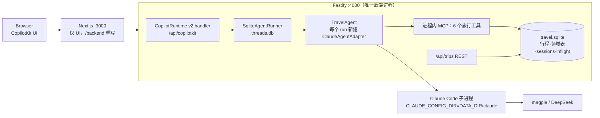

# 旅行 Agent 后端改用 Claude Agent SDK + CopilotKit 原生集成 设计

日期：2026-11-02
状态：设计待用户审阅
分支：`claude-agent-sdk`（从 `main` 切出）

## 1. 意图与背景

现在 `apps/server`（TypeScript）建在 `@earendil-works/pi-ai`、`@earendil-works/pi-durable`、`@earendil-works/chord` 上：agent 循环、耐久会话、领域状态文档、事件流都由 pi-durable 提供，再由自写的 `agui/mapper.ts`（798 行）把 pi 事件翻成 AG-UI 事件。

用户决定**不再使用 pi-durable，改用 Claude Agent SDK**，并且明确要求用 **CopilotKit 与 Claude Agent SDK 的原生集成**（`@ag-ui/claude-agent-sdk` 适配器、CopilotKit 运行时的 `AgentRunner`），不自己再造 mapper 和事件回放。

这不是替换一个依赖，而是换运行时。Claude Agent SDK 提供 agent 循环、进程内 MCP 工具、流式增量事件、按 session 恢复；它不提供事务性领域文档，也不会在进程被杀后自动续跑进行中的 run。这两样要由本设计补上。

`net-rewrite` 分支（.NET 10 重写）与本方案无关：用户要求它**不合并**，本分支不基于它、不触碰它。该分支设计文档记录的动机是"团队熟悉 .NET、不熟悉 Node/TypeScript"；本方案回到 TypeScript 是用户的明确选择（Claude Agent SDK 只有 TypeScript 和 Python 版）。

## 2. 目标

1. `apps/server` 不再依赖任何 `@earendil-works/*` 包。
2. agent 循环由 Claude Agent SDK 运行；AG-UI 事件由 `@ag-ui/claude-agent-sdk` 产生；线程历史与重连由 CopilotKit 运行时的 `SqliteAgentRunner` 负责。仓库内不再有自写的 pi→AG-UI mapper。
3. 保留现有产品行为：澄清、研究并引用来源、按天卡片与 SVG、可见的推理与工具调用、预算检查、崩溃后自动续跑。
4. 对外配置名称不变（`MAGPIE_*`、`PI_THINKING_LEVEL`、`DATA_DIR`、`DEEPSEEK_*` 等），模型仍走 magpie/DeepSeek。
5. 原设计文档（`docs/design/2026-10-19-taishan-travel-agent-design.md`）§10 的验收场景 A–H 在新实现上全部有真实运行证据。

## 3. 非目标

- 不合并、不修改 `net-rewrite`。
- 不迁移旧数据：旧的 `pi.sqlite` 和 `trips.json` 不带过去，文档里写明删除旧 `DATA_DIR` 从空库开始。
- 不加产品功能：不加工具、不加页面。
- 不做鉴权、多用户、CopilotKit Intelligence、前端工具/人工审批、`STATE_SNAPSHOT` 共享状态同步（日卡与预算仍走 REST 快照）。
- 不修改 `@ag-ui/claude-agent-sdk`、`@copilotkit/*` 的源码；发现阻塞性缺陷就记录并上报，不打补丁。

## 4. 失败条件（即使跑通也算失败）

以下是推导出来的，不是用户原话，实现前应确认：

- 仓库里仍有自写的事件 mapper 或 pi 依赖。
- 崩溃恢复后重复执行已完成的搜索/抓取，或在途请求重复超过一次。
- 崩溃恢复后刷新页面，聊天里缺少用户的最后一句话。
- 崩溃后某个行程永久返回 `Thread already running`。
- 前端为适配后端改动超出接线范围（`runtimeUrl`、历史恢复方式），或现有 52 个前端测试不再通过。
- A–H 只有 happy path 通过。

## 5. 约束

- Node.js 22.22，开发环境 Windows x64，必须在此环境可安装、可运行。
- `@ag-ui/claude-agent-sdk` 当前为 0.0.8，它把 `@anthropic-ai/claude-agent-sdk` 精确钉在 `0.3.296`（peer 依赖，2026-11-02 通过 `npm view` 核实；SDK 最新为 0.3.316）。本方案跟随这个精确版本。
- 服务端的 `@copilotkit/runtime` 与 `@copilotkit/sqlite-runner` 都精确钉在 `1.79.1`（与前端当前的 `@copilotkit/* 1.79.1` 一致；`sqlite-runner` 的版本号与运行时一一对应，`1.79.1` 存在，已用 `npm view` 核实）。该版本的 `AgentRunnerRunRequest` 没有 `ownerId`，`run_state(thread_id, is_running, current_run_id, updated_at)` 表和 `is_running` 检查已在 1.79.1 源码中核实。
- 服务端的 `@ag-ui/client`、`@ag-ui/core` 精确钉在 `1.0.2`（运行时和 `sqlite-runner` 都依赖 1.0.2，文档要求同一份拷贝；适配器要求 `>=1.0.0`）。
- `@copilotkit/sqlite-runner` 依赖 `better-sqlite3`（peer `^12.2.0`，必需，且 `dbPath` 必须是真实文件）。
- 本地单用户 demo，API 绑定 `127.0.0.1`，不暴露到不受信网络。
- 研究上限保持每个行程 40 次搜索 / 30 次抓取。

## 6. 已定的选择（用户决定）

1. 弃用 pi-durable / pi-ai，改用 Claude Agent SDK。
2. 在 `main`（TypeScript）上新开分支 `claude-agent-sdk` 做；`net-rewrite` 不动，**不合并**。
3. 保留"服务被杀后自动续跑进行中的 run"这项能力（含 `acceptance:crash`）。
4. 模型仍走 magpie/DeepSeek，对外配置不变。
5. 采用 CopilotKit + `@ag-ui/claude-agent-sdk` 的原生能力，不自写 mapper。
6. CopilotKit 运行时挂在 Fastify 后端上，Next.js 只保留 UI。
7. 持久化分层：线程历史交给 `SqliteAgentRunner`；SDK 会话用默认 JSONL，`CLAUDE_CONFIG_DIR` 指向 `DATA_DIR/claude`；**不写自定义 `SessionStore`**。这一条修订了用户先前选择的"自写 SQLite SessionStore + 运行日志"，修订在设计评审第 1 节中由用户确认。

## 7. 实现决策（我们的判断，实现者可调整细节）

### 7.1 总体结构

`DATA_DIR` 下的内容：`travel.sqlite`（本设计的领域状态）、`threads.db`（runner 的线程历史）、`claude/`（SDK 的 JSONL 会话）。

### 7.2 单元

| 单元 | 作用 | 依赖 |
| --- | --- | --- |
| `http/routes/copilotkit.ts` | 用 `createCopilotRuntimeHandler` 建 fetch handler，再用 `createCopilotNodeHandler`（`@copilotkit/runtime/v2/node`）得到 `(req, res) => Promise<void>`，在 Fastify 路由里 `reply.hijack()` 后直接交给它；该路由作用域内关闭 Fastify 的请求体解析，让运行时自己读流 | `@copilotkit/runtime/v2` |
| `TravelAgent extends AbstractAgent` | 用 `input.threadId` 作为 `tripId`；每个 run 新建 `ClaudeAgentAdapter`，配置：`systemPrompt`（规划指令 + 当前行程上下文）、`mcpServers: { travel }`（绑定该 `tripId`）、`tools: []`、`allowedTools: mcp__travel__*`、`permissionMode: "dontAsk"`、`env`、`forwardedProps.resume`。见到 `system:init` 即写 `sessionId`；把 `RUN_FINISHED.result.isError === true` 改写为 `RUN_ERROR`。必须 override `clone()` 保留自有字段（CopilotKit 每个请求克隆 agent），override `abortRun()` 转调适配器的 `interrupt()` | `@ag-ui/claude-agent-sdk`、`store/` |
| `store/` | `better-sqlite3`，`DATA_DIR/travel.sqlite`。表：行程索引、brief / plan / sources / research / search_cache / faults、`sessions(tripId → sessionId)`、`inflight` | `better-sqlite3` |
| `agent/tools/*` | 6 个工具：`tool()` + zod；写库用事务；幂等靠缓存与 `emit_day` 按 `dayIndex` 覆盖；校验失败返回 `isError: true` 的内容，让模型自行修正 | Claude Agent SDK、`store/` |
| `recovery.ts` | 启动时驱动崩溃恢复（见 7.4） | `store/`、runner |
| 草图生成 | 单轮 `query()`，不带工具、`maxTurns: 1`，替代原来的 `completeSimple` 调用 | Claude Agent SDK |

**删除：** `agui/mapper.ts` 及其测试、`harness/`（pi harness、事件监视）、`trips/docs.ts`（pi 文档定义）、`/agui` 路由、`apps/web` 里自己的 CopilotKit route。`model/magpie.ts` 去掉 pi-ai 的模型注册，只保留 `MAGPIE_*` 到 `ANTHROPIC_*` 的环境变量映射。`harness/transcript.ts` 是否保留，取决于探针第 5 项（前端 `connect` 回放能否取代 REST transcript）。

**保留：** `plan/`、`research/`、`svg/`、`deepseek/` 的纯逻辑；`packages/shared` 类型；REST 的 `GET /health`、`GET /api/trips`、`POST /api/trips`、`GET /api/trips/:id`。**移除：** `POST /api/trips/:id/messages` 和 `GET /api/trips/:id/transcript`。它们的消费者只有前端 `getTranscript` 与两个验收脚本，前者由 `connect` 回放取代，后者改走运行时端点。

### 7.3 正常一轮的数据流

1. 浏览器发消息，CopilotKit 向 `POST /api/copilotkit/agent/travel/run` 发 AG-UI 请求，`threadId = tripId`。
2. runner 检查线程未在运行，标记 `is_running=1`，开始记录事件。
3. `TravelAgent.run` 在 `inflight` 写一行（`tripId, runId, 用户消息 id 与原文, attempts=0`），读 `sessionId` 与行程状态，新建适配器，`resume: sessionId`。
4. 适配器调 `query()`，把 SDK 流翻译成 AG-UI 事件；runner 转发给浏览器并在内存累积。
5. 工具在进程内 MCP 中执行，事务写领域表。（现有 6 个工具都不产生进度事件，旧 mapper 转发的 `travel.tool_progress` 只是 pi 的通用机制，所以本方案不做进度事件合并。）
6. 见到 `system:init` 立刻写 `sessionId`，保证 run 中途崩溃也能续会话。
7. `RUN_FINISHED` 或 `RUN_ERROR`：删除 `inflight` 行；错误记为 fault；runner 把整轮事件落盘，`is_running=0`。

**刷新页面：** 浏览器发 `connect`，runner 回放已落盘历史并把进行中的 run 接到新连接。领域状态（日卡、预算、faults）仍走 `GET /api/trips/:id`，沿用现有轮询。

**行程上下文刷新时机：** 原来的 pi `section` 每次模型调用都刷新；现在改为每个 run 开始时刷新。run 内部的变化模型通过工具返回值看到。这是实际差异，已向用户说明。

### 7.4 崩溃恢复

runner 的两个事实（读 `@copilotkit/sqlite-runner` 源码得到）：

- 事件和输入只在 run **结束时**写入 `agent_runs`；进行中的事件只在内存。
- `run()` 先查数据库里的 `run_state.is_running`，为真就抛 `ThreadAlreadyRunningError`，没有进程存活检查；源码里没有找到启动时清理残留标记的逻辑。

所以进程被杀后：被中断那轮的用户消息不在历史里，且该行程会被永久锁死。恢复流程：

1. 读 `inflight` 表得到被中断的 run。
2. **在构造 `SqliteAgentRunner` 之前**，用普通 `better-sqlite3` 句柄把 `threads.db` 里 `run_state.is_running` 清零（表不存在则跳过）。
3. 构造 runner 与运行时，开始监听。
4. 逐个行程**串行**调用 `runner.run()`，输入消息为 `[原用户消息（沿用原 id）, 一条 role 为 user 的提示消息："服务已重启，请继续未完成的任务"]`，`resume: sessionId`。提示消息可见，是因为它要经 runner 持久化，无法隐藏。
5. `inflight.attempts` 加一；最多 2 次，仍失败就写一条 "recovery failed" fault 并删行，避免每次启动重复拉起。

语义：已完成的搜索/抓取由缓存保证不重复；`emit_day` 按 `dayIndex` 覆盖；`update_brief` 是合并，天然幂等；在途工具请求最多重复一次（满足 §10 的 C）。被中断那一轮的部分输出不会出现在聊天历史里，但工具已写库的内容保留。

### 7.5 配置映射

| 现有变量 | 内部去向 |
| --- | --- |
| `MAGPIE_BASE_URL` / `MAGPIE_API_KEY` | `ANTHROPIC_BASE_URL` / `ANTHROPIC_API_KEY`（意图是保持 `x-api-key` 语义，探针第 1 项验证） |
| `MAGPIE_MODEL` | `model`；Claude Code 的各模型别名变量也指向它，避免网关收到不认识的小模型名 |
| `MAGPIE_MAX_TOKENS` | `CLAUDE_CODE_MAX_OUTPUT_TOKENS` |
| `PI_THINKING_LEVEL`（`off/low/medium/high`） | SDK 的 `thinking` 选项：`off` → `{ type: "disabled" }`，其余 → `{ type: "enabled", budgetTokens }`。`maxThinkingTokens` 已被 SDK 标为弃用，不用。名字保留，档位数值在计划里定 |
| `DATA_DIR` | 其下放 `travel.sqlite`、`threads.db`、`claude/` |
| `AGENT_URL` | 不再使用；前端 `runtimeUrl` 指向后端 |
| `DEEPSEEK_*`、`PORT`、`API_URL`、`NEXT_PUBLIC_API_URL`、`MAGPIE_LIVE` | 不变 |

需要的额外 Claude Code 环境变量（例如关闭非必要网络流量）由探针确定。

### 7.6 错误处理

- 任何失败都以 `RUN_ERROR` 加 fault 记录呈现。适配器遇到 `result.is_error` 时发的是 `RUN_FINISHED`（带 `isError`），由 `TravelAgent` 改写。
- 工具校验失败保持现有语义：返回 `isError: true` 的内容，不让 run 失败。
- 断开 SSE 不终止 run（runner 的 `ReplaySubject` 独立驱动），探针第 5 项验证。
- 恢复失败保护见 7.4 第 5 步。

## 8. 验证

### 8.1 探针（实施计划第 0 个任务，门槛）

全部通过才能继续；任何一项不通过，停下来回到用户这里讨论，不擅自换路线。

1. Windows 上 SDK 自带的 Claude Code CLI 能启动，经 `ANTHROPIC_BASE_URL` 连上 magpie，不因陌生请求头或模型名报 400。
2. 思考块和工具参数流式能通过网关，并在 AG-UI 事件里看到。
3. 带 zod 的进程内 MCP 工具（含可选数组、联合类型）DeepSeek 能正确调用。
4. `resume` 在进程重启后可用，**且在工具执行中途被杀后**可用。
5. CopilotKit 1.79 的运行时 + `SqliteAgentRunner` + `ClaudeAgentAdapter` 经 Fastify 胶水跑通；前端现有 v1 hooks 能用（文档里的 runner 属于 v2 运行时，1.79 的 v1 `CopilotRuntime` 是否接受 `runner` 需实测）；`connect` 回放历史；断开 SSE 不终止 run；并发 run 得到 `Thread already running`。
6. `better-sqlite3` 在 Windows + Node 22.22 能装上预编译包。

### 8.2 自动化测试

- 单元（vitest）：工具（内存库）、`store`、`recovery`（清残留、重建消息、`attempts` 上限、runner 表结构缺失即失败的守护测试）、`TravelAgent` 的事件改写（注入假适配器工厂，不依赖模型）。
- 无凭据集成：对一个本地假的 Anthropic 兼容服务（脚本化 SSE）跑真实 SDK 子进程，覆盖 MCP 工具执行与 `resume`。`@copilotkit/aimock` 是候选工具，在计划阶段评估，这里不承诺。
- 删除：mapper、pi harness、旧 transcript 的测试。
- 前端：现有 52 个测试保持通过，只改受 `runtimeUrl` 与历史恢复方式影响的部分。

### 8.3 实测验收（对应原设计文档 §10）

- A. 完整 brief：直接进入研究，3 张按天卡片，含 SVG、来源、费用分项，各区间上界之和 ≤ ¥3000。
- B. 不完整 brief：先提问，补齐前不出现任何 `plan_emit_day` 写入。
- C. 崩溃恢复：研究中途 `SIGKILL`，重启后续跑；已完成的搜索/抓取不重复；在途请求最多重复一次；刷新后聊天里有用户原话与续跑提示。`acceptance:crash` 改走新端点并新增这些断言。
- D. 刷新恢复：刷新或断线重连后，历史与卡片从 `connect` 回放和 REST 快照重建。
- E. SVG 失败：注入非法 SVG，验证重试与占位图，界面保持可用。
- F. 局部修改："第三天轻松一点"只改 Day 3。
- G. 引用：每条硬事实 claim 都有来源 id；无来源的逐条标注未核实。
- H. 内容：覆盖虹桥往返、住宿区域、徒步/索道组合、日出决策、美食、预算分项。

`acceptance:live` 同步改走新端点。

## 9. 风险

1. **适配器是 0.0.x 预发布，且把 SDK 精确钉在 0.3.296。** 升级要同步评估；dependabot 需忽略这两个包。
2. **Claude Code 的请求特征能否被 DeepSeek 网关承受尚未验证**（beta 头、模型名、思考块、工具参数流式）。探针第 1–3 项。
3. **清残留标记依赖 runner 的表结构**（`run_state(thread_id, is_running, current_run_id)`）。锁定 `@copilotkit/sqlite-runner` 版本并写守护测试。
4. **CopilotKit v1/v2 API 差异未验证。** 前端当前是 `@copilotkit/* ^1.79.1` 的 v1 API，文档里的 runner 属于 v2 运行时。探针第 5 项；若不通，需要把前端 hooks 升到 v2，那会扩大前端改动范围，须回到用户确认。
5. **工具执行中途被杀后 `resume` 能否正常**（JSONL 里留下没有结果的 `tool_use`）尚未验证，是崩溃恢复成立的前提。探针第 4 项。
6. **被中断那轮的部分输出不进聊天历史**，续跑提示作为可见用户消息出现。已接受。
7. **草图每张多一次子进程启动**（一个行程 3 张）。若实测太慢，再改为直接调 Messages API。
8. **`better-sqlite3` 是原生模块**，CI 与 Windows 都要能装预编译包。探针第 6 项。

## 10. 留给实现者的决定

- `PI_THINKING_LEVEL` 各档对应的 `budgetTokens` 数值（计划里先给出初值，探针第 2 项后可调）。
- `inflight.attempts` 上限是否就取 2。
- Fastify 在 `/api/copilotkit/*` 作用域内关闭请求体解析的具体写法。
- 前端历史恢复走"provider 自动 connect"还是"在 `ChatPanel` 里显式 `connectAgent`"（取决于探针第 5 项）。
- 无凭据集成测试用 `@copilotkit/aimock` 还是自写脚本化服务。
- 草图生成的提示词是否需要因换模型调用方式而调整。
